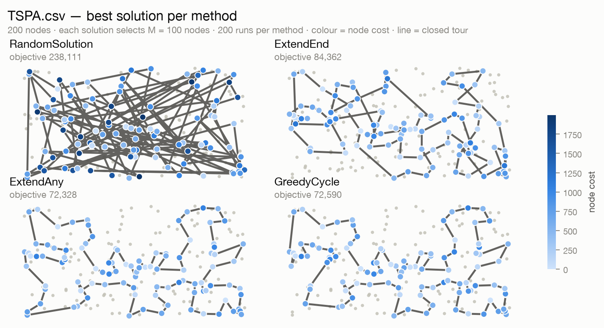
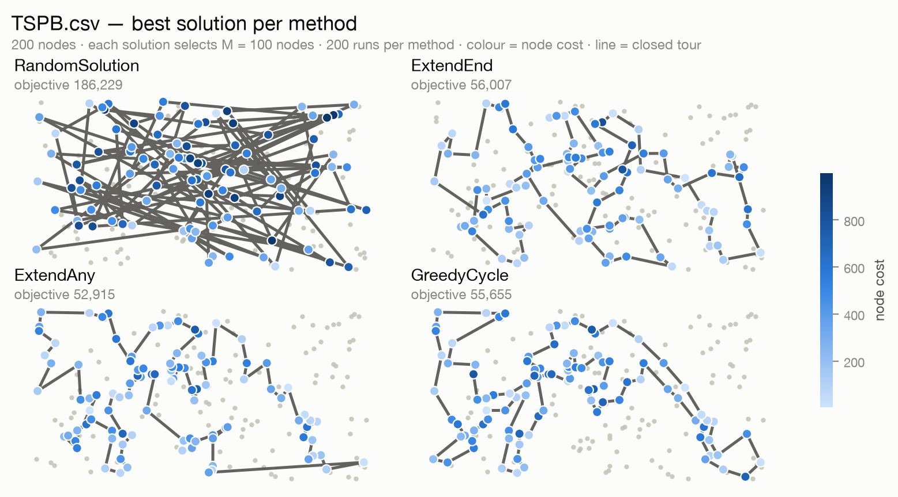
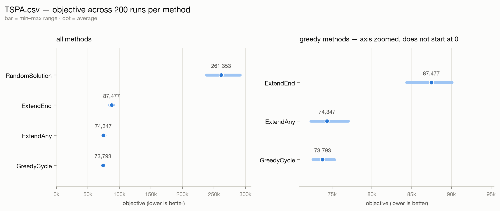
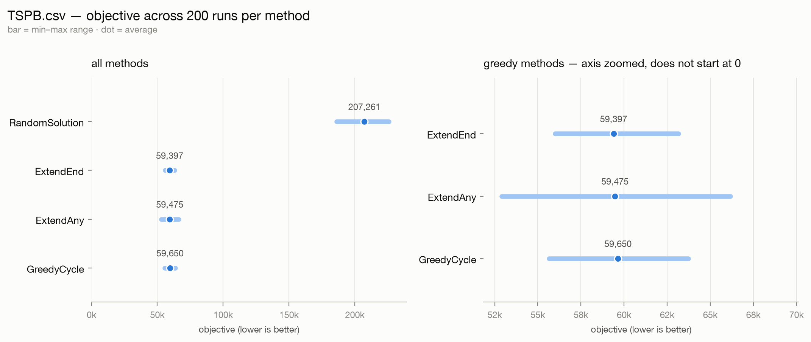

# Task 1 — Greedy heuristics

**Code revision:** `850d45b` (branch `report1`)
**Instances:** `TSPA.csv`, `TSPB.csv` — 200 nodes each
**Methods:** random, nearest neighbour (add at the end), nearest neighbour (add anywhere),
greedy cycle

---

## 1. The problem

We are given `N` points. Each point has an `x` and `y` coordinate and a **cost**. We have to
choose exactly half of the points, rounded up:

```
M = ceil(N / 2)
```

and put them in some order. The solution is scored as a **closed** tour, which means we go back
to the first node at the end:

```
objective = tour length + cost of the chosen nodes

tour length = sum of the distances between consecutive nodes
              (including the last node back to the first one)
node cost   = sum of costs of all chosen nodes
```

Distances are Euclidean and rounded to the nearest integer (`int(sqrt(dx² + dy²) + 0.5)`), so
all objective values are integers. Lower is better. Both files have `N = 200`, so `M = 100`.

Each line of an instance file is one node, written as `x;y;cost`.

The two parts of the objective pull in opposite directions. A cheap node saves money but
usually means a longer detour, and a short tour forces expensive nodes into the selection.
This is why none of the methods below looks for the smallest distance. They all pick the node
that gives the smallest **change in the objective**, which is what "nearest" means here.

## 2. Methods

All four methods build a solution step by step. They start from a small piece of a tour and
add one node at a time until `M` nodes are chosen. Each method is started once from every node
(section 3).

### 2.1 The insertion delta

Two of the methods need the same helper: how much the objective changes if we insert node `v`
at position `j` of the current path. It is also the function the checker in section 5 goes
through.

```
DeltaCost(path, v, j, cyclic):
    Δ ← cost[v]                                  # we always pay for the new node

    if j = 0:                                    # insert at the front
        next ← path[0]
        Δ ← Δ + dist[v][next]
        if cyclic:                               # and close the cycle again
            last ← path[len(path)-1]
            Δ ← Δ + dist[last][v] − dist[last][next]

    elif j = len(path):                          # insert at the end
        last ← path[len(path)-1]
        Δ ← Δ + dist[last][v]
        if cyclic:
            next ← path[0]
            Δ ← Δ + dist[v][next] − dist[last][next]

    else:                                        # insert between path[j-1] and path[j]
        prev ← path[j-1]; next ← path[j]
        Δ ← Δ + dist[prev][v] + dist[v][next] − dist[prev][next]

    return Δ
```

The `cyclic` flag is the only difference between the two insert-anywhere methods. When it is
true, inserting a node also has to pay for the edge that closes the tour, and it is allowed to
shorten that edge.

### 2.2 Random solution

This is the baseline. It picks `M` different nodes at random and keeps them in a random order.

```
RandomSolution(instance, run):
    rng ← new RNG(seed = run)
    nodes ← [0, 1, ..., N-1]
    rng.shuffle(nodes)
    return nodes[0 .. M-1]
```

### 2.3 Nearest neighbour, adding only at the end (ExtendEnd)

We start with a single node. In every step we add the unused node that changes the objective
the least when we put it at the end of the path. That change is `cost[v] + dist[last][v]`.

```
ExtendEnd(instance, run):
    start ← run
    path ← [start]; used[start] ← true

    while len(path) < M:
        last ← path[len(path)-1]
        best ← ∞
        for v ← 0 to N-1:
            if used[v]: continue
            Δ ← cost[v] + dist[last][v]
            if Δ < best:
                best ← Δ; next ← v
        path.append(next); used[next] ← true

    return path
```

### 2.4 Nearest neighbour, adding at any position (ExtendAny)

The same idea, except the new node can also go at the front or between two existing nodes. The
path is treated as **open** here, so the delta does not include the edge that will close the
tour at the end.

```
ExtendAny(instance, run):
    start ← run
    path ← [start]; used[start] ← true

    while len(path) < M:
        best ← ∞
        for v ← 0 to N-1:
            if used[v]: continue
            for j ← 0 to len(path):              # front, middle, or end
                Δ ← DeltaCost(path, v, j, cyclic = false)
                if Δ < best:
                    best ← Δ; next ← v; pos ← j
        path.insert(pos, next); used[next] ← true

    return path
```

### 2.5 Greedy cycle

This is ExtendAny with `cyclic = true`, so the path is kept as a cycle:

```
GreedyCycle(instance, run):
    start ← run
    path ← [start]; used[start] ← true

    while len(path) < M:
        best ← ∞
        for v ← 0 to N-1:
            if used[v]: continue
            for j ← 0 to len(path):
                Δ ← DeltaCost(path, v, j, cyclic = true)
                if Δ < best:
                    best ← Δ; next ← v; pos ← j
        path.insert(pos, next); used[next] ← true

    return path
```

Every insertion also accounts for the closing edge, which is the edge the objective charges at
the end. That makes `GreedyCycle` the only one of the three greedy methods whose step-by-step
decisions match the final objective exactly. `ExtendEnd` and `ExtendAny` ignore the closing
edge while building, so their choices are only an approximation of it.

## 3. Experiment setup

* `N = 200` nodes, `M = 100` chosen, two instances.
* **200 runs per method per instance.** Run `r` starts from node `r`, so with `N = 200` every
  node is used as a starting point exactly once. The random method has no starting node — each
  of its 200 runs just gets its own seed.
* 4 methods × 2 instances × 200 runs = **1600 solutions**.
* The times mentioned below are measured inside the solver. Loading the instance file is not
  counted.

To reproduce:

```sh
go run . -json results.json                      # 1600 runs -> results.json
.venv/bin/python tools/make_report.py results.json   # figures + the tables in this report
```

The first command writes down every run, the second one draws the figures and prints the
tables, so the numbers below come from the solver output and not from a table typed by hand.

## 4. Results

### 4.1 Objective values

| Instance | Method | Runs | Min | Max | Average |
|---|---|---:|---:|---:|---:|
| TSPA.csv | RandomSolution | 200 | 238,111 | 291,409 | 261,353.1 |
| TSPA.csv | ExtendEnd | 200 | 84,362 | 90,075 | 87,476.6 |
| TSPA.csv | ExtendAny | 200 | 72,328 | 77,022 | 74,347.0 |
| TSPA.csv | GreedyCycle | 200 | 72,590 | 75,281 | 73,793.4 |
| TSPB.csv | RandomSolution | 200 | 186,229 | 225,881 | 207,261.0 |
| TSPB.csv | ExtendEnd | 200 | 56,007 | 63,166 | 59,397.3 |
| TSPB.csv | ExtendAny | 200 | 52,915 | 66,164 | 59,475.5 |
| TSPB.csv | GreedyCycle | 200 | 55,655 | 63,734 | 59,649.9 |

`ExtendAny` and `GreedyCycle` need about 2 ms per run on TSPA against a few microseconds for
`ExtendEnd`. The reason is that they check every possible insertion position, so their work per
step grows with the length of the path, while `ExtendEnd` only checks the end.

### 4.2 Pictures of the best solutions

Node cost is shown by **colour**: light blue is cheap and dark blue is expensive. All four
panels of a figure share one colour scale, so they can be compared. The grey dots are nodes the
method did not choose, and the dark line is the closed tour.





The same numbers as ranges. The bar is the min–max range over the 200 runs and the dot is the
average. The right panel repeats the three greedy methods with a zoomed axis, because on the
full scale they are impossible to tell apart next to the random baseline:





### 4.3 Best solutions as node indices

Every list below is a tour in visit order. The tour is closed, so the last node connects back
to the first one. Node indices start from 0. The objective and the starting node that produced
it are given above each list.

**TSPA.csv**

`RandomSolution` — objective 238,111 (start node 154):
```
130, 153, 146, 138, 43, 140, 39, 91, 22, 67, 135, 179, 112, 99, 49, 76, 32, 94, 152, 57, 143, 163, 83, 137, 180, 113, 131, 38, 87, 121, 145, 175, 1, 176, 5, 72, 26, 195, 173, 4, 114, 36, 0, 84, 24, 23, 110, 104, 31, 66, 156, 58, 12, 40, 74, 120, 199, 80, 157, 111, 29, 108, 141, 55, 3, 92, 47, 193, 50, 59, 123, 170, 127, 118, 167, 90, 2, 45, 60, 144, 122, 183, 88, 185, 86, 6, 161, 61, 172, 136, 129, 73, 106, 30, 184, 158, 139, 28, 75, 85
```

`ExtendEnd` — objective 84,362 (start node 54):
```
54, 9, 33, 36, 177, 67, 144, 53, 135, 58, 134, 176, 174, 106, 89, 107, 57, 182, 151, 93, 50, 3, 1, 164, 178, 29, 136, 186, 184, 47, 159, 130, 153, 78, 88, 193, 170, 146, 75, 64, 150, 42, 113, 43, 85, 142, 8, 131, 84, 158, 192, 181, 114, 141, 180, 132, 76, 80, 48, 31, 63, 149, 168, 97, 127, 187, 30, 123, 152, 108, 60, 116, 49, 11, 119, 160, 83, 90, 51, 16, 35, 87, 45, 140, 52, 179, 185, 28, 102, 156, 157, 71, 91, 38, 100, 4, 112, 139, 115, 5
```

`ExtendAny` — objective 72,328 (start node 11):
```
104, 129, 69, 127, 97, 168, 116, 149, 63, 11, 49, 160, 83, 123, 100, 152, 108, 60, 31, 48, 80, 91, 157, 71, 4, 76, 132, 180, 28, 102, 185, 35, 156, 51, 16, 67, 144, 140, 53, 179, 52, 177, 36, 33, 9, 54, 131, 174, 8, 164, 186, 136, 163, 29, 101, 178, 1, 169, 3, 50, 147, 47, 93, 106, 42, 89, 113, 130, 159, 146, 170, 153, 193, 78, 88, 107, 64, 57, 182, 151, 150, 176, 72, 134, 84, 58, 158, 192, 181, 114, 135, 73, 45, 87, 141, 187, 30, 189, 2, 171
```

`GreedyCycle` — objective 72,590 (start node 31):
```
116, 149, 168, 63, 11, 49, 60, 108, 152, 100, 90, 123, 83, 160, 97, 127, 69, 171, 2, 189, 30, 187, 141, 87, 45, 73, 135, 114, 181, 192, 158, 58, 84, 134, 72, 176, 150, 151, 182, 57, 64, 107, 88, 78, 193, 153, 170, 146, 159, 130, 113, 89, 42, 106, 93, 47, 147, 50, 3, 169, 1, 178, 101, 29, 163, 136, 186, 164, 142, 8, 174, 131, 54, 9, 33, 36, 177, 52, 179, 53, 140, 144, 67, 16, 51, 156, 35, 185, 102, 28, 180, 132, 76, 4, 71, 157, 91, 80, 48, 31
```

**TSPB.csv**

`RandomSolution` — objective 186,229 (start node 165):
```
84, 116, 177, 129, 44, 94, 124, 35, 41, 117, 42, 34, 9, 160, 152, 93, 83, 162, 79, 92, 155, 26, 24, 51, 179, 82, 184, 196, 186, 89, 80, 173, 40, 55, 88, 145, 183, 115, 141, 50, 131, 95, 70, 58, 38, 148, 137, 120, 138, 191, 15, 169, 3, 190, 78, 106, 22, 122, 130, 146, 98, 59, 75, 76, 185, 63, 164, 133, 64, 165, 32, 1, 73, 99, 65, 74, 178, 135, 109, 199, 77, 156, 7, 198, 195, 113, 56, 10, 27, 6, 149, 147, 168, 167, 53, 5, 18, 171, 8, 192
```

`ExtendEnd` — objective 56,007 (start node 32):
```
32, 89, 57, 76, 54, 127, 129, 90, 153, 20, 14, 2, 110, 118, 56, 114, 196, 10, 148, 143, 78, 192, 162, 104, 185, 184, 3, 151, 69, 172, 133, 120, 96, 121, 198, 48, 72, 46, 86, 117, 160, 136, 8, 21, 154, 140, 47, 170, 125, 177, 6, 132, 29, 197, 175, 134, 45, 60, 40, 71, 155, 97, 115, 180, 65, 28, 149, 145, 158, 116, 147, 42, 50, 130, 30, 183, 38, 64, 85, 59, 167, 51, 87, 179, 82, 88, 171, 99, 67, 24, 34, 181, 152, 73, 98, 27, 135, 75, 79, 156
```

`ExtendAny` — objective 52,915 (start node 50):
```
110, 2, 14, 20, 74, 153, 182, 52, 90, 129, 127, 80, 54, 192, 162, 104, 76, 185, 57, 89, 86, 46, 72, 3, 184, 173, 151, 122, 117, 8, 160, 69, 172, 136, 133, 120, 156, 43, 48, 96, 198, 121, 130, 191, 50, 42, 147, 116, 37, 146, 13, 149, 28, 145, 65, 158, 177, 125, 26, 170, 197, 36, 132, 29, 6, 180, 115, 155, 71, 175, 134, 45, 157, 60, 40, 141, 97, 154, 140, 47, 38, 21, 176, 30, 183, 189, 168, 64, 59, 85, 51, 73, 167, 152, 34, 24, 181, 179, 87, 82
```

`GreedyCycle` — objective 55,655 (start node 174):
```
36, 197, 6, 180, 115, 170, 97, 140, 47, 155, 71, 175, 134, 45, 157, 60, 141, 40, 33, 64, 21, 189, 168, 69, 160, 172, 136, 133, 120, 8, 117, 72, 46, 86, 184, 3, 173, 122, 151, 98, 111, 27, 135, 76, 185, 162, 192, 80, 52, 182, 20, 74, 2, 93, 110, 118, 14, 153, 90, 129, 127, 54, 104, 57, 89, 156, 43, 48, 96, 198, 121, 63, 130, 191, 183, 30, 176, 38, 154, 26, 125, 177, 138, 158, 145, 149, 147, 42, 116, 37, 146, 13, 28, 65, 178, 103, 29, 132, 1, 174
```

## 5. Solution checker

All 1600 runs, including the eight best solutions above, were checked by a separate program in
`tools/oeviz.py`. It reads the instance CSV again, builds the distance matrix again and
recomputes the objective from scratch, so it shares no code with the Go solver. It checks
three things:

* the solution contains exactly `M = 100` different nodes, all of them in range;
* the recomputed objective equals the one the solver reported;
* the tour length and the node cost also match separately, not only their sum.

| Instance | Method | Runs checked | Feasible | Objective matches | Components match |
|---|---|---:|---:|---:|---:|
| TSPA.csv | RandomSolution | 200 | 200/200 | 200/200 | 200/200 |
| TSPA.csv | ExtendEnd | 200 | 200/200 | 200/200 | 200/200 |
| TSPA.csv | ExtendAny | 200 | 200/200 | 200/200 | 200/200 |
| TSPA.csv | GreedyCycle | 200 | 200/200 | 200/200 | 200/200 |
| TSPB.csv | RandomSolution | 200 | 200/200 | 200/200 | 200/200 |
| TSPB.csv | ExtendEnd | 200 | 200/200 | 200/200 | 200/200 |
| TSPB.csv | ExtendAny | 200 | 200/200 | 200/200 | 200/200 |
| TSPB.csv | GreedyCycle | 200 | 200/200 | 200/200 | 200/200 |

**1600 runs checked, 0 failures.**

One thing I want to be clear about: this checker is one I wrote myself. I did not have an
official checker to compare against, so if the course provides one, that step is still missing.

## 6. Source code

| File | Contents |
|---|---|
| `solver/problem.go` | the problem definition, loading the instance, `TourLength` / `NodesCost` / `Objective` |
| `solver/solver.go` | the `Strategy` interface, the runner and the benchmark loop |
| `task1/task1.go` | `objectiveDelta` (the `DeltaCost` pseudocode from section 2.1) and the shared insertion loop |
| `task1/strategies.go` | the four methods |
| `main.go` | the command line, the results table and the `-json` export |
| `tools/oeviz.py` | plotting plus the checker from section 5 |
| `tools/make_report.py` | turns `results.json` into the figures and the tables |

`tools/oeviz.py` does not know anything about this task in particular — it takes an instance
file and a list of node indices — so it can be reused for the later tasks.

## 7. Conclusions

1. **Choosing by the objective instead of by distance is what makes these methods work.** All
   three greedy methods are about 3.5 times better than the random baseline on both instances
   (on TSPA the average goes from 261,353 down to 73,793, on TSPB from 207,261 down to 59,397),
   and they still run in milliseconds. The random solution is a useful floor: it shows how much
   of the objective is decided by which nodes we pick and in what order.
2. **The two insert-anywhere methods are the best, and they are very close.** On TSPA
   `GreedyCycle` has the better average (73,793 against 74,347) while `ExtendAny` has the single
   best solution (72,328 against 72,590). On TSPB it is the other way round: `ExtendAny` has the
   best minimum and the better average. So this experiment does not settle which of the two is
   better.
3. **`ExtendEnd` gives the most predictable results.** It has the smallest spread on both
   instances (TSPA 84,362–90,075, TSPB 56,007–63,166) and the best average on TSPB, even though
   its own best solution is the worst of the three greedy methods. Being allowed to insert
   anywhere gives a better best case but a wider spread: `ExtendAny` on TSPB ranges over 13,249,
   which is about 22% of its average, against 7,159 (12%) for `ExtendEnd`.
4. **The starting node matters.** For every greedy method the 200 runs differ by a few percent,
   which is not a small detail. That spread is the reason for starting from every node instead
   of from one fixed node.
5. **`GreedyCycle` is the cleanest of the three in theory**, because it is the only one that
   prices the closing edge the objective actually charges. On TSPA this shows up as both the
   best average and the smallest spread (2,691, about 3.6%).
6. **The extra search costs time but is worth it.** `ExtendAny` and `GreedyCycle` are roughly
   100 times slower per run than `ExtendEnd`, and in exchange they improve the average objective
   on TSPA by about 15% (87,477 down to 73,793). Any later improvement, like local search or
   2-opt, should start from these constructions, because they are cheap and already close to
   each other.

## 8. Limitations

* `-repeat` is tied to the starting node: run `r` starts from node `r`, and the greedy methods
  use `path[0] = iteration` without a modulo. So `-repeat 201` on a 200-node instance crashes
  with `index out of range`. The default `-repeat 200` is fine and is what produced this report,
  but this should be fixed before `-repeat` is changed.
* `ExtendEnd` and `ExtendAny` build an open path while the objective scores a closed tour, so
  their step-by-step choices are not perfectly aligned with what is being minimised. This
  matches the wording of the task, and `GreedyCycle` is the version that is consistent with the
  objective, but it is worth deciding on purpose which of them the task intends.
* The figures are drawn by the Python tools from the same CSV files. They agree with the solver
  because both read the same instance data, not because they share code.
