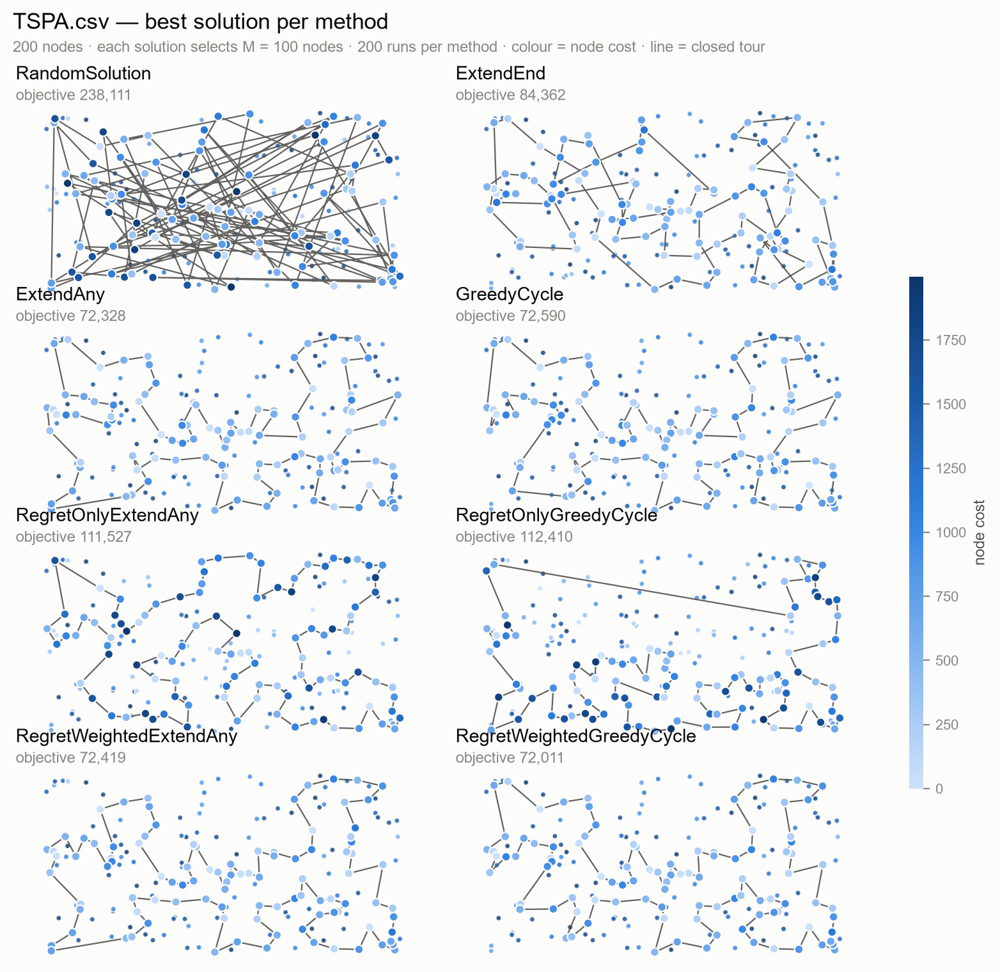
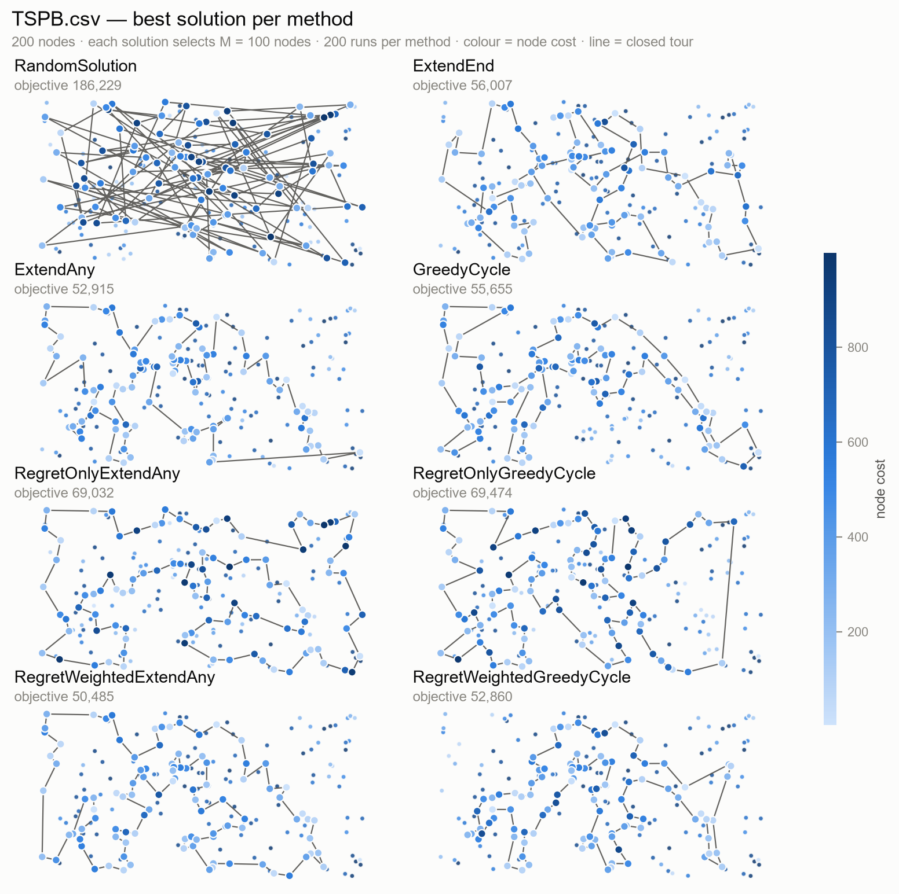
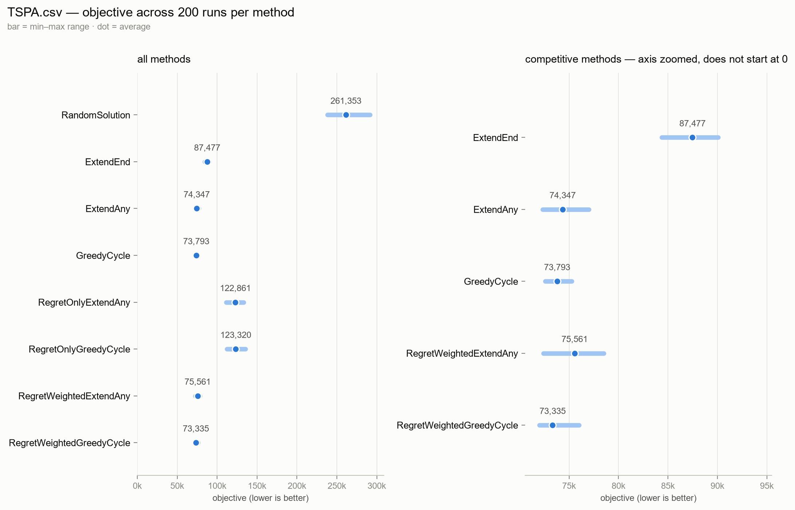
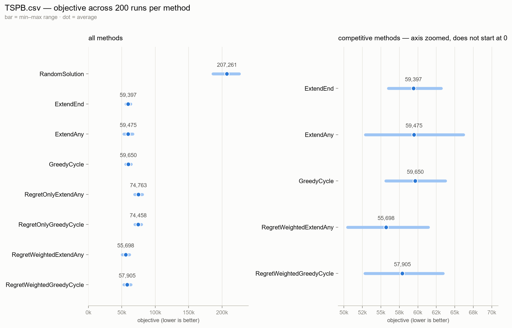

# Task 2 - Greedy regret heuristics

- 160296: Paweł Laszczyk
- 160314: Ashley Jurga

**Code revision:** `663932f` (task 2 strategies; this report run also enables all eight methods in `main.go`, adds `--zoom` / `--excel-check` to `tools/make_report.py`, and adds `tools/check_with_excel.py`)\
**Source code link**: [GitHub](https://github.com/AER00/evolutionary_computation_pp)\
**Instances:** `TSPA.csv`, `TSPB.csv` — 200 nodes each\
**Methods:** the four methods from Task 1, plus greedy 2-regret and weighted
2-regret built on both the extended nearest neighbour and the greedy cycle

---

## 1. The problem

We are given `N` points. Each point has an `x` and `y` coordinate and a **cost**. We have to
choose exactly half of the points, rounded up:

```
M = ceil(N / 2)
```

and put them in some order. The solution is scored as a **closed** tour, which means we go back
to the first node at the end:

```
objective = tour length + cost of the chosen nodes

tour length = sum of the distances between consecutive nodes
              (including the last node back to the first one)
node cost   = sum of costs of all chosen nodes
```

Distances are Euclidean and rounded to the nearest integer (`int(sqrt(dx² + dy²) + 0.5)`), so
all objective values are integers. Lower is better. Both files have `N = 200`, so `M = 100`.

Each line of an instance file is one node, written as `x;y;cost`. The problem definition and the
distance matrix are the same as in Task 1; only the construction rules change.

The two parts of the objective pull in opposite directions. A cheap node saves money but
usually means a longer detour, and a short tour forces expensive nodes into the selection.
This is why none of the methods below looks for the smallest distance. They all work with the
**change in the objective**, which is what "nearest" means here.

## 2. Methods

All methods build a solution step by step. They start from a small piece of a tour and add one
node at a time until `M` nodes are chosen. Each method is started once from every node
(section 3).

### 2.1 The insertion delta

The helper is the same as in Task 1: how much the objective changes if we insert node `v` at
position `j` of the current path.

```
DeltaCost(path, v, j, cyclic):
    Δ ← cost[v]                                  # we always pay for the new node

    if j = 0:                                    # insert at the front
        next ← path[0]
        Δ ← Δ + dist[v][next]
        if cyclic:                               # and close the cycle again
            last ← path[len(path)-1]
            Δ ← Δ + dist[last][v] − dist[last][next]

    elif j = len(path):                          # insert at the end
        last ← path[len(path)-1]
        Δ ← Δ + dist[last][v]
        if cyclic:
            next ← path[0]
            Δ ← Δ + dist[v][next] − dist[last][next]

    else:                                        # insert between path[j-1] and path[j]
        prev ← path[j-1]; next ← path[j]
        Δ ← Δ + dist[prev][v] + dist[v][next] − dist[prev][next]

    return Δ
```

As before, `cyclic = false` gives the **extended nearest neighbour** (the path is open while it
is built, so the closing edge is ignored), and `cyclic = true` gives the **greedy cycle**
(the path is kept as a cycle, so every insertion takes the closing edge into account).

### 2.2 The 2-regret of a node

Task 1 asked only for the single best `(node, position)` pair. The regret methods look at every
unused node separately, and for each of them they compare its **best** insertion with its
**second-best** insertion.

Let `Δ[0], …, Δ[len(path)]` be the insertion costs of a node `v` at all positions. Define:

```
b1(v) = min Δ[j]            best insertion cost of v
j1(v) = argmin Δ[j]         position that achieves it
b2(v) = second smallest Δ   second-best insertion cost of v

regret(v) = b2(v) − b1(v)
```

The regret says how much we lose if `v` cannot use its favourite position. A node with a large
regret has one position where it fits much better than anywhere else, so it is "urgent": if we
wait, we will probably have to pay much more for it.

```
Regret(path, v, cyclic):
    Δ[j] ← DeltaCost(path, v, j, cyclic)  for j = 0 .. len(path)
    b1 ← min Δ;  j1 ← position of b1
    b2 ← second smallest value in Δ
    return b2 − b1, j1
```

### 2.3 Greedy 2-regret

In every step, compute the regret of every unused node and insert the node with the **largest**
regret, at its own best position.

```
RegretGreedy(instance, start, cyclic):
    path ← [start]; used[start] ← true

    while len(path) < M:
        bestScore ← −∞
        for v ← 0 to N-1:
            if used[v]: continue
            (r, j) ← Regret(path, v, cyclic)
            if r > bestScore:
                bestScore ← r; next ← v; at ← j
        path.insert(at, next); used[next] ← true

    return path
```

With `cyclic = false` this is `RegretOnlyExtendAny`, and with `cyclic = true` it is
`RegretOnlyGreedyCycle`. Ties are broken by node index, because the comparison is strict.

### 2.4 Weighted criterion: 2-regret + best change of the objective

The pure regret ignores how good the best insertion actually is. The second method combines
both quantities in one score:

```
score(v) = w · regret(v) − (1 − w) · b1(v)
```

We maximise the score. The first term rewards urgent nodes (large regret), and the second term
rewards nodes that can be inserted cheaply (small `b1`). The minus sign is there because the
objective is minimised: a small `b1` must give a large score. With `w = 0.5` the two parts have
equal weight, which is the default used below. The algorithm is otherwise identical to
`RegretGreedy`: choose the node with the largest score and insert it at its best position.

```
WeightedRegretGreedy(instance, start, cyclic, w):
    path ← [start]; used[start] ← true

    while len(path) < M:
        bestScore ← −∞
        for v ← 0 to N-1:
            if used[v]: continue
            Δ[j] ← DeltaCost(path, v, j, cyclic) for all j
            b1 ← min Δ;  j1 ← position of b1
            b2 ← second smallest Δ
            score ← w · (b2 − b1) − (1 − w) · b1
            if score > bestScore:
                bestScore ← score; next ← v; at ← j1
        path.insert(at, next); used[next] ← true

    return path
```

With `cyclic = false` this is `RegretWeightedExtendAny`, and with `cyclic = true` it is
`RegretWeightedGreedyCycle`; both use `w = 0.5`. We also tested the other end of the scale
(`w = 1`), which is exactly the pure-regret method from section 2.3, so the experiment covers
two points of this trade-off.

The formula contains the two methods of this task as special cases. `w = 1` removes the
objective term and leaves pure 2-regret, while `w = 0` removes the regret and leaves the
ordinary greedy insertion from Task 1. So the four strategies below are really two bases
(open path / cycle) crossed with two settings of the same criterion.

### 2.5 One property of the regret term

The node cost is the same for every insertion position, so it appears in every `Δ[j]` and
cancels out when we compute `b2 − b1`. Pure regret therefore knows **nothing about node
costs**, and it also ignores whether the best insertion is cheap or expensive. It only measures
how unevenly a node fits the current path. The weighted score keeps the objective term through
`b1`, which is why it is expected to behave differently. Section 4 checks whether this matters
in practice.

There is one degenerate step in every run. When the path contains only the starting node, the
front and the end position give the same delta, so every candidate has regret 0. With `w = 1`
the first choice is therefore a tie, broken by node index; with `w = 0.5` the `b1` term decides
it. After the second node is inserted, the regrets become informative.

## 3. Experiment setup

* `N = 200` nodes, `M = 100` chosen, two instances.
* **200 runs per method per instance.** Run `r` starts from node `r`, so with `N = 200` every
  node is used as a starting point exactly once. The greedy methods are deterministic for a
  fixed start node (the weighted variants use no random numbers either); `RandomSolution` is
  the exception, and each of its runs uses its own seed, as in Task 1.
* 8 methods × 2 instances × 200 runs = **3200 solutions**. Four of the methods are the ones
  from Task 1, repeated here so that the comparison uses identical conditions and the same
  starting nodes.
* The times mentioned below are measured inside the solver. Loading the instance file is not
  counted.

To reproduce:

```sh
go run . -json results.json                      # 3200 runs -> results.json
python3 tools/check_with_excel.py results.json \
    --out report/excel_check.json                # check with Solution checker.xlsx
python3 tools/make_report.py results.json \
    --figures report/figures_task2 \
    --zoom ExtendEnd,ExtendAny,GreedyCycle,RegretWeightedExtendAny,RegretWeightedGreedyCycle \
    --excel-check report/excel_check.json
```

The first command writes down every run, the second one checks each run with the course
workbook, and the third one draws the figures and prints the tables. The numbers below
therefore come from the solver output and from the workbook, not from a table typed by hand.

## 4. Results

### 4.1 Objective values

| Instance | Method | Runs | Min | Max | Average | Time |
|---|---|---:|---:|---:|---:|---:|
| TSPA.csv | RandomSolution | 200 | 238,111 | 291,409 | 261,353.1 | 0.00 s |
| TSPA.csv | ExtendEnd | 200 | 84,362 | 90,075 | 87,476.6 | 0.00 s |
| TSPA.csv | ExtendAny | 200 | 72,328 | 77,022 | 74,347.0 | 0.39 s |
| TSPA.csv | GreedyCycle | 200 | 72,590 | 75,281 | 73,793.4 | 0.40 s |
| TSPA.csv | RegretOnlyExtendAny | 200 | 111,527 | 133,181 | 122,860.7 | 2.14 s |
| TSPA.csv | RegretOnlyGreedyCycle | 200 | 112,410 | 135,431 | 123,320.3 | 2.11 s |
| TSPA.csv | RegretWeightedExtendAny | 200 | 72,419 | 78,504 | 75,561.2 | 2.07 s |
| TSPA.csv | RegretWeightedGreedyCycle | 200 | 72,011 | 76,027 | 73,335.3 | 2.04 s |
| TSPB.csv | RandomSolution | 200 | 186,229 | 225,881 | 207,261.0 | 0.00 s |
| TSPB.csv | ExtendEnd | 200 | 56,007 | 63,166 | 59,397.3 | 0.00 s |
| TSPB.csv | ExtendAny | 200 | 52,915 | 66,164 | 59,475.5 | 0.39 s |
| TSPB.csv | GreedyCycle | 200 | 55,655 | 63,734 | 59,649.9 | 0.39 s |
| TSPB.csv | RegretOnlyExtendAny | 200 | 69,032 | 80,767 | 74,763.4 | 2.09 s |
| TSPB.csv | RegretOnlyGreedyCycle | 200 | 69,474 | 79,437 | 74,458.2 | 2.03 s |
| TSPB.csv | RegretWeightedExtendAny | 200 | 50,485 | 61,406 | 55,698.3 | 1.99 s |
| TSPB.csv | RegretWeightedGreedyCycle | 200 | 52,860 | 63,406 | 57,905.2 | 1.96 s |

The first four rows of each instance are the previous methods; the last four are the new ones.
The result is clear and was not obvious before running the experiment:

* **Pure 2-regret is much worse than the heuristics from Task 1.** On TSPA it averages
  122,861 and 123,320, against 74,347 and 73,793 for its two baselines. On TSPB the gap is
  smaller but still large: 74,763 and 74,458, against 59,476 and 59,650. It is even worse than
  `ExtendEnd`, which was the weakest of the three previous greedy methods.
* **The weighted criterion works.** With equal weights, the regret methods are close to the
  Task 1 methods and sometimes better. On TSPA `RegretWeightedGreedyCycle` has the best average
  of all eight methods (73,335, against 73,793 for `GreedyCycle`). On TSPB
  `RegretWeightedExtendAny` has the best average (55,698, against 59,397 for the best previous
  method, `ExtendEnd`).
* The best single solution of the whole experiment is `RegretWeightedExtendAny` on TSPB with
  objective **50,485**, which is 2,430 (4.6%) below the best previous solution (52,915,
  `ExtendAny`).

The table below makes the comparison direct. "Wins" means that the new method had a lower
objective than its baseline for the same starting node; there were no ties.

| Instance | New method | Baseline | Change in average | Wins / losses (of 200) |
|---|---|---|---:|---:|
| TSPA.csv | RegretOnlyExtendAny | ExtendAny | +65.25% | 0 / 200 |
| TSPA.csv | RegretOnlyGreedyCycle | GreedyCycle | +67.12% | 0 / 200 |
| TSPA.csv | RegretWeightedExtendAny | ExtendAny | +1.63% | 59 / 200 |
| TSPA.csv | RegretWeightedGreedyCycle | GreedyCycle | −0.62% | 162 / 200 |
| TSPB.csv | RegretOnlyExtendAny | ExtendAny | +25.70% | 0 / 200 |
| TSPB.csv | RegretOnlyGreedyCycle | GreedyCycle | +24.83% | 0 / 200 |
| TSPB.csv | RegretWeightedExtendAny | ExtendAny | −6.35% | 177 / 200 |
| TSPB.csv | RegretWeightedGreedyCycle | GreedyCycle | −2.92% | 168 / 200 |

The paired comparison is strong evidence, because every pair of runs starts from the same
node. Neither pure-regret method wins a single one of its 400 paired runs. The weighted variants are
not universally better: `RegretWeightedExtendAny` loses to `ExtendAny` on TSPA, but wins 177
of 200 starts on TSPB.

Another way to see it is to count, for every starting node, which method produced the lowest
objective. Among the seven non-random methods:

| Instance | RegretWeightedGreedyCycle | RegretWeightedExtendAny | GreedyCycle | ExtendAny | ExtendEnd |
|---|---:|---:|---:|---:|---:|
| TSPA.csv | **142** | 10 | 30 | 18 | 0 |
| TSPB.csv | 68 | **119** | 4 | 6 | 3 |

The two weighted methods take 152 of the 200 starts on TSPA and 187 of the 200 starts on TSPB.
The pure regret methods never produce the best run for any start.

**Where the objective goes.** The averages of the two objective components explain why pure
regret fails. The component averages are rounded, so they may differ from the objective
average by one unit.

| Instance | Method | Avg tour length | Avg node cost | Avg objective |
|---|---|---:|---:|---:|
| TSPA.csv | ExtendAny | 23,071 | 51,276 | 74,347 |
| TSPA.csv | GreedyCycle | 22,304 | 51,489 | 73,793 |
| TSPA.csv | RegretOnlyExtendAny | 22,558 | 100,303 | 122,861 |
| TSPA.csv | RegretOnlyGreedyCycle | 21,215 | 102,105 | 123,320 |
| TSPA.csv | RegretWeightedExtendAny | 23,352 | 52,209 | 75,561 |
| TSPA.csv | RegretWeightedGreedyCycle | 21,185 | 52,151 | 73,335 |
| TSPB.csv | ExtendAny | 18,678 | 40,798 | 59,476 |
| TSPB.csv | GreedyCycle | 18,015 | 41,635 | 59,650 |
| TSPB.csv | RegretOnlyExtendAny | 22,584 | 52,179 | 74,763 |
| TSPB.csv | RegretOnlyGreedyCycle | 21,110 | 53,348 | 74,458 |
| TSPB.csv | RegretWeightedExtendAny | 20,850 | 34,848 | 55,698 |
| TSPB.csv | RegretWeightedGreedyCycle | 17,025 | 40,880 | 57,905 |

On TSPA, pure regret builds a tour that is about as short as `GreedyCycle` (22,558 and 21,215
against 22,304), but it pays almost twice as much for the selected nodes (100,303 and 102,105
against 51,489). The selected cost is close to what random selection gives (96,992 on average).
This is exactly the effect predicted in section 2.5: the node cost cancels from the regret, so
pure regret optimises the geometry and lets the cost term grow without limit. On TSPB the same
effect is weaker but still visible: the selected cost is 52,179 and 53,348, close to the random
level of 51,987, while the good methods stay near 41,000.

The weighted methods behave like a compromise, and the compromise is not the same on the two
instances:

* On TSPA, `RegretWeightedGreedyCycle` improves the tour length over `GreedyCycle` by 1,119
  and pays only 662 more for the nodes, which gives the net improvement of 458.
* On TSPB, `RegretWeightedExtendAny` buys much cheaper nodes: 34,848 against 40,798 for
  `ExtendAny`, a saving of 5,950. The tour becomes 2,172 longer, but the net objective is still
  3,777 lower. This is the clearest example of the weighted criterion making a deliberate
  trade between the two parts of the objective.
* `RegretWeightedGreedyCycle` on TSPB improves both components at once (tour length 17,025
  against 18,015, node cost 40,880 against 41,635), which is why it is the second-best method
  there.

### 4.2 Pictures of the best solutions

Node cost is shown by **colour**: light blue is cheap and dark blue is expensive. All eight
panels of a figure share one colour scale, so they can be compared. The grey dots are nodes
the method did not choose, and the dark line is the closed tour.





The same numbers as ranges. The bar is the min–max range over the 200 runs and the dot is the
average. The right panel repeats the five methods that are competitive on the full scale
(`ExtendEnd`, the two Task 1 insert-anywhere methods, and the two weighted regret methods).
The pure regret methods are left out of the right panel because their averages are 25% to 67%
above their own baselines, and including them would make the zoom useless; they are visible in
the left panel:





The figures match the tables. Pure regret produces tours that look geometrically reasonable
but are built from visibly more expensive nodes, especially on TSPA. The weighted methods keep
the dense, short-tour structure of the Task 1 methods while shifting the selection towards
cheaper nodes (TSPB) or shortening the tour further (TSPA).

### 4.3 Best solutions as node indices

The previous methods use the same start nodes and seeds as in Task 1, so their best tours are
identical to the ones in the Task 1 report (section 4.3) and are not repeated here. For
reference, their best objectives and starting nodes are:

| Instance | Method | Best objective | Start node |
|---|---|---:|---:|
| TSPA.csv | RandomSolution | 238,111 | 154 |
| TSPA.csv | ExtendEnd | 84,362 | 54 |
| TSPA.csv | ExtendAny | 72,328 | 11 |
| TSPA.csv | GreedyCycle | 72,590 | 31 |
| TSPB.csv | RandomSolution | 186,229 | 165 |
| TSPB.csv | ExtendEnd | 56,007 | 32 |
| TSPB.csv | ExtendAny | 52,915 | 50 |
| TSPB.csv | GreedyCycle | 55,655 | 174 |

The four new methods follow. Every list is a tour in visit order; the tour is closed, so the
last node connects back to the first one. Node indices start from 0.

**TSPA.csv**

`RegretOnlyExtendAny` — objective 111,527 (start node 85):
```
199, 82, 116, 119, 11, 49, 108, 152, 123, 160, 12, 97, 120, 92, 171, 166, 183, 10, 22, 98, 27, 87, 141, 23, 180, 28, 156, 16, 190, 74, 144, 179, 177, 36, 99, 41, 61, 135, 181, 58, 84, 134, 65, 158, 111, 182, 105, 57, 64, 107, 88, 78, 26, 75, 170, 159, 130, 117, 113, 106, 150, 0, 176, 174, 8, 142, 85, 128, 3, 1, 59, 46, 86, 55, 17, 29, 19, 163, 24, 136, 186, 109, 34, 62, 154, 39, 175, 115, 5, 112, 139, 18, 4, 76, 132, 68, 44, 14, 38, 80
```

`RegretOnlyGreedyCycle` — objective 112,410 (start node 31):
```
1, 59, 178, 101, 29, 55, 86, 46, 155, 6, 21, 147, 37, 47, 93, 117, 130, 159, 170, 75, 26, 78, 88, 122, 107, 64, 57, 105, 124, 103, 89, 113, 43, 106, 150, 151, 0, 176, 72, 13, 134, 84, 58, 20, 158, 138, 111, 192, 181, 118, 114, 25, 22, 98, 70, 27, 87, 121, 135, 61, 41, 140, 53, 179, 144, 67, 45, 185, 102, 28, 180, 191, 141, 23, 30, 187, 189, 10, 183, 166, 2, 32, 92, 161, 120, 110, 104, 188, 127, 95, 168, 119, 116, 63, 11, 49, 167, 60, 77, 31
```

`RegretWeightedExtendAny` — objective 72,419 (start node 69):
```
171, 2, 189, 187, 30, 141, 87, 45, 73, 135, 114, 181, 192, 158, 58, 84, 134, 72, 176, 174, 150, 106, 113, 89, 42, 151, 138, 182, 57, 64, 107, 88, 78, 193, 153, 75, 170, 146, 159, 130, 47, 93, 50, 3, 169, 1, 59, 178, 101, 55, 29, 163, 136, 186, 164, 142, 8, 9, 54, 33, 131, 36, 177, 52, 179, 53, 140, 144, 67, 16, 51, 35, 185, 102, 28, 180, 132, 76, 4, 71, 157, 91, 80, 100, 123, 83, 160, 152, 108, 49, 60, 116, 149, 63, 168, 97, 127, 69, 129, 104
```

`RegretWeightedGreedyCycle` — objective 72,011 (start node 31):
```
60, 116, 149, 63, 168, 11, 49, 108, 152, 100, 123, 83, 160, 97, 127, 161, 30, 187, 171, 2, 189, 141, 87, 45, 73, 135, 114, 181, 192, 158, 58, 84, 134, 72, 176, 174, 150, 106, 113, 89, 42, 151, 138, 182, 57, 64, 107, 88, 78, 193, 153, 75, 170, 146, 159, 130, 47, 93, 50, 3, 169, 1, 178, 101, 55, 29, 163, 136, 186, 164, 142, 8, 9, 54, 33, 131, 36, 177, 52, 179, 53, 140, 144, 67, 16, 51, 35, 185, 102, 28, 180, 132, 76, 4, 71, 157, 91, 80, 48, 31
```

**TSPB.csv**

`RegretOnlyExtendAny` — objective 69,032 (start node 185):
```
57, 44, 89, 32, 43, 48, 58, 198, 121, 195, 50, 42, 116, 37, 13, 149, 145, 65, 178, 103, 132, 1, 108, 62, 175, 134, 157, 60, 141, 155, 113, 115, 19, 177, 125, 26, 161, 154, 140, 47, 38, 21, 168, 136, 8, 95, 128, 122, 151, 111, 3, 137, 72, 86, 0, 185, 104, 162, 54, 127, 129, 52, 182, 150, 84, 66, 35, 24, 25, 73, 59, 101, 179, 88, 163, 99, 171, 17, 74, 20, 14, 2, 93, 23, 110, 118, 131, 148, 10, 196, 193, 61, 105, 169, 165, 199, 70, 190, 194, 12
```

`RegretOnlyGreedyCycle` — objective 69,474 (start node 169):
```
2, 17, 171, 39, 99, 163, 31, 67, 66, 35, 11, 34, 25, 181, 126, 88, 82, 85, 59, 49, 4, 33, 47, 38, 21, 183, 191, 161, 154, 26, 125, 170, 115, 97, 155, 141, 60, 157, 45, 134, 175, 62, 91, 36, 108, 1, 132, 6, 102, 103, 178, 65, 138, 145, 28, 149, 13, 37, 116, 42, 123, 50, 195, 121, 198, 96, 48, 164, 43, 156, 166, 92, 120, 133, 172, 69, 128, 122, 151, 111, 27, 184, 137, 46, 86, 89, 44, 83, 57, 79, 0, 135, 76, 144, 104, 77, 194, 190, 70, 169
```

`RegretWeightedExtendAny` — objective 50,485 (start node 192):
```
65, 145, 28, 149, 13, 146, 37, 116, 147, 42, 50, 130, 63, 121, 198, 96, 48, 156, 89, 57, 185, 76, 104, 162, 54, 192, 80, 127, 129, 90, 153, 14, 2, 20, 74, 17, 171, 99, 88, 179, 87, 82, 51, 85, 59, 73, 167, 181, 152, 34, 24, 67, 66, 27, 98, 151, 122, 3, 184, 46, 72, 117, 8, 120, 133, 136, 172, 160, 69, 124, 21, 183, 30, 38, 47, 154, 140, 64, 33, 40, 141, 155, 71, 60, 157, 45, 134, 175, 62, 36, 197, 6, 115, 170, 125, 177, 29, 132, 174, 1
```

`RegretWeightedGreedyCycle` — objective 52,860 (start node 5):
```
197, 29, 132, 6, 19, 177, 125, 26, 154, 140, 47, 38, 21, 30, 183, 191, 130, 63, 121, 198, 96, 48, 43, 156, 32, 89, 57, 79, 185, 104, 54, 196, 114, 10, 90, 14, 2, 74, 20, 153, 129, 127, 80, 192, 162, 76, 135, 27, 11, 66, 67, 24, 34, 152, 181, 126, 88, 179, 87, 82, 167, 51, 85, 59, 73, 98, 151, 122, 173, 3, 184, 86, 46, 72, 117, 8, 120, 133, 136, 172, 160, 69, 124, 4, 64, 33, 40, 141, 60, 157, 45, 134, 175, 71, 155, 97, 170, 115, 180, 5
```

## 5. Solution checker

All 3200 runs, including the best solutions listed above, were checked with the
course-provided **`Solution checker.xlsx`**. The workbook has one sheet per instance (`TSPA`
and `TSPB`) and does all the arithmetic itself:

* `A3:D202` holds the node table (id, x, y, cost);
* `F3:F102` holds the solution — the 100 selected node ids;
* `G3:I102` uses `LOOKUP` to fetch the x, y and cost of every selected node;
* `J3:J102` computes the edge length `INT(SQRT(dx² + dy²) + 0.5)` to the next node in the
  list, and `F103 = F3` closes the cycle;
* `I2 = SUM(I3:I102)` is the node cost, `J2 = SUM(J3:J102)` is the tour length, and
  `K2 = I2 + J2` is the objective.

The workbook was driven by `tools/check_with_excel.py`. That script does not recompute any
distance or objective: it copies the workbook to a temporary file, writes one tour into
`F3:F102`, forces `calculateAll()` and reads `I2`, `J2` and `K2`. The only thing it checks
itself is that the tour contains exactly `M = 100` distinct in-range node ids, because a
repeated or out-of-range id would make the `LOOKUP` meaningless. A temporary copy is used, so
the provided file is never modified.

The table below therefore reports what the workbook returned for every run:

| Instance | Method | Runs checked | Feasible | Objective matches | Components match |
|---|---|---:|---:|---:|---:|
| TSPA.csv | RandomSolution | 200 | 200/200 | 200/200 | 200/200 |
| TSPA.csv | ExtendEnd | 200 | 200/200 | 200/200 | 200/200 |
| TSPA.csv | ExtendAny | 200 | 200/200 | 200/200 | 200/200 |
| TSPA.csv | GreedyCycle | 200 | 200/200 | 200/200 | 200/200 |
| TSPA.csv | RegretOnlyExtendAny | 200 | 200/200 | 200/200 | 200/200 |
| TSPA.csv | RegretOnlyGreedyCycle | 200 | 200/200 | 200/200 | 200/200 |
| TSPA.csv | RegretWeightedExtendAny | 200 | 200/200 | 200/200 | 200/200 |
| TSPA.csv | RegretWeightedGreedyCycle | 200 | 200/200 | 200/200 | 200/200 |
| TSPB.csv | RandomSolution | 200 | 200/200 | 200/200 | 200/200 |
| TSPB.csv | ExtendEnd | 200 | 200/200 | 200/200 | 200/200 |
| TSPB.csv | ExtendAny | 200 | 200/200 | 200/200 | 200/200 |
| TSPB.csv | GreedyCycle | 200 | 200/200 | 200/200 | 200/200 |
| TSPB.csv | RegretOnlyExtendAny | 200 | 200/200 | 200/200 | 200/200 |
| TSPB.csv | RegretOnlyGreedyCycle | 200 | 200/200 | 200/200 | 200/200 |
| TSPB.csv | RegretWeightedExtendAny | 200 | 200/200 | 200/200 | 200/200 |
| TSPB.csv | RegretWeightedGreedyCycle | 200 | 200/200 | 200/200 | 200/200 |

**3200 runs checked, 0 failures.**

For every run the workbook's `K2` equals the objective reported by the Go solver, and `I2` and
`J2` equal the node cost and tour length separately. Unlike Task 1, this is the course-provided
checker, so that part is no longer self-written.

## 6. Source code

| File | Contents |
|---|---|
| `solver/problem.go` | the problem definition, loading the instance, `TourLength` / `NodesCost` / `Objective` |
| `solver/solver.go` | the `Strategy` interface, the runner and the benchmark loop |
| `task1/task1.go` | `ObjectiveDelta` (the `DeltaCost` pseudocode from section 2.1) and the shared insertion loop |
| `task1/strategies.go` | the four Task 1 methods |
| `task2/task2.go` | the shared regret loop, the 2-regret calculation and the weighted score |
| `task2/strategies.go` | the four new methods as thin wrappers around the shared loop |
| `main.go` | the command line, the results table and the `-json` export; registers all eight strategies |
| `tools/check_with_excel.py` | drives `Solution checker.xlsx`: pastes each tour into the workbook, recalculates and reads `I2` / `J2` / `K2` |
| `tools/oeviz.py` | plotting helpers (also used by Task 1) |
| `tools/make_report.py` | turns `results.json` into the figures and the tables (`--zoom` selects the right-hand panel, `--excel-check` uses the workbook results) |

`tools/oeviz.py` still knows nothing about this task in particular — it takes an instance file
and a list of node indices — so the same plotting code works for both tasks without changes.
The checker is now the course workbook rather than a second implementation in Python.

## 7. Conclusions

1. **The 2-regret idea only works together with the objective term.** Pure regret is the worst
   of the non-random methods tested so far. Its average is 65% (TSPA) and 25% (TSPB) above the
   corresponding Task 1 baseline, it loses all 400 paired comparisons, and it never produces
   the best run for any starting node. The equal-weight version is competitive instead:
   −0.62% and −6.35% against its baselines on TSPA and TSPB respectively.
2. **The failure of pure regret has a clear explanation.** The node cost is identical at every
   insertion position, so it cancels from `b2 − b1`. Pure regret therefore selects nodes using
   geometry alone and ignores the cost part of the objective. On TSPA it builds a tour that is
   about as short as `GreedyCycle` (22,558 against 22,304) but pays 100,303 for the nodes
   against 51,489. The selected cost is at the level of random selection, which is exactly what
   the algebra predicts.
3. **The weighted criterion is the better way to use regret.** Adding the best insertion delta
   restores the missing objective term. The improvement of the weighted cycle variant over
   `GreedyCycle` is small on TSPA (−0.62%) and the improvement of the weighted `ExtendAny`
   variant over `ExtendAny` is large on TSPB (−6.35%), but the direction is consistent: the weighted
   `GreedyCycle` variant beats `GreedyCycle` on 162 of 200 starts on TSPA and 168 of 200 on
   TSPB. The weighted `ExtendAny` variant beats `ExtendAny` on 177 of 200 starts on TSPB; its
   loss on TSPA (59 wins out of 200) is the one exception.
4. **The weighted criterion trades tour length for node cost.** On TSPB,
   `RegretWeightedExtendAny` saves 5,950 in node cost while accepting a tour 2,172 longer, and
   still improves the total by 3,777. On TSPA, `RegretWeightedGreedyCycle` instead shortens the
   tour by 1,119 for an extra 662 in node cost. The same criterion can therefore move in
   different directions depending on the instance, because the balance between the two parts of
   the objective is different.
5. **Which variant is best depends on the instance, as in Task 1.** On TSPA the best average is
   `RegretWeightedGreedyCycle` (73,335) and the best single solution is its 72,011, both close
   to the Task 1 results. On TSPB the best average (55,698) and the best single solution
   (50,485) both belong to `RegretWeightedExtendAny`, and both are clear improvements over the
   previous methods. The weighted cycle variant is the more consistent of the two across
   instances: it is best on TSPA and second on TSPB.
6. **The starting node still matters, and the weighted methods do not remove that.** Their
   spreads are 4,016 (5.5%) and 10,546 (18.2%) for `RegretWeightedGreedyCycle`, and 6,085
   (8.1%) and 10,921 (19.6%) for `RegretWeightedExtendAny`. These are comparable to the Task 1
   insert-anywhere methods, but a little wider. Pure regret is much less stable still, with
   spreads of 17.6–18.7% on TSPA.
7. **Regret costs time but not much.** Each regret run takes about 10 ms against about 2 ms for
   `ExtendAny` / `GreedyCycle`, roughly five times slower. The extra work is the sort of the
   whole insertion list for every candidate in every step, which is needed to find the
   second-best delta. For 3200 runs the whole experiment still finishes in under 20 seconds.
8. **What to keep from this task.** Pure 2-regret should not be used on its own for this
   objective. The weighted criterion with equal weights is a useful addition: the two weighted
   variants together produce the best average and the best single solution on both instances,
   and the weight gives a principled way
   to tune how much the method cares about urgency versus immediate insertion cost. A natural
   next step is to start a local search (for example 2-opt) from the weighted solutions, since
   they are already among the best constructions and the remaining gain is likely in the tour
   order rather than in the selection.
