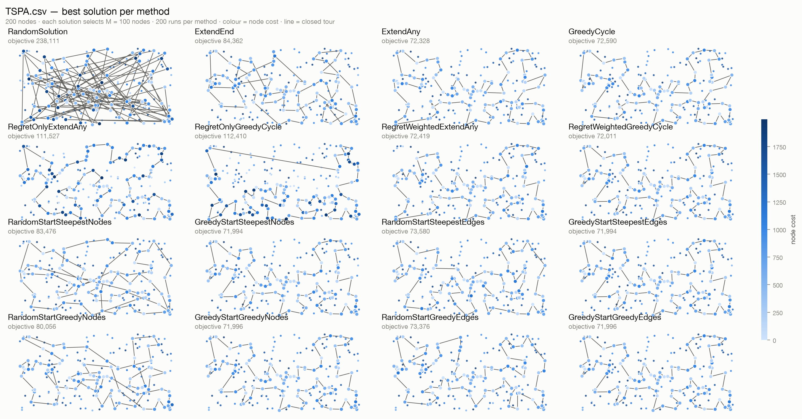
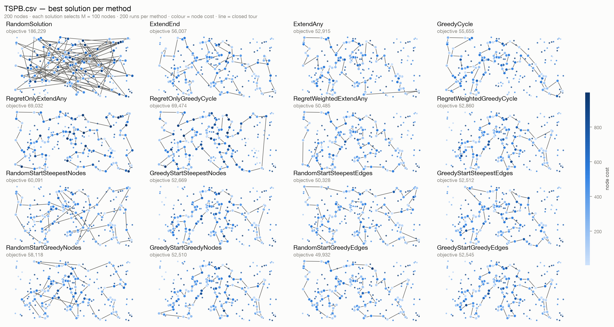
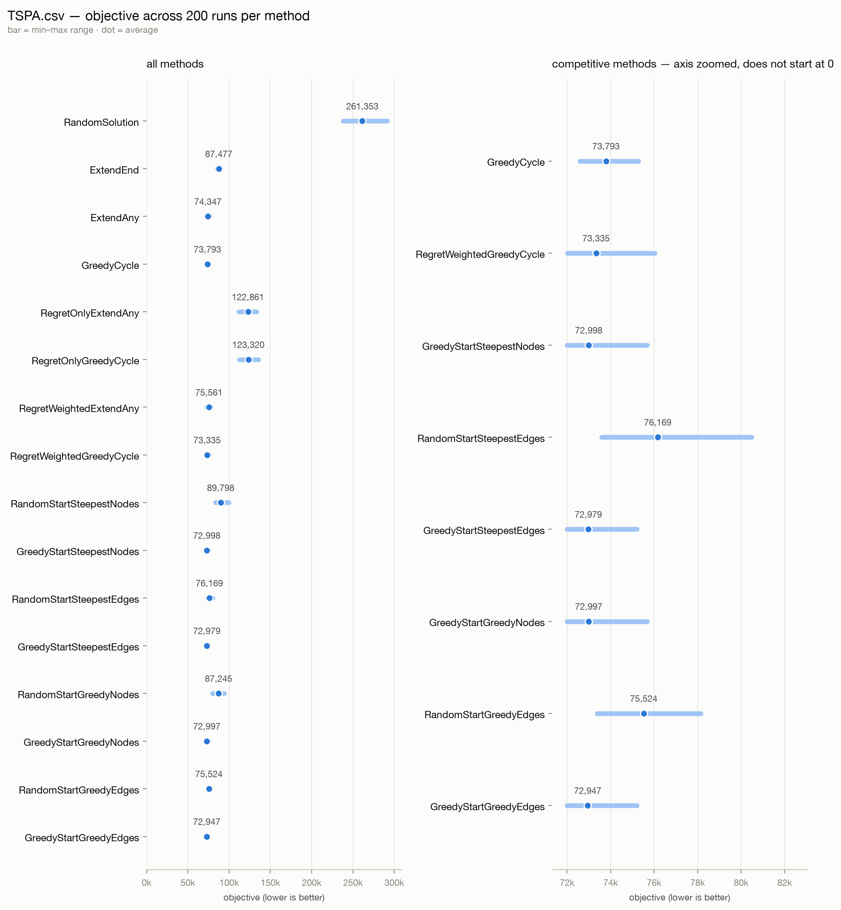
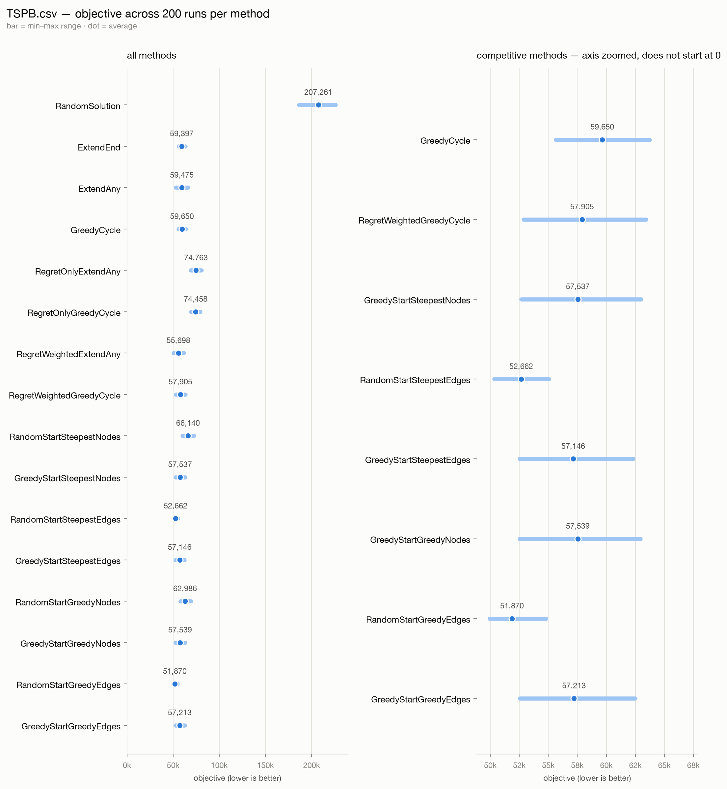

# Task 3 - Local search

- 160296: Paweł Laszczyk
- 160314: Ashley Jurga

**Code revision:** working tree on top of `bafb10b` (Task 3 strategies; this revision re-checks all runs with the course workbook and drops the full tour lists)\
**Source code link**: [GitHub](https://github.com/AER00/evolutionary_computation_pp)\
**Instances:** `TSPA.csv`, `TSPB.csv` — 200 nodes each\
**Methods:** the eight methods from Tasks 1 and 2, plus the eight combinations of
steepest/greedy local search, nodes/edges intra-route moves and random/greedy starts

---

## 1. The problem

The problem is the same as in Tasks 1 and 2. Each instance has `N = 200` points with
coordinates and a **cost**. We choose exactly

```
M = ceil(N / 2) = 100
```

points and put them in a closed tour. The objective is

```
objective = tour length + cost of the chosen nodes
```

and lower is better. Distances are Euclidean and rounded to the nearest integer, so all
values stay integer.

What changes in this task is the way a solution is built. The construction heuristics built
a tour from nothing. Local search starts from a **complete** solution — 100 selected nodes
in some order — and repeatedly applies a small change (a *move*) as long as the objective
goes down. Every move keeps the solution feasible: an intra-route move keeps the same 100
nodes, and an inter-route move swaps one selected node for one unselected node, so there
are still exactly 100 of them.

## 2. Methods

### 2.1 Move deltas

For every move we need only the **change** in the objective (the delta). We never build the
neighbour tour just to score it, and we never recompute the objective from scratch. Let the
path be `v[0], …, v[M-1]` in cyclic order (so `v[M] = v[0]`), and let `u` be a node that is
not selected.

**Inter-route move: swap selected `v[i]` with unselected `u`.** Only three edges change:

```
delta = cost[u] − cost[v[i]]
      + dist[v[i-1]][u] + dist[u][v[i+1]]
      − dist[v[i-1]][v[i]] − dist[v[i]][v[i+1]]
```

The two removed edges are replaced by two new edges around `u`, and the node cost changes
by `cost[u] − cost[v[i]]`.

**Intra-route move: exchange nodes `v[i]` and `v[j]`.** In the general case four edges change:

```
delta = dist[v[i-1]][v[j]] + dist[v[j]][v[i+1]]
      + dist[v[j-1]][v[i]] + dist[v[i]][v[j+1]]
      − dist[v[i-1]][v[i]] − dist[v[i]][v[i+1]]
      − dist[v[j-1]][v[j]] − dist[v[j]][v[j+1]]
```

If the two positions are neighbours in the cycle, the edge between them stays in the tour,
so only the other two edges are compared. For `j = i+1`:

```
delta = dist[v[i-1]][v[j]] + dist[v[i]][v[j+1]]
      − dist[v[i-1]][v[i]] − dist[v[j]][v[j+1]]
```

For the wrap-around pair `i = 0, j = M-1` the same argument gives:

```
delta = dist[v[j-1]][v[i]] + dist[v[j]][v[i+1]]
      − dist[v[j-1]][v[j]] − dist[v[i]][v[i+1]]
```

**Intra-route move: exchange two edges (2-opt).** For edges `(v[i], v[i+1])` and
`(v[j], v[j+1])`:

```
delta = dist[v[i]][v[j]] + dist[v[i+1]][v[j+1]]
      − dist[v[i]][v[i+1]] − dist[v[j]][v[j+1]]
```

The move is applied by reversing the segment `v[i+1], …, v[j]`. Pairs with `j = i+1` are
not considered (the two edges share a node), and the pair `i = 0, j = M-1` is skipped
because it only reverses the whole tour and has delta 0.

All these formulas only read the distance matrix and the cost array. The move is applied to
the current path in place, and the next iteration uses the updated path. Deltas are always
recomputed from the current path: no move list or delta is cached from an earlier iteration,
and no candidate-move restriction is used.

### 2.2 Steepest and greedy local search

**Steepest.** One iteration scans the whole neighbourhood — all inter-route exchanges plus
all moves of the chosen intra-route type — and remembers the move with the smallest delta.
If that delta is negative, the move is applied and a new iteration starts. If no move has a
negative delta, the solution is a local optimum and the search stops.

**Greedy (first improvement).** One pass browses the two move kinds in a random order and
applies the **first** move with a negative delta. Then a new pass starts with a fresh random
order. The pass stops as soon as an improving move is found, so it does **not** evaluate the
whole neighbourhood. This matters: the greedy version is allowed much fewer delta
calculations than the steepest version, which is the point of the comparison.

### 2.3 Randomization in the greedy version

The two kinds of moves (inter-route and intra-route) are ordered with `rand.Perm(2)` at the
beginning of every pass. A kind is never always first, and the order is redrawn after every
accepted move. Inside a kind the order is fixed: inter-route moves go through path positions
and then unused nodes, and intra-route moves go through `i` and then `j`.

This is the "simpler randomization" mentioned in the assignment. The random choice is only
between the two kinds, not over every single move, because shuffling the whole neighbourhood
would cost more time than the evaluation itself and the assignment asks not to evaluate all
moves first. The random generator is local to the strategy and seeded with the run index, so
the browse order — and therefore the whole result — is reproducible.

### 2.4 The eight combinations

| Local search | Intra-route move | Starting solution | Method name |
|---|---|---|---|
| steepest | nodes exchange | random | `RandomStartSteepestNodes` |
| steepest | nodes exchange | greedy | `GreedyStartSteepestNodes` |
| steepest | edges exchange | random | `RandomStartSteepestEdges` |
| steepest | edges exchange | greedy | `GreedyStartSteepestEdges` |
| greedy | nodes exchange | random | `RandomStartGreedyNodes` |
| greedy | nodes exchange | greedy | `GreedyStartGreedyNodes` |
| greedy | edges exchange | random | `RandomStartGreedyEdges` |
| greedy | edges exchange | greedy | `GreedyStartGreedyEdges` |

The whole neighbourhood always consists of two kinds of moves: the inter-route node exchange
and **one** of the two intra-route types. The combination is a parameter of the local search,
not two separate runs mixed together.

### 2.5 Starting solutions

**Random start.** Run `r` uses `RandomSolution` with seed `r` from Task 1. This returns 100
nodes in a random order out of all 200. With `r = 0, …, 199` we get 200 different random
solutions.

**Greedy start.** Run `r` uses `RegretWeightedGreedyCycle` from Task 2 and starts it from
node `r`. Since `N = 200`, the 200 runs use every node exactly once as the starting node.
This is the weighted-regret greedy cycle with weight `w = 0.5`. It has the best mean over
the two instances among the previous methods (65,620.3, against 65,629.8 for
`RegretWeightedExtendAny`) and is the best on TSPA (73,335; on TSPB it is second with
57,905, behind 55,698). We use it for both instances; it is deterministic for a fixed start
node.

## 3. Experiment setup

* 8 new methods × 2 instances × 200 runs = **3200 local-search solutions**.
* The same 8 methods from Tasks 1 and 2 are included, giving **6400 solutions** in total.
* Each random start uses its own seed; each greedy start uses its own start node. Runs are
  reproducible: two identical invocations of the program produce the same objectives.
* Times are measured around the strategy call only, so loading the instance file is not
  counted.
* One full experiment (6400 runs) takes about 18 seconds on this machine; the timing varies
  between runs.

To reproduce:

```sh
go run . -json results.json
python3 tools/check_with_excel.py results.json --out report/excel_check.json
python3 tools/make_report.py results.json \
    --figures report/figures_task3 --ncols 4 --wide \
    --zoom GreedyCycle,RegretWeightedGreedyCycle,RandomStartSteepestEdges,RandomStartGreedyEdges,GreedyStartSteepestNodes,GreedyStartSteepestEdges,GreedyStartGreedyNodes,GreedyStartGreedyEdges \
    --excel-check report/excel_check.json
```

The second command checks every run with the workbook. The third draws the figures from
`results.json` and, with `--excel-check`, prints the workbook checker table. Objectives are
deterministic; the times in section 4.2 are from one representative run and vary.

## 4. Results

### 4.1 Objective values

| Method | TSPA.csv av (min–max) | TSPB.csv av (min–max) |
|---|---:|---:|
| RandomSolution | 261,353.1 (238,111 – 291,409) | 207,261.0 (186,229 – 225,881) |
| ExtendEnd | 87,476.6 (84,362 – 90,075) | 59,397.3 (56,007 – 63,166) |
| ExtendAny | 74,347.0 (72,328 – 77,022) | 59,475.5 (52,915 – 66,164) |
| GreedyCycle | 73,793.4 (72,590 – 75,281) | 59,649.9 (55,655 – 63,734) |
| RegretOnlyExtendAny | 122,860.7 (111,527 – 133,181) | 74,763.4 (69,032 – 80,767) |
| RegretOnlyGreedyCycle | 123,320.3 (112,410 – 135,431) | 74,458.2 (69,474 – 79,437) |
| RegretWeightedExtendAny | 75,561.2 (72,419 – 78,504) | 55,698.3 (50,485 – 61,406) |
| RegretWeightedGreedyCycle | 73,335.3 (72,011 – 76,027) | 57,905.2 (52,860 – 63,406) |
| RandomStartSteepestNodes | 89,797.9 (83,476 – 99,440) | 66,139.6 (60,091 – 72,562) |
| GreedyStartSteepestNodes | 72,998.0 (71,994 – 75,688) | 57,536.9 (52,669 – 62,998) |
| RandomStartSteepestEdges | 76,168.9 (73,580 – 80,490) | 52,662.4 (50,328 – 55,056) |
| GreedyStartSteepestEdges | 72,978.7 (71,994 – 75,204) | 57,145.6 (52,512 – 62,301) |
| RandomStartGreedyNodes | 87,245.0 (80,056 – 94,234) | 62,985.8 (58,118 – 69,313) |
| GreedyStartGreedyNodes | 72,997.2 (71,996 – 75,688) | 57,538.7 (52,510 – 62,933) |
| RandomStartGreedyEdges | 75,524.3 (73,376 – 78,145) | 51,869.9 (49,932 – 54,790) |
| GreedyStartGreedyEdges | 72,947.1 (71,996 – 75,204) | 57,213.5 (52,545 – 62,475) |

The eight new methods appear below the eight previous ones. The best new average is
**72,947.1** on TSPA (`GreedyStartGreedyEdges`) and **51,869.9** on TSPB
(`RandomStartGreedyEdges`). The best previous averages were 73,335.3
(`RegretWeightedGreedyCycle`) and 55,698.3 (`RegretWeightedExtendAny`), so the improvement is
388.2 (0.53%) on TSPA and 3,828.4 (6.87%) on TSPB.

The single best solution is 71,994 on TSPA (`GreedyStartSteepestNodes` and
`GreedyStartSteepestEdges`) against 72,011 before, and 49,932 on TSPB
(`RandomStartGreedyEdges`) against 50,485 before. The TSPA improvement is very small; the
TSPB improvement is large. This is the first clear sign that the two instances behave
differently.

### 4.2 Running times

| Method | TSPA.csv av (min–max) | TSPB.csv av (min–max) |
|---|---:|---:|
| RandomSolution | 0.01 ms (0.01 – 0.04) | 0.01 ms (0.01 – 0.01) |
| ExtendEnd | 0.03 ms (0.02 – 0.05) | 0.02 ms (0.01 – 0.02) |
| ExtendAny | 1.97 ms (1.77 – 2.71) | 1.89 ms (1.73 – 2.18) |
| GreedyCycle | 1.95 ms (1.77 – 2.07) | 1.91 ms (1.78 – 2.02) |
| RegretOnlyExtendAny | 2.19 ms (1.97 – 2.56) | 2.13 ms (1.88 – 2.66) |
| RegretOnlyGreedyCycle | 2.07 ms (1.75 – 2.33) | 2.01 ms (1.79 – 2.25) |
| RegretWeightedExtendAny | 2.24 ms (2.03 – 2.84) | 2.15 ms (1.94 – 2.59) |
| RegretWeightedGreedyCycle | 2.22 ms (1.98 – 2.48) | 2.13 ms (1.96 – 2.35) |
| RandomStartSteepestNodes | 8.54 ms (6.41 – 12.27) | 8.41 ms (6.90 – 10.92) |
| GreedyStartSteepestNodes | 2.46 ms (2.21 – 2.98) | 2.49 ms (2.12 – 3.46) |
| RandomStartSteepestEdges | 6.59 ms (5.63 – 7.61) | 6.63 ms (5.64 – 7.76) |
| GreedyStartSteepestEdges | 2.41 ms (2.05 – 2.79) | 2.64 ms (2.23 – 3.30) |
| RandomStartGreedyNodes | 4.39 ms (2.37 – 6.32) | 4.02 ms (2.25 – 5.88) |
| GreedyStartGreedyNodes | 2.39 ms (2.14 – 3.02) | 2.35 ms (2.13 – 2.78) |
| RandomStartGreedyEdges | 3.44 ms (1.91 – 5.24) | 3.27 ms (1.65 – 4.91) |
| GreedyStartGreedyEdges | 2.38 ms (2.15 – 3.04) | 2.38 ms (2.03 – 3.18) |

The time is per run, and all 16 methods were measured the same way, so the table is directly
comparable (multiply by 200 for the total). The insertion and regret constructions take about
2 ms; `RandomSolution` and `ExtendEnd` take a few hundredths of a millisecond. The local
search adds about 0.2–0.5 ms on top of the greedy construction and 3.3–8.5 ms on top of a
random solution. Times come from one representative run; the objectives are deterministic,
but the times vary.

* Steepest with random starts is the slowest: 8.54 ms (nodes) and 6.59 ms (edges) on TSPA.
  Every iteration scans the whole neighbourhood, and a random starting solution is far from
  a local optimum, so there are many iterations.
* The same methods from a greedy start take about 2.4–2.6 ms. The construction is already
  close to a local optimum, so only a few passes are needed.
* The greedy (first improvement) version is faster than steepest for the same start type,
  because it stops at the first improving move instead of scanning everything.

### 4.3 Comparison of the variants

**Greedy start versus the construction it starts from.** Because every run `r` starts from
the same construction, the pairs can be compared directly:

| Instance | Method | Average gain | Improved / tied (of 200) |
|---|---|---:|---:|
| TSPA.csv | GreedyStartSteepestNodes | 337.3 | 188 / 12 |
| TSPA.csv | GreedyStartSteepestEdges | 356.6 | 188 / 12 |
| TSPA.csv | GreedyStartGreedyNodes | 338.1 | 188 / 12 |
| TSPA.csv | GreedyStartGreedyEdges | 388.2 | 188 / 12 |
| TSPB.csv | GreedyStartSteepestNodes | 368.3 | 200 / 0 |
| TSPB.csv | GreedyStartSteepestEdges | 759.6 | 200 / 0 |
| TSPB.csv | GreedyStartGreedyNodes | 366.5 | 200 / 0 |
| TSPB.csv | GreedyStartGreedyEdges | 691.7 | 200 / 0 |

On TSPB every run improves. On TSPA 12 start nodes are already local optima for the moves we
use, and the other 188 improve by 359–413 on average (337–388 is the average over all 200
starts, including the unchanged ones). These gains are small compared with the gap between a
random and a greedy start, which is expected: the weighted-regret construction is already a
good solution.

**Nodes versus edges.** The difference `nodes − edges` is positive when the edges exchange
is better:

| Instance | Start | Local search | Average difference | Edges better / nodes better / tie |
|---|---|---|---:|---:|
| TSPA.csv | random | steepest | 13,629.0 | 200 / 0 / 0 |
| TSPA.csv | random | greedy | 11,720.7 | 200 / 0 / 0 |
| TSPA.csv | greedy | steepest | 19.3 | 20 / 0 / 180 |
| TSPA.csv | greedy | greedy | 50.2 | 43 / 5 / 152 |
| TSPB.csv | random | steepest | 13,477.2 | 200 / 0 / 0 |
| TSPB.csv | random | greedy | 11,115.9 | 200 / 0 / 0 |
| TSPB.csv | greedy | steepest | 391.3 | 156 / 0 / 44 |
| TSPB.csv | greedy | greedy | 325.2 | 153 / 3 / 44 |

From a random start the edges exchange is much better in **all 200** paired runs on both
instances. This makes sense: swapping two nodes keeps the rest of the tour order untouched,
so a random order stays messy. The edge exchange reverses a whole segment, which is exactly
what fixes crossings in a tour. From a greedy start the tour is already short: there are
152–180 ties on TSPA and 44 on TSPB, and the remaining differences are small (about 20–50 on
TSPA and 300–400 on TSPB).

**Steepest versus greedy.** The difference `steepest − greedy` is positive when greedy is
better:

| Instance | Start | Intra move | Average difference | Greedy better / steepest better / tie |
|---|---|---|---:|---:|
| TSPA.csv | random | nodes | 2,552.8 | 151 / 49 / 0 |
| TSPA.csv | random | edges | 644.6 | 137 / 63 / 0 |
| TSPA.csv | greedy | nodes | 0.8 | 6 / 15 / 179 |
| TSPA.csv | greedy | edges | 31.6 | 24 / 22 / 154 |
| TSPB.csv | random | nodes | 3,153.8 | 170 / 30 / 0 |
| TSPB.csv | random | edges | 792.5 | 148 / 52 / 0 |
| TSPB.csv | greedy | nodes | −1.8 | 10 / 28 / 162 |
| TSPB.csv | greedy | edges | −67.9 | 14 / 105 / 81 |

From a random start the greedy version is clearly better and also faster. The reason is that
a randomized first-improvement path visits a different sequence of local optima than
steepest descent; on this landscape it tends to end lower. From a greedy start the two
versions are practically identical, with most runs ending at the same solution. The one
exception is TSPB with edges, where steepest is better on average by 67.9 and wins 105
paired runs; it is also slower there (2.64 ms against 2.38 ms).

**Random versus greedy start.** The average objective by start type is:

| Instance | Start | Steepest nodes | Greedy nodes | Steepest edges | Greedy edges |
|---|---|---:|---:|---:|---:|
| TSPA.csv | random | 89,797.9 | 87,245.0 | 76,168.9 | 75,524.3 |
| TSPA.csv | greedy | 72,998.0 | 72,997.2 | 72,978.7 | 72,947.1 |
| TSPB.csv | random | 66,139.6 | 62,985.8 | 52,662.4 | 51,869.9 |
| TSPB.csv | greedy | 57,536.9 | 57,538.7 | 57,145.6 | 57,213.5 |

On TSPA the greedy start is much better for every variant. On TSPB it is the other way
round: with the edges exchange, the random start gives averages of 52,662.4 and 51,869.9,
while the greedy start gives about 57,200. The components explain it:

| Instance | Method | Avg tour length | Avg node cost | Avg objective |
|---|---|---:|---:|---:|
| TSPA.csv | RegretWeightedGreedyCycle | 21,185 | 52,151 | 73,335.3 |
| TSPA.csv | RegretWeightedExtendAny | 23,352 | 52,209 | 75,561.2 |
| TSPA.csv | RandomStartSteepestNodes | 37,459 | 52,339 | 89,797.9 |
| TSPA.csv | GreedyStartSteepestNodes | 21,139 | 51,859 | 72,998.0 |
| TSPA.csv | RandomStartSteepestEdges | 23,040 | 53,129 | 76,168.9 |
| TSPA.csv | GreedyStartSteepestEdges | 21,122 | 51,857 | 72,978.7 |
| TSPA.csv | RandomStartGreedyNodes | 34,575 | 52,670 | 87,245.0 |
| TSPA.csv | GreedyStartGreedyNodes | 21,136 | 51,862 | 72,997.2 |
| TSPA.csv | RandomStartGreedyEdges | 22,737 | 52,787 | 75,524.3 |
| TSPA.csv | GreedyStartGreedyEdges | 21,093 | 51,854 | 72,947.1 |
| TSPB.csv | RegretWeightedGreedyCycle | 17,025 | 40,880 | 57,905.2 |
| TSPB.csv | RegretWeightedExtendAny | 20,850 | 34,848 | 55,698.3 |
| TSPB.csv | RandomStartSteepestNodes | 35,185 | 30,954 | 66,139.6 |
| TSPB.csv | GreedyStartSteepestNodes | 17,100 | 40,437 | 57,536.9 |
| TSPB.csv | RandomStartSteepestEdges | 20,848 | 31,815 | 52,662.4 |
| TSPB.csv | GreedyStartSteepestEdges | 16,705 | 40,441 | 57,145.6 |
| TSPB.csv | RandomStartGreedyNodes | 31,445 | 31,541 | 62,985.8 |
| TSPB.csv | GreedyStartGreedyNodes | 17,102 | 40,437 | 57,538.7 |
| TSPB.csv | RandomStartGreedyEdges | 20,885 | 30,985 | 51,869.9 |
| TSPB.csv | GreedyStartGreedyEdges | 16,773 | 40,441 | 57,213.5 |

On TSPA both start types end near the same node cost (about 51,850–53,130), but the greedy
start keeps a much shorter tour: 21,100 against 22,700–23,000 with the edge exchange and
34,575–37,459 with the node exchange, so it wins both. On TSPB the random start gets much
cheaper nodes (about 31,000 against 40,400) but a longer tour. With the edge exchange the
tour is about 20,900 against 16,700, so the node saving (about 9,400) beats the extra tour
length (about 4,200) and the random start wins. With the node exchange the random-start tour
is 31,445–35,185 against 17,100, so the greedy start wins.

This is not a contradiction: local search finds a *local* optimum, and which local optimum
it reaches depends on where it starts. The greedy construction is strong because it picks
cheap nodes early, but that same bias can also lock the search into a region with more
expensive nodes than a random start would find. A different instance, or a different set of
moves, can reverse the order.

### 4.4 Pictures of the best solutions

Node colour is the node cost (light blue cheap, dark blue expensive) and the dark line is
the closed tour. All panels share one colour scale.





The ranges of all 16 methods, with the competitive ones repeated on a zoomed axis:





The pictures agree with the tables. The random-start figures show tours that are visibly
messier, and the nodes-only variants keep many long edges. The edge-exchange variants have
the clean look of a 2-opt tour.

### 4.5 Best solutions

The best tour of every method is shown in the figures above. The exact visit orders are not
repeated here: all 16 tours would fill several pages and add little that the figures do not
already show. Every run — with its tour, objective, tour length, node cost and run index — is
written to `results.json` by the first command in section 3, and `go run .` prints the best
tour of each method. A tour is in visit order and closed (the last node connects to the first
one); node indices start from 0, and run `r` uses seed (random start) or start node (greedy
start) `r`, so the run index identifies the solution.

## 5. Solution checker

All 6400 runs were checked with the course-provided **`Solution checker.xlsx`** through
`tools/check_with_excel.py`. The workbook does the arithmetic itself: the tour is written into
`F3:F102`, `LOOKUP` fetches the cost and coordinates of every node, `J3:J102` computes the
rounded Euclidean edges (`F103 = F3` closes the cycle), and `I2`, `J2`, `K2` are the node cost,
the tour length and the objective. The script only verifies that the tour has `M = 100`
distinct in-range ids and reads those cells back; it works on a temporary copy, so the
provided file is not modified.

Each cell counts runs that passed all checks (feasible tour, workbook objective equal to the
solver objective, and both components equal); all 200 runs per method and instance passed.

| Method | TSPA.csv | TSPB.csv |
|---|---:|---:|
| RandomSolution | 200/200 | 200/200 |
| ExtendEnd | 200/200 | 200/200 |
| ExtendAny | 200/200 | 200/200 |
| GreedyCycle | 200/200 | 200/200 |
| RegretOnlyExtendAny | 200/200 | 200/200 |
| RegretOnlyGreedyCycle | 200/200 | 200/200 |
| RegretWeightedExtendAny | 200/200 | 200/200 |
| RegretWeightedGreedyCycle | 200/200 | 200/200 |
| RandomStartSteepestNodes | 200/200 | 200/200 |
| GreedyStartSteepestNodes | 200/200 | 200/200 |
| RandomStartSteepestEdges | 200/200 | 200/200 |
| GreedyStartSteepestEdges | 200/200 | 200/200 |
| RandomStartGreedyNodes | 200/200 | 200/200 |
| GreedyStartGreedyNodes | 200/200 | 200/200 |
| RandomStartGreedyEdges | 200/200 | 200/200 |
| GreedyStartGreedyEdges | 200/200 | 200/200 |

**6400 runs checked, 0 failures.** As an additional check while developing the code, every
delta produced by the three iterators was compared with
`Objective(after move) − Objective(before move)` on 20 random tours per instance (about
800,000 moves). All deltas matched, so the local search really optimises the objective it
reports. We also verified that both local searches stop only when no move in their
neighbourhood improves the objective.

## 6. Source code

| File | Contents |
|---|---|
| `solver/problem.go` | loading the instance, distance matrix, `TourLength` / `NodesCost` / `Objective` |
| `solver/solver.go` | the `Strategy` interface and the benchmark loop |
| `task1/task1.go` | `ObjectiveDelta` and the shared insertion loop |
| `task1/strategies.go` | the four Task 1 constructions |
| `task2/task2.go` | regret and weighted-regret construction |
| `task2/strategies.go` | the four Task 2 methods |
| `task3/task3.go` | the three move iterators with deltas, `improvePathSteepest`, `improvePathFirst` |
| `task3/strategies.go` | the eight combinations as one parametrised type and `All()` |
| `main.go` | command line, results table, JSON export; registers all 16 methods |
| `tools/check_with_excel.py` | drives `Solution checker.xlsx`: pastes each tour into the workbook, recalculates and reads `I2` / `J2` / `K2` |
| `tools/make_report.py` | figures, the checker table and the wide tables in the format of this task; `--excel-check` uses the workbook results |
| `tools/oeviz.py` | plotting and an independent Python recomputation, used when no workbook check is supplied |

The three iterators share one interface: they call a callback with the move and its delta.
The same iterator is used by both local searches, so the delta formula exists in one place
only. The intra-route type is an `IntraMove` value (`NodesExchange` or `EdgesExchange`), and
the eight strategies are one type with three fields: local search type, intra move type and
start type.

## 7. Conclusions

1. **The edge exchange is the useful intra-route move.** From a random start it beats the
   nodes exchange in all 200 paired runs on both instances, by about 11,000–13,600. The
   nodes exchange changes only four edges and leaves most of the order untouched, so a
   random order stays bad; the 2-opt move repairs the order directly. From a good greedy
   start the difference is small, because both neighbourhoods often have nothing to improve.
2. **Greedy first improvement is competitive with steepest and often better.** On random
   starts it is better on average (by 645–3,154 depending on the variant) and it is faster,
   because it stops at the first improving move. On greedy starts the two versions are
   almost identical, with the exception of TSPB with edges, where steepest wins by 67.9 on
   average.
3. **The starting solution matters, and not in the same way on both instances.** On TSPA
   the greedy construction is the much better start: every variant started from it stays
   around 72,950–73,000. On TSPB the best local optima come from random starts: `RandomStartGreedyEdges`
   averages 51,869.9, against about 57,200 for the greedy start with the same edge exchange.
   The component averages show why: the random-start search finds nodes that are about 9,400
   cheaper, and the longer tour costs only about 4,200 more.
4. **The gain over the previous methods is small on TSPA and large on TSPB.** The best new
   average improves the best previous average by 0.53% on TSPA and 6.87% on TSPB. On TSPA
   the construction is already very good and the local search changes it by only a few
   hundred units; 12 of the 200 starts are already local optima. On TSPB the new methods
   find solutions that were not reachable by the constructions.
5. **Nodes-only local search from a random start is not enough.** It ends at 89,798 and
   87,245 on TSPA (`Steepest` and `Greedy`); the steepest one is even worse than `ExtendEnd`
   (87,477). This is a useful negative result: the choice of the intra-route neighbourhood
   matters more than the choice between steepest and greedy on this instance.
6. **The time cost is modest.** The local-search methods take 2.4–8.5 ms per run, against
   about 2 ms for the insertion and regret constructions (`RandomSolution` and `ExtendEnd`
   are much faster). Greedy-start searches are close to the construction time because they
   need very few passes; random-start steepest is the slowest because it scans the whole
   neighbourhood many times. The whole 6400-run experiment still finishes in about 18
   seconds on this machine (timings vary between runs).
7. **What to keep from this task.** For this problem the edge exchange should be the default
   intra-route move. The greedy (first-improvement) version gives better results at a lower
   cost for random starts, and nearly equal results for greedy starts (steepest is slightly
   better on TSPB with edges). Starting from the best
   construction is the safer choice on TSPA, but on TSPB a random start with 2-opt is
   clearly better, which shows that a good construction is not automatically a good basin
   for local search. A natural next step would be to combine both neighbourhoods or to use
   candidate moves from the previous iteration, which the assignment reserves for later.
