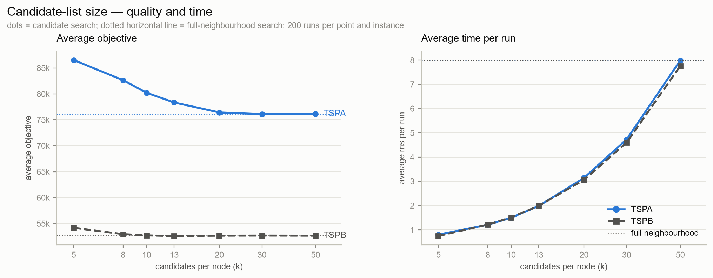
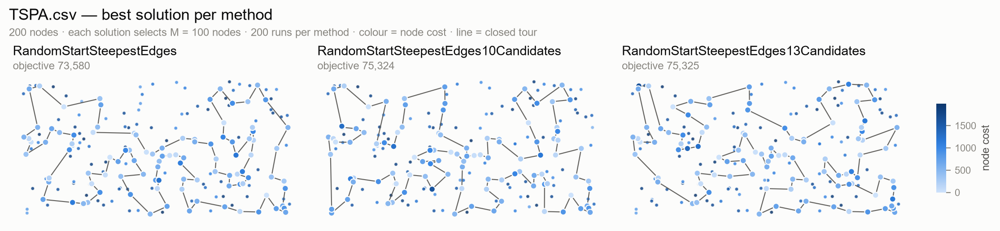
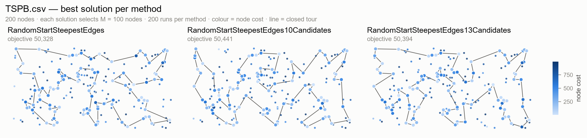
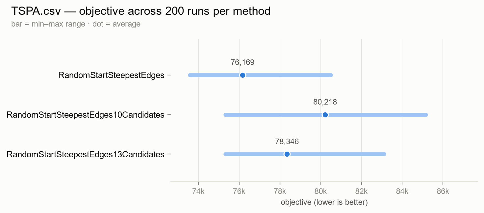
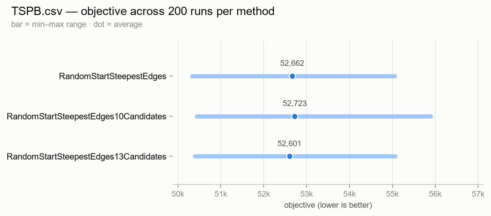

# Task 4 — Steepest local search with candidate moves

- 160296: Paweł Laszczyk
- 160314: Ashley Jurga

**Solver revision:** `3cb2af4` (branch `task4-fixes`)<br>
**Source code link**: [GitHub](https://github.com/AER00/evolutionary_computation_pp)<br>
**Instances:** `TSPA.csv`, `TSPB.csv` — 200 nodes each<br>
**Methods:** `RandomSolution` (baseline), full-neighbourhood steepest local search with a random start (reference), and the same search restricted to candidate lists with `k = 10` and `k = 13`

---

## 1. The problem

The problem is the same as in Tasks 1–3. Each instance has `N` points with coordinates and a
**cost**. We select exactly

```
M = ceil(N / 2) = 100
```

points and put them in a closed tour. The objective is

```
objective = tour length + cost of the selected nodes
```

and lower is better. Distances are Euclidean and rounded to the nearest integer, so all objective
values are integers. A solution is stored as the list of selected nodes in visit order; the last
node connects back to the first one.

Task 4 changes the neighbourhood, not the objective. The local search from Task 3 checks every
inter-route exchange and every 2-opt move. Candidate moves check only a small part of that
neighbourhood, chosen by a heuristic. The goal is to keep most of the quality while evaluating
far fewer moves.

## 2. Methods

### 2.1 Candidate lists

For every node `i` we build a list `C[i]` of `k` other nodes. The nodes are sorted by

```
score[i][j] = dist[i][j] + cost[j]
```

and the `k` smallest are kept. The cost term matters: a cheap node is more attractive than an
expensive one at the same distance. The lists are built once per instance and do not change
during the search.

```
BuildCandidates(instance, k):
    for i ← 0 to N-1:
        for j ← 0 to N-1:
            score[i][j] ← dist[i][j] + cost[j]

        order ← [0, 1, ..., N-1]
        sort order by score[i][order[a]] ascending

        C[i] ← []
        for v in order:
            if v ≠ i:
                C[i].append(v)
                if len(C[i]) = k:
                    break

    return C
```

The lists are directed: `v` can be in `C[i]` even when `i` is not in `C[v]`. The iterators below
read the list of every selected node; section 2.6 explains what this misses for inter-route moves.

### 2.2 Inter-route moves through candidate edges

An inter-route move replaces one selected node with one unselected node. In the full
neighbourhood every pair `(position, unselected node)` is checked. In the candidate version we
only check moves that create a candidate edge.

Suppose the tour contains `old` and `new` is in `C[old]`. To create the edge `(old, new)`, we can
replace one of the two neighbours of `old`:

* replace the predecessor `prev` of `old`, creating `prevPrev → new → old`;
* replace the successor `next` of `old`, creating `old → new → nextNext`.

Both moves are checked. The delta includes the node costs, because one selected node leaves and
one unselected node enters.

```
InterRouteIterator(path, C, selected):
    m ← len(path)

    for i ← 0 to m-1:
        old      ← path[i]
        prev     ← path[(i-1+m) mod m]
        prevPrev ← path[(i-2+m) mod m]
        next     ← path[(i+1) mod m]
        nextNext ← path[(i+2) mod m]

        for new in C[old]:
            if selected[new]:
                continue

            # Replace prev with new.
            Δprev ← cost[new] + dist[prevPrev][new] + dist[new][old]
                    − cost[prev] − dist[prevPrev][prev] − dist[prev][old]
            yield (replace position (i-1+m) mod m with new, Δprev)

            # Replace next with new.
            Δnext ← cost[new] + dist[old][new] + dist[new][nextNext]
                    − cost[next] − dist[old][next] − dist[next][nextNext]
            yield (replace position (i+1) mod m with new, Δnext)
```

`selected[new]` is a boolean array, so the membership test is O(1). A replacement can be
generated twice, once from each neighbour of the replaced position. The two yields have the same
delta, so the search removes the duplicate (section 2.4).

### 2.3 Intra-route moves through candidate edges

The intra-route move is a 2-opt exchange. For edges `(a, aNext)` and `(b, bNext)`, it removes
them, adds `(a, b)` and `(aNext, bNext)`, and reverses the segment between the removed edges.
No node enters or leaves, so node costs cancel and the delta contains only distances.

For a candidate edge `(old, new)` there are two such moves. If `i` is the position of `old` and
`j` is the position of `new`, they remove the edges **after** both nodes or the edges **before**
both nodes.

```
IntraRouteIterator(path, C, pos):
    m ← len(path)

    for i ← 0 to m-1:
        old ← path[i]

        for new in C[old]:
            j ← pos[new]
            if j = -1:
                continue                         # new is not selected
            if j = (i-1+m) mod m or j = (i+1) mod m:
                continue                         # the nodes are adjacent

            YieldTwoOpt(i, j)
            YieldTwoOpt((i-1+m) mod m, (j-1+m) mod m)

YieldTwoOpt(e1, e2):
    if e1 > e2:
        swap e1, e2
    if e2 - e1 < 2 or (e1 = 0 and e2 = m-1):
        return                                   # adjacent edges or wrap-around pair

    a     ← path[e1]
    aNext ← path[(e1+1) mod m]
    b     ← path[e2]
    bNext ← path[(e2+1) mod m]

    Δ ← −dist[a][aNext] − dist[b][bNext]
        + dist[a][b] + dist[aNext][bNext]

    yield (reverse segment e1+1 .. e2, Δ)
```

`pos[new]` is the position of `new`, or `-1` when it is not selected, so both the membership
test and the position lookup are O(1). The first call removes the edges after `old` and `new`,
the second removes the edges before them. The `e2 - e1 < 2` check skips adjacent edges, and
`e1 = 0 and e2 = m-1` skips the wrap-around pair `(v0, v1)` and `(v_{m-1}, v0)`, which share
node `v0` and cannot be used for a 2-opt move.

### 2.4 Steepest search with candidate lists

This is normal steepest descent, but the neighbourhood is the candidate set. One iteration checks
all candidate inter-route moves and all candidate 2-opt moves, keeps the best delta, and applies
it if it is negative. If nothing improves, the search stops.

The tour is kept in a fixed-size array. Two arrays are maintained with it:

* `selected[v]` — whether `v` is in the tour;
* `pos[v]` — its position in the tour, or `-1` when it is not selected.

They are updated after every accepted move, so the iterators never scan the path. Duplicate moves
are removed with generation stamps.

```
SteepestCandidates(path, C):
    x ← copy(path)
    m ← len(x)

    for v ← 0 to N-1:
        selected[v] ← false
        pos[v]      ← -1
    for i ← 0 to m-1:
        selected[x[i]] ← true
        pos[x[i]]      ← i

    generation ← 0
    repeat:
        generation ← generation + 1
        bestDelta  ← 0
        bestMove   ← none

        for each (q, new, Δ) from InterRouteIterator(x, C, selected):
            if seenInter[q][new] = generation:
                continue
            seenInter[q][new] ← generation
            if Δ < bestDelta:
                bestDelta ← Δ
                bestMove  ← (replace x[q] with new)

        for each (e1, e2, Δ) from IntraRouteIterator(x, C, pos):
            if seenIntra[e1][e2] = generation:
                continue
            seenIntra[e1][e2] ← generation
            if Δ < bestDelta:
                bestDelta ← Δ
                bestMove  ← (reverse x[e1+1 .. e2])

        if bestDelta ≥ 0:
            return x

        apply bestMove
        update selected and pos
```

The comparison is strict, and `bestDelta` starts at zero, so only improving moves are accepted.
Ties go to the first move in the fixed iteration order. Candidate lists are not updated during
the search, and no delta is reused from a previous iteration.

### 2.5 The full-neighbourhood reference

The reference is the steepest edge-exchange search from Task 3 with a random start. It uses the
same deltas but checks every move.

```
SteepestFull(path):
    x ← copy(path)
    m ← len(x)

    repeat:
        bestDelta ← 0
        bestMove  ← none

        used[v] ← false for all v
        for v in x:
            used[v] ← true
        unused ← [v | used[v] = false]

        # All inter-route exchanges.
        for i ← 0 to m-1:
            old  ← x[i]
            prev ← x[(i-1+m) mod m]
            next ← x[(i+1) mod m]

            for new in unused:
                Δ ← cost[new] + dist[prev][new] + dist[new][next]
                    − cost[old] − dist[prev][old] − dist[old][next]
                if Δ < bestDelta:
                    bestDelta ← Δ
                    bestMove  ← (replace x[i] with new)

        # All 2-opt exchanges.
        for i ← 0 to m-1:
            for j ← i+2 to m-1:
                if i = 0 and j = m-1:
                    continue

                a     ← x[i]
                aNext ← x[(i+1) mod m]
                b     ← x[j]
                bNext ← x[(j+1) mod m]

                Δ ← dist[a][b] + dist[aNext][bNext]
                    − dist[a][aNext] − dist[b][bNext]
                if Δ < bestDelta:
                    bestDelta ← Δ
                    bestMove  ← (reverse x[i+1 .. j])

        if bestDelta ≥ 0:
            return x

        apply bestMove
```

One full iteration checks `M(N−M) = 10,000` inter-route moves and `M(M−3)/2 = 4,850` 2-opt
moves, about 14,850 in total. A candidate iteration yields at most `2Mk` moves of each type
before skips: 4,000 moves for `k = 10` and 5,200 for `k = 13`. The real number is lower because
many candidates are already selected and duplicates are removed.

### 2.6 What the restriction does, and what it does not do

Every candidate move also exists in the full neighbourhood, but not the other way round. A good
move is invisible to the candidate search if it creates no candidate edge. This is the expected
trade-off: fewer evaluations, but a risk of stopping in a worse local optimum.

The list is built from `dist + cost`. For an inter-route move that replaces `prev` by `new`, the
true node-cost change is `cost[new] − cost[prev]`, but the candidate score only sees `cost[new]`.
For a 2-opt move the node cost cancels completely. So the list is a heuristic ordering, not an
exact ranking of the moves by their delta. Section 4.4 shows what this does on the two instances.

The lists are also directed. Because `dist + cost` is not symmetric, a pair can be a candidate
edge from one side only. The intra-route iterator still sees both endpoints because both are
selected and both are visited. The inter-route iterator only reads the selected node's list, so a
swap whose candidate edge appears only in the unselected node's list is not generated. With a
distance-only list this would not happen; it is a consequence of the cost-aware criterion.

## 3. Experiment setup

* `N = 200`, `M = 100`, two instances.
* **200 runs per method per instance.** Run `r` starts from `RandomSolution` with seed `r`, the
  same starts as in the Task 3 local search.
* 4 methods × 2 instances × 200 runs = **1600 solutions**: `RandomSolution` (baseline),
  full neighbourhood, 10 candidates, 13 candidates.
* Candidate lists are built once per instance before the timed loop, so their construction is
  not charged to the first run.
* Times are measured around the strategy call only. They come from one run of the program and
  vary between runs; only comparisons inside the same run are meaningful.
* The sweep in section 4.5 uses the same 200 runs and adds `k = 5, 8, 20, 30, 50`.

To reproduce:

```sh
go run . -json results_task4.json
go run . -candidates 5,8,10,13,20,30,50 -json results_task4_sweep.json
python3 tools/check_with_excel.py results_task4.json \
    --out report/excel_check_task4.json
python3 tools/make_report_task4.py results_task4.json \
    --sweep results_task4_sweep.json \
    --excel-check report/excel_check_task4.json
```

## 4. Results

### 4.1 Objective values

| Method | TSPA.csv av (min–max) | TSPB.csv av (min–max) |
|---|---:|---:|
| RandomSolution | 261,353.1 (238,111 – 291,409) | 207,261.0 (186,229 – 225,881) |
| RandomStartSteepestEdges | 76,168.9 (73,580 – 80,490) | 52,662.4 (50,328 – 55,056) |
| RandomStartSteepestEdges10Candidates | 80,218.4 (75,324 – 85,156) | 52,723.0 (50,441 – 55,895) |
| RandomStartSteepestEdges13Candidates | 78,345.8 (75,325 – 83,113) | 52,600.8 (50,394 – 55,062) |

`RandomSolution` is only a baseline. Its average is 261,353 on TSPA and 207,261 on TSPB,
about 3.4 and 3.9 times the local-search averages. It is kept in the tables to show the scale but
is not used in the plots.

The two instances behave differently:

* **TSPA.** 10 candidates are 4,049.5 worse on average (+5.32%), 13 candidates are 2,176.9 worse
  (+2.86%). The 10-candidate search loses all 200 paired runs; the 13-candidate search wins 11
  and loses 189.
* **TSPB.** 10 candidates are only 60.5 worse (+0.11%), and 13 candidates are 61.6 *better*
  (−0.12%). The paired results are almost even: 96/103/1 and 107/90/3.

The best single solutions show the same. On TSPA the full search reaches 73,580, while the
candidate searches stop at 75,324 and 75,325. On TSPB the best solutions are 50,328, 50,441 and
50,394, so the candidate searches are within 113 units of the full search.

### 4.2 Running times

| Method | TSPA.csv av (min–max) | TSPB.csv av (min–max) |
|---|---:|---:|
| RandomSolution | 0.01 ms (0.01 – 0.35) | 0.01 ms (0.01 – 0.04) |
| RandomStartSteepestEdges | 8.03 ms (7.06 – 10.58) | 8.02 ms (6.95 – 9.61) |
| RandomStartSteepestEdges10Candidates | 1.49 ms (1.31 – 3.31) | 1.59 ms (1.30 – 3.50) |
| RandomStartSteepestEdges13Candidates | 2.00 ms (1.74 – 4.16) | 2.00 ms (1.78 – 3.71) |

The candidate searches are about **5.0–5.4 times faster** with `k = 10` and about **4.0 times
faster** with `k = 13`. The first run of a method is a bit slower because the process is warming
up (for example 3.31 ms against a median of 1.47 ms for `k = 10` on TSPA). `RandomSolution` is
almost free (0.01 ms) and is only the baseline.

The speedup is not only from checking fewer moves. The iterators use O(1) `selected` and `pos`
arrays and generation stamps for duplicates. A naive version that scans the path for every
candidate, or evaluates the same move several times, can lose the whole advantage.

The absolute times differ from Report 3 for the same full-neighbourhood method (6.59 ms on TSPA,
6.63 ms on TSPB). The objectives are identical, so this is machine and timing variation. Only
relative times inside this report should be compared.

### 4.3 Paired comparisons

Every pair uses the same seed, so the difference is caused by the neighbourhood alone.

| Instance | Comparison | Mean difference | Better / worse / tie (of 200) |
|---|---|---:|---:|
| TSPA.csv | 10 candidates − full | +4,049.4 | 0 / 200 / 0 |
| TSPA.csv | 13 candidates − full | +2,176.9 | 11 / 189 / 0 |
| TSPA.csv | 13 candidates − 10 candidates | −1,872.5 | 177 / 23 / 0 |
| TSPB.csv | 10 candidates − full | +60.5 | 96 / 103 / 1 |
| TSPB.csv | 13 candidates − full | −61.6 | 107 / 90 / 3 |
| TSPB.csv | 13 candidates − 10 candidates | −122.2 | 104 / 93 / 3 |

On TSPA the restriction is a clear loss. On TSPB the candidate search is not simply worse: it
reaches a different local optimum and wins 96–107 of 200 starts. A restricted neighbourhood can
change the whole sequence of accepted moves, not only the first step.

### 4.4 Where the objective goes

Component averages are rounded, so they may not add exactly to the objective.

| Instance | Method | Avg tour length | Avg node cost | Avg objective |
|---|---|---:|---:|---:|
| TSPA.csv | RandomSolution | 164,360.7 | 96,992.4 | 261,353.1 |
| TSPA.csv | RandomStartSteepestEdges | 23,040.2 | 53,128.7 | 76,168.9 |
| TSPA.csv | RandomStartSteepestEdges10Candidates | 23,663.5 | 56,554.8 | 80,218.4 |
| TSPA.csv | RandomStartSteepestEdges13Candidates | 23,358.0 | 54,987.9 | 78,345.8 |
| TSPB.csv | RandomSolution | 155,274.3 | 51,986.7 | 207,261.0 |
| TSPB.csv | RandomStartSteepestEdges | 20,847.6 | 31,814.8 | 52,662.4 |
| TSPB.csv | RandomStartSteepestEdges10Candidates | 21,074.1 | 31,648.9 | 52,723.0 |
| TSPB.csv | RandomStartSteepestEdges13Candidates | 20,884.4 | 31,716.4 | 52,600.8 |

The random baseline is far behind, mostly because its tour is much longer: 164,361 against
23,040 on TSPA and 155,274 against 20,848 on TSPB.

On TSPA the candidate searches lose on both parts. With `k = 10` the tour is 623 longer and the
nodes cost 3,426 more; with `k = 13` the tour is 318 longer and the nodes cost 1,859 more. The
restricted search ends in a worse basin, and the cost-aware list does not make up for the missing
moves.

On TSPB the parts move in opposite directions. With `k = 10` the search saves 166 on nodes but
pays 227 more for the tour (net +61). With `k = 13` it saves 98 on nodes and pays 37 more for the
tour (net −62). The list shifts the selection towards cheaper nodes, and the tour grows only a
little.

TSPA node costs average 971 (sd 568), TSPB 519 (sd 287). The cost term therefore has a larger
effect on the candidate ordering on TSPA, while the 2-opt delta is cost-blind and the inter-route
criterion ignores the cost of the node that leaves. This is the likely reason for the TSPA
deterioration. The experiment does not separate these effects.

### 4.5 Candidate-list size

The choice `k = 13` is not special. The table below runs the same search for several list sizes;
the full-neighbourhood row is the reference.

| k | TSPA avg objective | TSPB avg objective | TSPA ms/run | TSPB ms/run |
|---:|---:|---:|---:|---:|
| full | 76,168.9 | 52,662.4 | 8.01 | 7.98 |
| 5 | 86,525.6 | 54,185.8 | 0.80 | 0.74 |
| 8 | 82,638.2 | 52,961.8 | 1.21 | 1.21 |
| 10 | 80,218.4 | 52,723.0 | 1.49 | 1.51 |
| 13 | 78,345.8 | 52,600.8 | 1.98 | 1.99 |
| 20 | 76,432.7 | 52,668.6 | 3.14 | 3.06 |
| 30 | 76,093.9 | 52,688.9 | 4.73 | 4.60 |
| 50 | 76,150.6 | 52,668.0 | 7.99 | 7.76 |

Timings in this table come from the sweep run and differ slightly from section 4.2 because
timing varies; the objectives are deterministic.



* **TSPA needs about 20–30 candidates.** At `k = 20` the average is 0.35% above the full search
  and the search is 2.5 times faster; at `k = 30` it is 0.10% below the full search and 1.7 times
  faster. The curve is still improving at 13.
* **TSPB is already fine with 10 candidates.** At `k = 10` the average is 0.11% above the full
  search and the search is 5.3 times faster. Larger lists change the average by less than 0.25%
  and only cost time.

So 13 is an awkward middle point: slower than 10 without closing the TSPA gap, and unnecessary
on TSPB. For speed, 10 is the better choice on TSPB; for quality on TSPA, 20–30 is the useful
range.

### 4.6 Pictures of the best solutions

Node colour is the node cost (light blue cheap, dark blue expensive) and the dark line is the
closed tour. The first panel is the full-neighbourhood reference, the other two are the candidate
searches. `RandomSolution` is left out of the plots because its objective is about three times
larger and would make the panels hard to read; it is in the tables.









On TSPA the candidate panels have more long edges and the selected nodes are on average more
expensive, which matches section 4.4. On TSPB the three panels look close.

### 4.7 Best runs

| Instance | Method | Best objective | Run | Tour length | Node cost |
|---|---|---:|---:|---:|---:|
| TSPA.csv | RandomSolution | 238,111 | 154 | 146,623 | 91,488 |
| TSPA.csv | RandomStartSteepestEdges | 73,580 | 171 | 21,726 | 51,854 |
| TSPA.csv | RandomStartSteepestEdges10Candidates | 75,324 | 70 | 22,896 | 52,428 |
| TSPA.csv | RandomStartSteepestEdges13Candidates | 75,325 | 15 | 22,694 | 52,631 |
| TSPB.csv | RandomSolution | 186,229 | 165 | 132,442 | 53,787 |
| TSPB.csv | RandomStartSteepestEdges | 50,328 | 101 | 20,812 | 29,516 |
| TSPB.csv | RandomStartSteepestEdges10Candidates | 50,441 | 149 | 21,229 | 29,212 |
| TSPB.csv | RandomStartSteepestEdges13Candidates | 50,394 | 149 | 20,711 | 29,683 |

The exact tours are in `results_task4.json`; `go run .` prints the best tour of every method, and
the run column identifies the random start.

## 5. Solution checker

All 1600 runs were checked with the course-provided **`Solution checker.xlsx`** through
`tools/check_with_excel.py`. The workbook writes the tour into `F3:F102`, uses `LOOKUP` to fetch
the coordinates and costs, computes the rounded edges in `J3:J102` (`F103 = F3` closes the cycle),
and reports the node cost in `I2`, the tour length in `J2` and the objective in `K2`. The script
only checks that the tour has exactly `M = 100` distinct in-range ids and reads those cells back
from a temporary copy, so the provided file is not modified.

| Instance | Method | Runs checked | Feasible | Objective matches | Components match |
|---|---|---:|---:|---:|---:|
| TSPA.csv | RandomSolution | 200 | 200/200 | 200/200 | 200/200 |
| TSPA.csv | RandomStartSteepestEdges | 200 | 200/200 | 200/200 | 200/200 |
| TSPA.csv | RandomStartSteepestEdges10Candidates | 200 | 200/200 | 200/200 | 200/200 |
| TSPA.csv | RandomStartSteepestEdges13Candidates | 200 | 200/200 | 200/200 | 200/200 |
| TSPB.csv | RandomSolution | 200 | 200/200 | 200/200 | 200/200 |
| TSPB.csv | RandomStartSteepestEdges | 200 | 200/200 | 200/200 | 200/200 |
| TSPB.csv | RandomStartSteepestEdges10Candidates | 200 | 200/200 | 200/200 | 200/200 |
| TSPB.csv | RandomStartSteepestEdges13Candidates | 200 | 200/200 | 200/200 | 200/200 |

**1600 runs checked, 0 failures.**

## 6. Source code

| File | Contents |
|---|---|
| `solver/problem.go` | loading the instance, the distance matrix, `TourLength` / `NodesCost` / `Objective` |
| `solver/solver.go` | the `Strategy` interface, the optional `Preparer` interface and the benchmark loop |
| `task1/strategies.go` | `RandomSolution`, used for the starts and as the baseline |
| `task3/task3.go` | the full-neighbourhood steepest search |
| `task4/task4.go` | candidate lists, the candidate iterators and `improvePathSteepestWithCandidates` |
| `task4/strategies.go` | `CandidateSteepest`, which prepares the lists and runs the search |
| `main.go` | command line, the `-candidates` option, the table and the JSON export |
| `tools/check_with_excel.py` | drives `Solution checker.xlsx` |
| `tools/make_report_task4.py` | figures and tables for this report |
| `tools/oeviz.py` | plotting helpers |

The candidate search is one type, `CandidateSteepest`, with the list size `K` as a field.
`Prepare` builds the lists before the timed loop and `Solve` runs the search. The `-candidates`
flag makes the list size an experiment parameter, which is how the sweep in section 4.5 is
produced without changing the code.

## 7. Conclusions

1. **Candidate moves give the expected speedup.** With `k = 10` the search is about 5.0–5.4 times
   faster, with `k = 13` about 4.0 times. Constant-time membership and position lookups and
   duplicate removal are needed; a naive implementation can lose the gain.
2. **The quality cost depends on the instance.** On TSPA 10 candidates are 5.32% worse and lose
   all 200 paired runs; 13 candidates are 2.86% worse and lose 189. On TSPB the differences are
   +0.11% and −0.12%, with almost even paired results.
3. **`k = 13` is not a special point.** TSPA needs about 20–30 candidates to recover the full
   quality, while TSPB is already fine with 10. Thirteen is slower than 10 without closing the
   TSPA gap, and it is unnecessary on TSPB.
4. **A restricted neighbourhood is not simply worse.** On TSPB the candidate search wins 96–107
   of 200 paired runs. It reaches a different local optimum, which can be better than the one
   found by the full search.
5. **The candidate criterion has limits.** The list uses `dist + cost`, but the 2-opt delta is
   cost-blind and the inter-route criterion ignores the cost of the node that leaves. On TSPA,
   where costs are larger, the search loses on both tour length and node cost. A criterion made
   for each move type, or learned from earlier solutions, could help.
6. **What to keep.** Candidate lists are useful when speed matters, especially on TSPB-like
   instances with 10 candidates. On TSPA-like instances, use 20–30 candidates or the full search.
   The next step is to put candidate lists inside a higher-level method such as MSLS or ILS.
