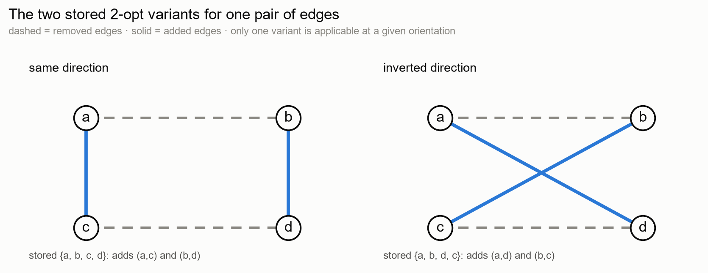
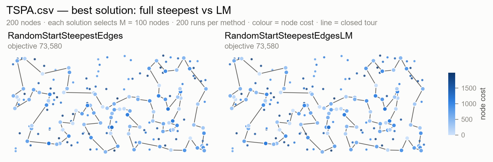
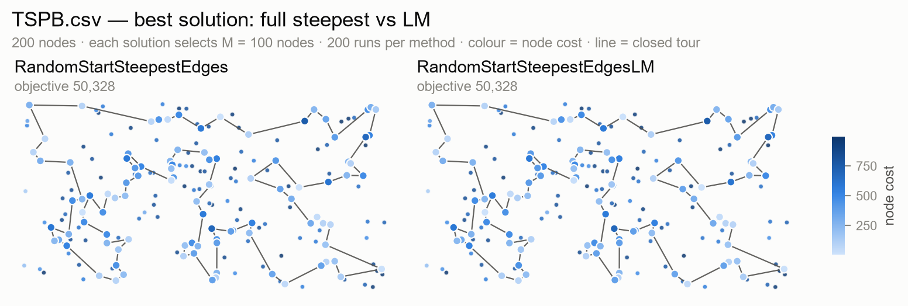
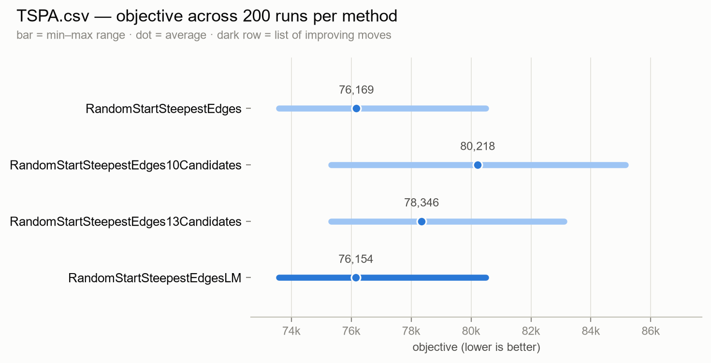
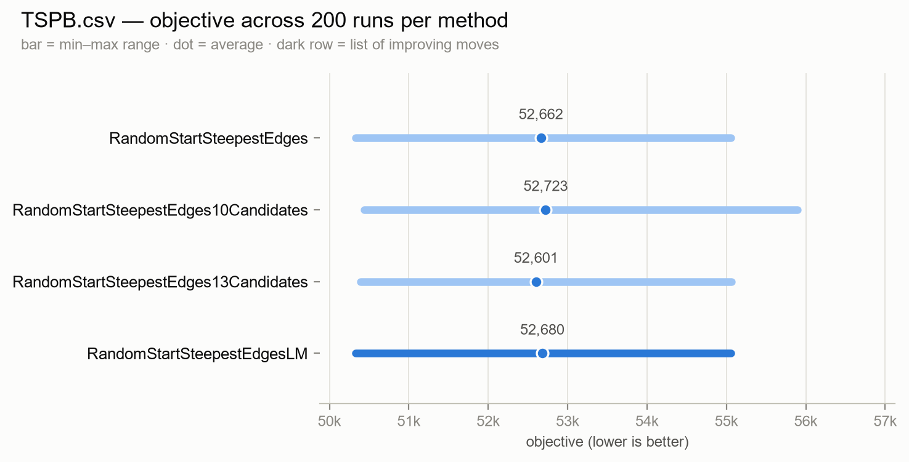
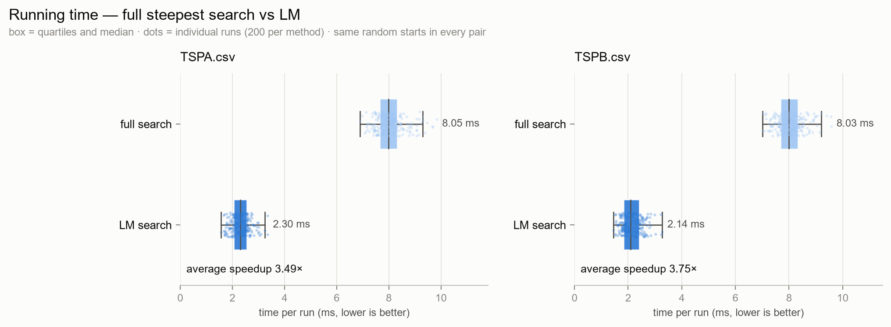

# Task 5 — Steepest local search with a list of improving moves

- 160296: Paweł Laszczyk
- 160314: Ashley Jurga

**Solver revision:** working tree on top of `81c7b03` (Task 5 strategies; this revision adds the 200-run experiment, the workbook check, the report generator and the move-by-move trace test)<br>
**Source code link**: [GitHub](https://github.com/AER00/evolutionary_computation_pp)<br>
**Instances:** `TSPA.csv`, `TSPB.csv` — 200 nodes each<br>
**Methods:** `RandomSolution` (the starting solutions and the scale baseline), the full-neighbourhood steepest local search with a random start (the reference), and the same search driven by the list of improving moves (the new method); the two Task 4 candidate-list searches are included as previous methods for context<br>
**Previous methods:** the Task 4 candidate searches, registered in the same benchmark run so their timings are comparable; the algorithms are unchanged

---

## 1. The problem

The problem is the same as in Tasks 1–4. Each instance has `N` points with coordinates and a
**cost**. We select exactly

```
M = ceil(N / 2) = 100
```

points and put them in a closed tour. The objective is

```
objective = tour length + cost of the selected nodes
```

and lower is better. Distances are Euclidean and rounded to the nearest integer, so all
objective values are integers. A solution is stored as the list of selected nodes in visit
order; the last node connects back to the first one.

Task 5 does not change the objective or the neighbourhood. It changes **how often the same
delta is computed**. The full steepest search from Task 3 scans the whole neighbourhood in
every iteration. Most moves are not affected by the move that was just accepted, so their
deltas are still valid. The task is to keep those deltas in a **list of improving moves**
(`LM`) and to use the list instead of scanning the neighbourhood again. The search should
then reach the same quality in less time.

## 2. Methods

### 2.1 The list of improving moves

`LM` is a list of moves ordered from the best (most negative delta) to the worst. Only moves
that improve the current solution are stored. The implementation uses a binary min-heap keyed
by `delta`, so the best move is popped first and insertion costs `O(log |LM|)`.

A move is stored by **node ids**, not by positions. This matters because a position in the
tour is not stable: a 2-opt move reverses a whole segment, and an inter-route move replaces a
node. The removed edges, on the other hand, are defined by their endpoints, so an entry that
stores the endpoints stays valid after later moves.

```
move
    kind       inter or 2-opt
    delta      objective change at the time the move was evaluated
    a, b, c, d node ids (the meaning depends on kind)
```

The mechanism is separate from candidate moves. The LM search uses the **full** neighbourhood
(every inter-route exchange and every 2-opt exchange), and the candidate lists from Task 4
are not used. The two mechanisms could be combined, but this experiment keeps them separate.

### 2.2 Inter-route moves

An inter-route move replaces one selected node `b` by one unselected node `d`. Let `a` be the
predecessor of `b` and `c` its successor. The removed edges are `(a,b)` and `(b,c)`; the added
edges are `(a,d)` and `(d,c)`. The delta includes the node costs:

```
Δ = cost[d] − cost[b]
  + dist[a][d] + dist[d][c]
  − dist[a][b] − dist[b][c]
```

The move is stored as `(a, b, c, d)`. One entry is enough: unlike a 2-opt move, a node
replacement has no second reconnection, and the formula is symmetric in `a` and `c`. If the
current neighbours of `b` are `a` and `c` in either order, the stored delta is still the exact
delta of replacing `b` by `d`.

### 2.3 2-opt moves and the two edge orientations

A 2-opt move removes two edges and reconnects the four endpoints. For the edges `(a,b)` and
`(c,d)` there are two ways to write the reconnection:

```
same direction:      add (a,c) and (b,d)
                     Δ  = dist[a][c] + dist[b][d] − dist[a][b] − dist[c][d]

inverted direction:  add (a,d) and (b,c)
                     Δ' = dist[a][d] + dist[b][c] − dist[a][b] − dist[c][d]
```

At a fixed moment only one of them is a valid 2-opt reconnection. The other one would be valid
if the relative direction of the two removed edges were reversed, for example after a reversal
of the segment between them. That is why every pair of edges stores **both** variants:

```
{a, b, c, d}   removes (a,b) and (c,d), adds (a,c) and (b,d)
{a, b, d, c}   removes (a,b) and (d,c), adds (a,d) and (b,c)
```

The second variant is written with its own forward endpoints `(d,c)`, so it is a separate move
in the list. Exactly one of the two is applicable for a given orientation, and the other one
may become applicable later. Both variants are also generated for the initial solution, as the
task requires.



The figure shows the same four endpoints with the two possible reconnections. Only the variant
whose removed edges are traversed in the stored direction is applied; the other one stays in
`LM`.

### 2.4 Applicability: the three cases

When a move is popped from `LM`, it is tested against the current tour before anything is
changed. The task distinguishes three situations:

| Situation | Test | Action |
|---|---|---|
| A removed edge no longer exists | at least one of the stored edges is not adjacent in the current tour | remove the move from `LM` |
| The removed edges exist, but in the opposite relative direction | the edges are adjacent, but one is forward and the other reversed | leave the move in `LM`, do not apply it, browse the rest of `LM` |
| The removed edges exist in the same relative direction (both forward or both reversed) | both edges are adjacent in the stored orientation | apply the move, remove it from `LM` |

For a 2-opt move the test uses the positions `pa, pb, pc, pd` of its four nodes:

```
forwardAB = (pb = pa + 1 mod M)
reverseAB = (pa = pb + 1 mod M)
forwardCD = (pd = pc + 1 mod M)
reverseCD = (pc = pd + 1 mod M)

if not (forwardAB or reverseAB) or not (forwardCD or reverseCD):
    drop the move
else if (forwardAB and forwardCD) or (reverseAB and reverseCD):
    apply the move
else:
    keep the move, skip it for now
```

For an inter-route move the test is simpler:

```
i = pos[b]                            # position of the old node
if i = -1 or pos[d] != -1:
    drop the move                     # b left the tour, or d entered it
pa = path[(i-1+M) mod M]
na = path[(i+1) mod M]
if {pa, na} != {a, c} in either order:
    drop the move                     # a removed edge no longer exists
apply the replacement
```

There is no "different relative direction" case for the node replacement: the two neighbours
are unordered in the delta, so the move is applied whenever both removed edges still exist.

### 2.5 Generating new moves

After a move is applied, only the part of the neighbourhood that touches the changed edges can
have new deltas. The implementation regenerates exactly that part and leaves the rest of `LM`
alone.

**Initial solution.** Every inter-route position and every pair of edges is evaluated. For
each edge pair both 2-opt variants are generated. This is the same 14,850-move scan as the full
steepest search.

**After an inter-route move.** The selected node at position `i` changed from `b` to `d`. The
positions whose neighbours changed are `i−1`, `i` and `i+1` (modulo `M`). The procedure is:

```
applyInter(i, d):
    old ← path[i]
    path[i] ← d

    for k in {i-1, i, i+1}:
        addInter(k)                   # replace path[k] by every unselected node

    for q not in {i-1, i, i+1}:
        evaluate replacing path[q] by old
                                      # old is now unselected and can re-enter anywhere

    for f in 0 .. M-1:
        addEdges(i-1, f)              # the two new edges around position i
        addEdges(i, f)
```

The separate loop over `q` is needed because the removed node `old` is now unselected and can
be inserted at every other position. The three `addInter` calls cover only the positions whose
neighbours changed.

**After a 2-opt move.** The segment `path[i+1 .. j]` is reversed. The nodes at positions
`i`, `i+1`, `j` and `j+1` change neighbours, and the two new boundary edges are at positions
`i` and `j`:

```
applyEdge(i, j):                      # reverse path[i+1 .. j]
    reverse the segment
    update pos for the reversed nodes

    for k in {i, i+1, j, j+1}:
        addInter(k)

    for f in 0 .. M-1:
        addEdges(i, f)
        addEdges(j, f)
```

All other adjacent pairs of nodes are unchanged as **undirected** pairs. Their stored deltas
remain exact; a reversal only flips the relative direction of some pairs, and the other
orientation variant was already stored when the pair was created. This is why no full
re-scan is necessary.

### 2.6 The LM-driven steepest search

The search follows the alternative algorithm from the assignment:

```
SteepestLM(path):                     # path = RandomSolution(seed)
    x  ← copy(path)
    LM ← empty min-heap

    for i ← 0 to M-1:
        addInter(i)
        for j ← i+2 to M-1:
            addEdges(i, j)

    repeat:
        skipped ← empty list
        applied ← false

        while LM is not empty:
            m ← LM.popMin()
            result ← check(m)
            if result = missing edge:
                continue                  # m is removed from LM
            if result = wrong direction:
                skipped.append(m)         # keep m, browse further
                continue
            x ← apply(m)                  # m is removed from LM
            applied ← true
            break

        if not applied:
            break                         # no applicable improving move left

        for m in skipped:
            LM.push(m)                    # deltas are still exact
    until false
```

The moves skipped in one pass are pushed back after the applied move. A skipped move is not
lost: its removed edges still exist, only their relative direction is wrong at the moment, so
the stored delta is still exact.

The implementation does **not** re-evaluate the whole neighbourhood when `LM` becomes empty.
This is not needed: by the rule in section 2.5, every applicable improving move is either
already in `LM` or was generated after the last accepted move. An empty `LM` therefore means
that the current solution is a local optimum for the full neighbourhood. Section 4.5 checks
this on all 800 baseline and LM runs (200 per method per instance).

### 2.7 The baseline

The reference is the steepest edge-exchange search from Task 3 with a random start,
`RandomStartSteepestEdges`. It uses the same starting solution, the same inter-route
exchanges, the same 2-opt exchanges and the same delta formulas, but it recomputes the whole
neighbourhood in every iteration and keeps no list. It is the "without the mechanism" baseline
required by the task.

The two Task 4 candidate searches are also registered in the same run. They are not part of the
LM comparison; they are included only so the timings and objectives come from one process.
The LM mechanism is implemented separately from candidate moves, as required.

### 2.8 Why the list is faster

One full steepest iteration evaluates

```
M(N−M) + M(M−3)/2 = 100·100 + 100·97/2 = 14,850 moves
```

on these instances: 10,000 inter-route exchanges and 4,850 2-opt exchanges. The LM search pays
that cost once, for the initial solution. After an accepted inter-route move it evaluates at
most

```
3(N−M) + (M−3) + 4M  ≈  3·100 + 97 + 400  ≈  800 moves
```

and after an accepted 2-opt move at most

```
4(N−M) + 4M  =  4·100 + 400  ≈  800 moves.
```

The `4M` term counts both orientation variants of every new edge pair. The per-iteration
evaluation count therefore drops by about a factor of `14,850 / 800 ≈ 18`. The measured
wall-clock speedup is smaller (3.5–3.8×). The initial scan is unchanged, every heap push and
pop costs more than a simple delta loop, and the search may pop many moves that turn out to be
non-applicable or missing.

### 2.9 Ties and equivalence with the full search

Both searches always apply a move with the smallest available delta. The full scan breaks a
tie by keeping the first move in its fixed iteration order; the heap breaks it by heap order.
When several moves have the same delta, the two searches can accept different moves and then
continue on a different path. This is the only difference between the two methods; the
neighbourhood and the acceptance rule are the same.

The experiment shows this: the two methods end with identical tours in 174 of 200 TSPA runs
and 175 of 200 TSPB runs, and both always end in a full local optimum. The average objective
difference is below 0.04% on both instances (section 4).

## 3. Experiment setup

* `N = 200`, `M = 100`, two instances.
* **200 runs per method per instance.** Run `r` starts from `RandomSolution` with seed `r`;
  every method uses the same 200 starts.
* 5 methods × 2 instances × 200 runs = **2000 solutions**: `RandomSolution`, the full
  steepest search, the two Task 4 candidate searches and the LM search.
* The LM search is deterministic for a fixed start. The only randomness is the starting
  solution; the list order among equal deltas is deterministic.
* Times are measured around the strategy call only. They come from one run of the program
  and vary between runs; only comparisons inside the same run are meaningful.
* The two Task 4 candidate searches and the full search are registered in the same benchmark
  run as the LM search, so their timings are directly comparable.
* Candidate lists are built once per instance before the timed loop, as in Task 4; they are
  not charged to the first run. The LM search has no preparation step.
* The solution checker from the course (`Solution checker.xlsx`) validates every run.

To reproduce:

```sh
go run . -repeat 200 -json results_task5.json
python3 tools/check_with_excel.py results_task5.json \
    --out report/excel_check_task5.json
python3 tools/make_report_task5.py results_task5.json --local-optima \
    --excel-check report/excel_check_task5.json
```

The default `go run .` registers the two baselines, the two candidate searches and the LM
search. To run only the two required methods and `RandomSolution`, pass an empty candidate
list:

```sh
go run . -candidates "" -repeat 200 -json results_task5_lm_only.json
```

`make_report_task5.py` writes the Task 5 figures to `report/figures_task5/` and prints the
tables below.

## 4. Results

### 4.1 Objective values

| Method | TSPA.csv av (min–max) | TSPB.csv av (min–max) |
|---|---:|---:|
| RandomSolution | 261,353.1 (238,111 – 291,409) | 207,261.0 (186,229 – 225,881) |
| RandomStartSteepestEdges | 76,168.9 (73,580 – 80,490) | 52,662.4 (50,328 – 55,056) |
| RandomStartSteepestEdges10Candidates | 80,218.4 (75,324 – 85,156) | 52,723.0 (50,441 – 55,895) |
| RandomStartSteepestEdges13Candidates | 78,345.8 (75,325 – 83,113) | 52,600.8 (50,394 – 55,062) |
| RandomStartSteepestEdgesLM | 76,154.2 (73,580 – 80,490) | 52,679.9 (50,328 – 55,056) |

The full-neighbourhood row reproduces Report 4 exactly (76,168.9 and 52,662.4), which confirms
that the baseline is the same algorithm. The LM search gives almost the same results:

* **TSPA:** 76,154.2 against 76,168.9, a difference of **−14.7** (−0.02%).
* **TSPB:** 52,679.9 against 52,662.4, a difference of **+17.5** (+0.03%).
* The min–max ranges are **identical** on both instances.
* The best solutions are identical: 73,580 on TSPA (run 171) and 50,328 on TSPB (run 101).

The two candidate rows are previous methods and are shown for context. Their behaviour is the
same as in Report 4: on TSPA they are clearly worse than the full neighbourhood (about
+4,050 and +2,177), while on TSPB the 13-candidate search is slightly better on average
(−61.6) and the 10-candidate search slightly worse (+60.6).

### 4.2 Running times

| Method | TSPA.csv av (min–max) | TSPB.csv av (min–max) |
|---|---:|---:|
| RandomSolution | 0.01 ms (0.01 – 0.59) | 0.01 ms (0.01 – 0.07) |
| RandomStartSteepestEdges | 8.05 ms (6.89 – 9.85) | 8.03 ms (7.00 – 9.57) |
| RandomStartSteepestEdges10Candidates | 1.48 ms (1.31 – 3.29) | 1.52 ms (1.31 – 3.23) |
| RandomStartSteepestEdges13Candidates | 1.97 ms (1.73 – 3.74) | 1.98 ms (1.73 – 3.75) |
| RandomStartSteepestEdgesLM | 2.30 ms (1.57 – 3.35) | 2.14 ms (1.46 – 3.26) |

The LM search is consistently faster than the full search:

| Instance | Aggregate speedup | Median per-run speedup | Min – max per-run speedup | LM faster |
|---|---:|---:|---:|---:|
| TSPA.csv | 3.49× | 3.48× | 2.46× – 5.51× | 200/200 |
| TSPB.csv | 3.75× | 3.88× | 2.46× – 5.83× | 200/200 |

The LM search is faster in **all 200 pairs** on both instances, so the speedup is not caused
by a few runs. The aggregate ratio (ratio of the average times) and the median per-run ratio
differ slightly because a run with a very small denominator has a large ratio; the aggregate
number is the more conservative one.

The candidate searches are even faster (1.48–1.98 ms per run), but on TSPA they pay for this
with a 2.9–5.3% worse objective. The LM search is the only method in this run that keeps the
full-neighbourhood quality and is also much faster.

Times vary between runs and between processes. The Task 4 report measured the same full
search at 8.31–8.34 ms in its extended run; here it is 8.03–8.05 ms. Only comparisons inside
the same run should be read as speedups. All numbers in this report come from one run that
registered all five methods together.

### 4.3 Paired comparisons

Every pair uses the same seed, so the difference is caused only by the two search mechanisms.

| Instance | Comparison | Mean difference | Min – max difference | Better / worse / tie | Identical tours |
|---|---|---:|---:|---:|---:|
| TSPA.csv | LM − full | -14.7 | -1,499 – +1,044 | 14 / 12 / 174 | 174/200 |
| TSPB.csv | LM − full | +17.5 | -1,163 – +1,373 | 9 / 14 / 177 | 175/200 |

On TSPA the LM result is better in 14 runs, worse in 12 and equal in 174. On TSPB it is better
in 9, worse in 14 and equal in 177. Almost all of the "equal" runs have exactly the same
tour; 174/200 TSPA and 175/200 TSPB tours are identical. The two TSPB runs that tie on the
objective but have a different tour are still full local optima.

The differences are not a systematic change in quality. They appear when several moves have
the same delta and the heap and the full scan pick different ones (section 2.9). The largest
single differences are 1,499 on TSPA and 1,373 on TSPB, but these are individual runs; the
average differences are 14.7 and 17.5, which is 0.02–0.03% of the objective.

### 4.4 Objective components

Component averages are rounded, so they may not add exactly to the objective.

| Instance | Method | Avg tour length | Avg node cost | Avg objective |
|---|---|---:|---:|---:|
| TSPA.csv | RandomSolution | 164,360.7 | 96,992.4 | 261,353.1 |
| TSPA.csv | RandomStartSteepestEdges | 23,040.2 | 53,128.7 | 76,168.9 |
| TSPA.csv | RandomStartSteepestEdges10Candidates | 23,663.5 | 56,554.8 | 80,218.4 |
| TSPA.csv | RandomStartSteepestEdges13Candidates | 23,358.0 | 54,987.9 | 78,345.8 |
| TSPA.csv | RandomStartSteepestEdgesLM | 23,035.0 | 53,119.2 | 76,154.2 |
| TSPB.csv | RandomSolution | 155,274.3 | 51,986.7 | 207,261.0 |
| TSPB.csv | RandomStartSteepestEdges | 20,847.6 | 31,814.8 | 52,662.4 |
| TSPB.csv | RandomStartSteepestEdges10Candidates | 21,074.1 | 31,648.9 | 52,723.0 |
| TSPB.csv | RandomStartSteepestEdges13Candidates | 20,884.4 | 31,716.4 | 52,600.8 |
| TSPB.csv | RandomStartSteepestEdgesLM | 20,856.1 | 31,823.8 | 52,679.9 |

The LM components are very close to the full search: on TSPA the tour is 5.2 shorter and the
nodes cost 9.5 less; on TSPB the tour is 8.5 longer and the nodes cost 9.0 more. There is no
clear shift towards cheaper nodes or a shorter tour, which is what we expect if the search is
the same and only faster.

The candidate methods on TSPA lose on both components, as in Report 4: with `k = 10` the tour
is 623 longer and the nodes cost 3,426 more; with `k = 13` the tour is 318 longer and the nodes
cost 1,859 more. The LM mechanism does not have this problem because it searches the full
neighbourhood.

### 4.5 Full-neighbourhood local-optimum check

For every baseline and LM run, a separate checker computed the best delta over the **full**
neighbourhood (all inter-route exchanges and all 2-opt exchanges) and checked that it is
non-negative. This is stronger than only checking that the search stopped: it shows that no
improving move was missed.

| Instance | Method | Runs checked | Full local optima |
|---|---|---:|---:|
| TSPA.csv | RandomStartSteepestEdges | 200 | 200/200 |
| TSPA.csv | RandomStartSteepestEdgesLM | 200 | 200/200 |
| TSPB.csv | RandomStartSteepestEdges | 200 | 200/200 |
| TSPB.csv | RandomStartSteepestEdgesLM | 200 | 200/200 |

All 800 searches end in a full local optimum. In particular, the LM search never stops early
because its list became empty while an improving move still existed. This confirms the rule
from section 2.6 on the actual runs.

A second, stronger check compared the two searches move by move. `task5/trace_check_test.go`
runs the full scan and the LM search from all 200 starts per instance and records the delta of
every accepted move and the resulting tour. While the two searches are on the same tour, they
always accept the **same** best delta: 19,125 accepted moves were compared on TSPA and 18,243
on TSPB before the first divergence. Every divergence happened at a tie — the two moves had
the same delta but a different tour — which is exactly the behaviour described in section 2.9.
No case was found where the LM search missed an improving move or used a stale delta.

```sh
go test ./task5
```

### 4.6 Pictures of the best solutions

Node colour is the node cost (light blue cheap, dark blue expensive) and the dark line is the
closed tour. The two panels are the full-neighbourhood search and the LM search. Their best
tours are identical, so the panels look the same.





The objective ranges of the four local-search methods. The two candidate methods are included
for context; on TSPA their ranges are visibly wider. The LM row is drawn in the darker accent
colour.





The running-time distributions. Each dot is one run; the box shows the quartiles and the
median. The full search and the LM search use the same random starts in every pair.



The time figure shows the speedup directly: the LM boxes sit at about 2.1–2.3 ms, the full
search boxes at about 8.0 ms, and almost every LM dot is to the left of every full-search dot.
Because the ranges overlap a little at the tails, the per-run speedup varies from run to run.

### 4.7 Best runs

| Instance | Method | Best objective | Run | Tour length | Node cost |
|---|---|---:|---:|---:|---:|
| TSPA.csv | RandomSolution | 238,111 | 154 | 146,623 | 91,488 |
| TSPA.csv | RandomStartSteepestEdges | 73,580 | 171 | 21,726 | 51,854 |
| TSPA.csv | RandomStartSteepestEdges10Candidates | 75,324 | 70 | 22,896 | 52,428 |
| TSPA.csv | RandomStartSteepestEdges13Candidates | 75,325 | 15 | 22,694 | 52,631 |
| TSPA.csv | RandomStartSteepestEdgesLM | 73,580 | 171 | 21,726 | 51,854 |
| TSPB.csv | RandomSolution | 186,229 | 165 | 132,442 | 53,787 |
| TSPB.csv | RandomStartSteepestEdges | 50,328 | 101 | 20,812 | 29,516 |
| TSPB.csv | RandomStartSteepestEdges10Candidates | 50,441 | 149 | 21,229 | 29,212 |
| TSPB.csv | RandomStartSteepestEdges13Candidates | 50,394 | 149 | 20,711 | 29,683 |
| TSPB.csv | RandomStartSteepestEdgesLM | 50,328 | 101 | 20,812 | 29,516 |

The best LM run is the same solution as the best full-search run on both instances. The run
column identifies the random start. Every run with its tour, objective, tour length, node cost
and run index is written to `results_task5.json`; `go run .` prints the best tour of each
method.

## 5. Solution checker

All 2000 runs were checked with the course-provided **`Solution checker.xlsx`** through
`tools/check_with_excel.py`. The workbook writes the tour into `F3:F102`, uses `LOOKUP` to
fetch the coordinates and costs, computes the rounded edges in `J3:J102` (`F103 = F3` closes
the cycle), and reports the node cost in `I2`, the tour length in `J2` and the objective in
`K2`. The script only checks that the tour has exactly `M = 100` distinct in-range ids and
reads those cells back from a temporary copy, so the provided workbook is not modified.

| Instance | Method | Runs checked | Feasible | Objective matches | Components match |
|---|---|---:|---:|---:|---:|
| TSPA.csv | RandomSolution | 200 | 200/200 | 200/200 | 200/200 |
| TSPA.csv | RandomStartSteepestEdges | 200 | 200/200 | 200/200 | 200/200 |
| TSPA.csv | RandomStartSteepestEdges10Candidates | 200 | 200/200 | 200/200 | 200/200 |
| TSPA.csv | RandomStartSteepestEdges13Candidates | 200 | 200/200 | 200/200 | 200/200 |
| TSPA.csv | RandomStartSteepestEdgesLM | 200 | 200/200 | 200/200 | 200/200 |
| TSPB.csv | RandomSolution | 200 | 200/200 | 200/200 | 200/200 |
| TSPB.csv | RandomStartSteepestEdges | 200 | 200/200 | 200/200 | 200/200 |
| TSPB.csv | RandomStartSteepestEdges10Candidates | 200 | 200/200 | 200/200 | 200/200 |
| TSPB.csv | RandomStartSteepestEdges13Candidates | 200 | 200/200 | 200/200 | 200/200 |
| TSPB.csv | RandomStartSteepestEdgesLM | 200 | 200/200 | 200/200 | 200/200 |

**2000 runs checked, 0 failures.** All objective arithmetic in the table comes from the
workbook, not from the Go solver. The additional local-optimum check in section 4.5 covers the
two relevant methods separately and also passes 800/800.

## 6. Source code

| File | Contents |
|---|---|
| `solver/problem.go` | loading the instance, the distance matrix, `TourLength` / `NodesCost` / `Objective` |
| `solver/solver.go` | the `Strategy` interface, the optional `Preparer` interface and the benchmark loop |
| `task1/strategies.go` | `RandomSolution`, used for the starting solutions and as the scale baseline |
| `task3/task3.go` | the full-neighbourhood steepest search, used as the baseline |
| `task4/task4.go`, `task4/strategies.go` | the Task 4 candidate lists and candidate steepest search, used for context |
| `task5/task5.go` | move representation, the min-heap, `addInter` / `addEdges`, `tryApply`, `applyInter` / `applyEdge`, `improvePathLM` |
| `task5/strategies.go` | `SteepestLM` |
| `task5/trace_check_test.go` | the move-by-move delta comparison used in section 4.5 |
| `main.go` | command line, the `-candidates` option, the results table and the JSON export; registers the LM search |
| `tools/check_with_excel.py` | drives `Solution checker.xlsx` |
| `tools/make_report_task5.py` | Task 5 figures and tables, the paired comparison and the local-optimum check |
| `tools/oeviz.py` | plotting helpers |

The whole mechanism is one type, `SteepestLM`, and one state struct. The state keeps the
current path, the `pos` array (position or `-1`), the heap and a small scratch list for the
skipped moves. `addInter` and `addEdges` are the only places where a delta is computed, and
the same functions are used for the initial scan and for the updates after a move, so the
delta formula is written only once.

## 7. Conclusions

1. **The list of improving moves gives a large speedup.** The LM search is 3.49× faster on
   TSPA and 3.75× faster on TSPB than the full steepest search, and it is faster in all 200
   paired runs on both instances. The median per-run speedup is 3.48× and 3.88×.
2. **The quality is the same.** The average objective differs by −14.7 on TSPA and +17.5 on
   TSPB (0.02–0.03%), the min–max ranges are identical, the best solutions are identical, and
   174/200 TSPA and 175/200 TSPB final tours are exactly the same. The remaining differences
   come from tie-breaking among equal deltas, not from a different search objective.
3. **The result is a full local optimum.** All 200 baseline and all 200 LM runs on each
   instance (800 runs in total) pass the
   independent full-neighbourhood local-optimum check. The update after a move covers all new
   moves, so an empty `LM` really means that no inter-route or 2-opt move improves the tour.
4. **The applicability rule is necessary.** A 2-opt move whose removed edges exist in the
   wrong relative direction must be kept, not dropped, because a later reversal can make it
   valid. Storing both orientation variants for every new edge pair is what makes these kept
   moves usable and keeps the list complete.
5. **The speedup is limited by the initial scan and the heap.** The number of evaluations
   per accepted move drops by about 18×, but the end-to-end speedup is 3.5–3.8×: the initial
   full scan is unchanged, and heap pushes, pops and non-applicable moves cost more than a
   simple delta loop. A hybrid with candidate lists could reduce the initial scan and the
   generation cost, but that is the optional combination and was not part of this experiment.
6. **What to keep.** The LM mechanism can be added to the steepest local search without
   changing anything else: keep the same neighbourhood, store moves by node ids, keep both
   2-opt variants, apply the three-case check, and regenerate only the moves around the
   changed edges. In this experiment this gives the same quality at about one third of the
   time on both instances.
