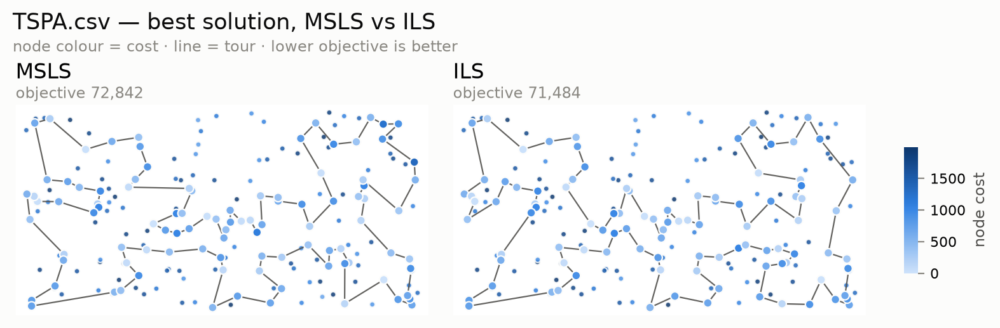
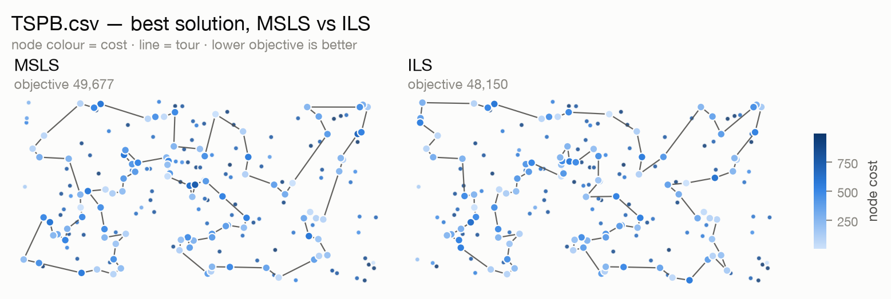
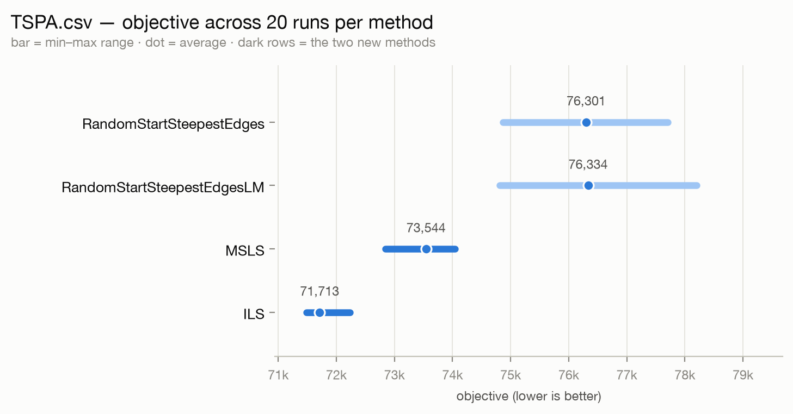
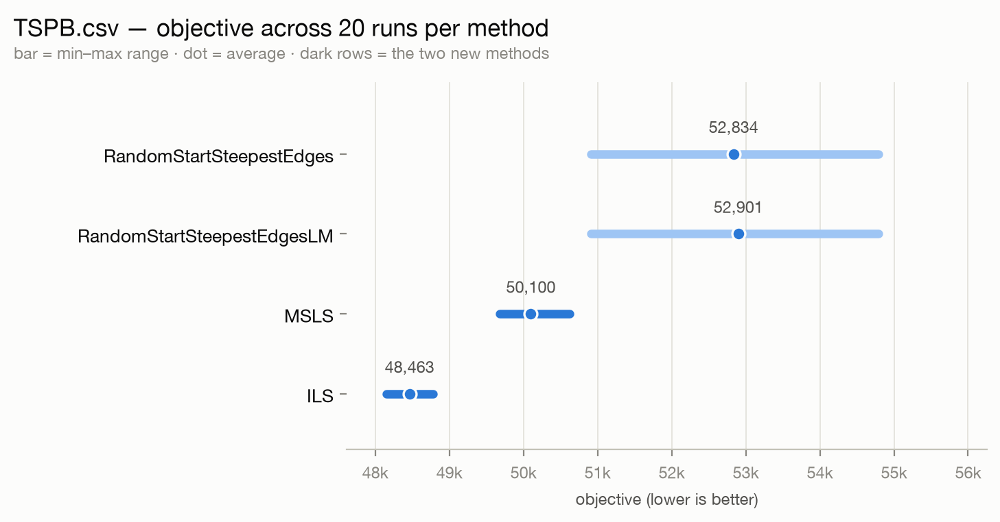

# Task 6 — Multiple start local search and iterated local search

- 160296: Paweł Laszczyk
- 160314: Ashley Jurga

**Solver revision:** working tree on top of `31f93b6` (Task 6 strategies; this revision adds the `-construction` reference run, the local-search counter in the JSON export and the report generator)<br>
**Source code link**: [GitHub](https://github.com/AER00/evolutionary_computation_pp)<br>
**Instances:** `TSPA.csv`, `TSPB.csv` — 200 nodes each<br>
**Methods:** `MSLS` (multiple start local search) and `ILS` (iterated local search). The local search inside both methods is the Task 5 `SteepestLM` search, unchanged.<br>
**Previous methods:** `RandomSolution`, the full-neighbourhood steepest search and the Task 5 LM search from the earlier reports, plus the seven construction heuristics from Tasks 1–2 as a reference.

---

## 1. The problem

The problem is the same as in Tasks 1–5. Each instance has `N` points with coordinates and a
**cost**. We select exactly

```
M = ceil(N / 2) = 100
```

points and put them in a closed tour. The objective is

```
objective = tour length + cost of the selected nodes
```

and lower is better. Distances are Euclidean and rounded to the nearest integer, so all
objective values are integers. A solution is stored as the list of selected nodes in visit
order; the last node connects back to the first one.

Tasks 3–5 changed the neighbourhood and then the way deltas are stored. Task 6 does not change
either. It changes the **outer loop**: a single local search is run from many random solutions
(MSLS), or many short local searches are chained on top of one random solution (ILS). The goal
is to get better local optima than one descent can reach, without spending much more time.

## 2. Methods

### 2.1 The local search used by both methods

Both methods use the same basic local search: the steepest search with the list of improving
moves from Task 5 (`SteepestLM`, `ImprovePathLM`). It starts from a given path, always applies
the move with the smallest delta from the list of improving moves, regenerates only the moves
around the changed edges, and stops when the list of applicable improving moves is empty. The
returned solution is a local optimum of the full neighbourhood (all inter-route exchanges and
all 2-opt exchanges).

The only difference between the two methods is where the starting solutions come from.

### 2.2 Multiple start local search

One run of MSLS performs `S = 400` steepest local searches, each from a random solution, and
returns the best of the 400 results:

```
MSLS(p, S, run):
    best ← none
    for i ← 0 to S-1:
        x ← SteepestLM(RandomSolution(seed(run, i)))
        if best is none or objective(x) < objective(best):
            best ← x
    return best
```

The search is independent between the starts. A bad local optimum costs only the time of one
descent; it does not stop the run. On the other hand, every start pays for the full local
search from a random solution, which is the expensive kind of descent.

### 2.3 Iterated local search

One run of ILS starts from a single random solution and then repeatedly perturbs the current
solution and improves it again with the same local search:

```
ILS(p, budget, run):
    x ← SteepestLM(RandomSolution(seed(run)))
    runs ← 1
    start ← now()
    rng ← seeded generator

    while now() − start < budget:
        y ← perturb(x, rng)
        y ← SteepestLM(y)
        runs ← runs + 1
        if objective(y) ≤ objective(x):
            x ← y                     # equal is accepted

    return x, runs
```

The value `runs` counts every local search that was completed, including the first one.

### 2.4 The perturbation

The perturbation is our own design. It has three parts and is applied to the current local
optimum `x`:

1. **Random rotation.** The tour is rotated by a random offset `r`. The tour is cyclic, so a
   rotation does not change the solution at all; it only moves the problem to a random part of
   the cycle, so the two segments below are not always the same part of the tour.

2. **Segment swap inside the tour** (a double bridge restricted to short segments). The tour is
   split into four parts `A B C D`, and the two inner parts are swapped:

   ```
   A B C D  →  A C B D
   |B|, |C| ∈ {1, ..., M/10} = {1, ..., 10}
   ```

   This changes three edges of the tour but keeps all selected nodes.

3. **Three node replacements.** Three random selected nodes are replaced by three distinct
   random unselected nodes, each at a random position. This is the only part that changes
   **which** nodes are selected.

```
perturb(x, rng):
    r  ← rng.Intn(M)
    x  ← rotate(x, r)
    lenB ← 1 + rng.Intn(M/10)
    lenC ← 1 + rng.Intn(M/10)
    p1   ← 1 + rng.Intn(M − lenB − lenC)

    y ← x[0:p1] + x[p1+lenB : p1+lenB+lenC] + x[p1 : p1+lenB] + x[p1+lenB+lenC :]

    for k ← 1 to 3:
        u ← random unselected node
        i ← rng.Intn(M)
        y[i] ← u                    # u becomes selected, y[i] becomes unselected

    return y
```

The reasons for this design:

* **Why the double bridge.** It is the standard perturbation for tour problems. It changes
  three edges of the tour and does not reverse long segments. A 2-opt move changes two edges,
  so the following local search cannot undo the perturbation with one move, and the
  perturbation is not simply reversed in the first iteration.
* **Why the segments are short.** With `|B|, |C| ≤ M/10 = 10`, the changed part of the tour is
  small compared with `M = 100`. The local search repairs it in a few iterations, so the
  perturbation explores the neighbourhood of the current local optimum instead of jumping to a
  random solution. A full double bridge with arbitrary cut points would change a much larger
  part of the tour and would be close to a random restart, which is what MSLS already does.
* **Why the node replacements.** The tour part of the perturbation cannot change the **set** of
  selected nodes. After a local optimum, an inter-route move from that set is often blocked,
  and the search would keep returning to the same selection while only the tour changes. Three
  replacements out of 100 nodes change a few costs and edges only, so the solution stays close
  to the previous one but the selected set is no longer the same.
* **Why exactly three.** One replacement is easy for the local search to undo, and a large
  number of replacements (for example 10% of the nodes) destroys the solution and the run turns
  into an expensive random restart. Three keeps the perturbation local and still changes the
  selection; it is the value used in the experiment.

### 2.5 Acceptance and stopping condition

A new local optimum replaces the current one when it is **not worse** (`objective(y) ≤
objective(x)`). Accepting equal solutions lets the search drift along plateaus of the objective
without losing quality; worse solutions are never accepted, so the result is the best solution
seen, and it is monotone non-increasing over the run.

The stopping condition is a **time budget**, as the task requires. The budget of an ILS run on
an instance is the average running time of one MSLS run on the same instance, measured in the
same process shortly before:

```
budget(instance) = mean over the 20 MSLS runs of (time of one MSLS run)
```

The time includes everything inside the strategy call: all local searches and all perturbations.

### 2.6 Why ILS performs many more local searches than MSLS has starts

Both methods get about 750 ms per run on these instances, but the number of local searches is
very different:

| | MSLS | ILS |
|---|---:|---:|
| Local searches per run | 400 (fixed) | about 9,800 (measured) |
| Average time of one local search | about 1.88 ms | about 0.077 ms |

The reason is the starting point. MSLS starts every local search from a **random** solution, so
the descent is long. ILS starts it from a **perturbed local optimum**: the first moves are few,
the list of improving moves from Task 5 keeps the descent cheap, and the search reaches a new
local optimum after a small number of iterations.

This is also why the comparison is fair in time and not in the number of descents. The task
asks for the average MSLS time as the ILS budget, not for the same number of local searches.

## 3. Experiment setup

* `N = 200`, `M = 100`, two instances.
* **20 runs per method per instance**, as the task requires.
* MSLS: `S = 400` local searches inside one run, each from a random solution.
* ILS: the budget is the average MSLS time on the same instance (753 ms on TSPA, 741 ms on
  TSPB in this run), measured in the same process.
* Starting solutions:
  * MSLS run `r`, start `i` uses `RandomSolution` with seed `r·1,000,003 + i`;
  * ILS run `r` uses `RandomSolution` with seed `r·1,000,003` and then its own generator for
    the perturbations.
  The first start of MSLS run `r` is therefore the same solution as the start of ILS run `r`,
  and the rest of the two runs is independent. The two methods are compared as two
  distributions, not run by run.
* 14 methods × 2 instances × 20 runs = **560 solutions**: 7 construction heuristics,
  `RandomSolution`, the full steepest search, the two Task 4 candidate searches, the LM search,
  MSLS and ILS.
* Times are measured around the strategy call only. They come from one program run and vary
  between runs; only comparisons inside the same run are meaningful.
* Each construction heuristic is deterministic for a fixed seed. Their values below are the
  averages over the same 20 starting solutions as the other methods, so the comparison uses the
  same seeds.

To reproduce:

```sh
go run . -repeat 20 -construction -json results_task6.json
python3 tools/make_report_task6.py results_task6.json
```

`make_report_task6.py` writes the Task 6 figures to `report/figures_task6/`, prints the tables
below, re-checks every objective from the CSV files, and runs the independent
full-neighbourhood local-optimum check.

## 4. Results

### 4.1 Construction heuristics (reference)

| Method | TSPA.csv av (min–max) | TSPB.csv av (min–max) |
|---|---:|---:|
| ExtendEnd | 87,625.6 (84,941 – 90,075) | 60,069.7 (56,954 – 63,166) |
| ExtendAny | 74,641.9 (72,328 – 76,985) | 59,481.4 (54,918 – 61,335) |
| GreedyCycle | 74,032.9 (72,912 – 75,281) | 59,618.6 (55,805 – 63,481) |
| RegretOnlyExtendAny | 122,757.1 (117,125 – 128,867) | 75,297.5 (71,821 – 79,871) |
| RegretOnlyGreedyCycle | 123,011.3 (114,576 – 131,469) | 74,876.1 (70,138 – 77,629) |
| RegretWeightedExtendAny | 75,362.2 (72,672 – 78,077) | 56,054.8 (51,196 – 61,406) |
| RegretWeightedGreedyCycle | 73,572.1 (72,024 – 75,260) | 58,357.9 (52,860 – 63,406) |

The best construction heuristic depends on the instance: `RegretWeightedGreedyCycle` on TSPA
(73,572.1) and `RegretWeightedExtendAny` on TSPB (56,054.8). The pure-regret variants are far
worse on both instances, as in Report 2. Single best runs are 72,024 (TSPA, run 11) and 51,196
(TSPB, run 17).

### 4.2 Objective values

| Method | TSPA.csv av (min–max) | TSPB.csv av (min–max) |
|---|---:|---:|
| RandomSolution | 261,033.1 (242,577 – 276,911) | 207,616.1 (191,480 – 220,547) |
| RandomStartSteepestEdges10Candidates | 80,237.6 (77,388 – 83,770) | 53,031.2 (51,084 – 54,499) |
| RandomStartSteepestEdges13Candidates | 78,198.0 (75,325 – 80,286) | 52,872.8 (51,354 – 54,864) |
| RandomStartSteepestEdges | 76,301.1 (74,872 – 77,704) | 52,834.2 (50,909 – 54,792) |
| RandomStartSteepestEdgesLM | 76,334.5 (74,809 – 78,204) | 52,900.7 (50,909 – 54,792) |
| MSLS | 73,543.9 (72,842 – 74,048) | 50,100.2 (49,677 – 50,626) |
| ILS | 71,712.6 (71,484 – 72,232) | 48,463.2 (48,150 – 48,777) |

The searches that start from a single solution are the weakest ones, and the two new methods are
clearly better than them:

* **MSLS against one local search.** 73,543.9 against 76,334.5 on TSPA (−2,790.6, −3.66%) and
  50,100.2 against 52,900.7 on TSPB (−2,800.5, −5.29%). Even against the **best** of the 20
  single starts it is better: −1,967 on TSPA and −1,232 on TSPB. Taking the best of 400
  descents removes the bad luck of one random start.
* **ILS against MSLS.** 71,712.6 against 73,543.9 on TSPA (−1,831.3, −2.49%) and 48,463.2
  against 50,100.2 on TSPB (−1,636.9, −3.27%).
* The improvement of ILS is not the result of a few good runs: on TSPA all 20 ILS runs are
  better than all 20 MSLS runs (the worst ILS run, 72,232, is below the best MSLS run, 72,842);
  the same holds on TSPB (48,777 against 49,677).
* The ILS distribution is also narrower: the min–max spread is 748 against 1,206 on TSPA and
  627 against 949 on TSPB.

The best ILS solutions, 71,484 and 48,150, are better than the best solutions in any previous
report (71,994 and 49,932 in Report 3) and better than the best construction solution on both
instances (72,024 and 51,196).

The two Task 4 candidate searches are included as context, as in Reports 4–5. On TSPA they are
worse than the full search (80,237.6 and 78,198.0); on TSPB they are close to it (53,031.2 and
52,872.8). Neither is part of the Task 6 comparison.

The values of `RandomStartSteepestEdges` and `RandomStartSteepestEdgesLM` differ slightly from
Report 5 because this run uses 20 starting solutions instead of 200.

### 4.3 Running times

| Method | TSPA.csv av (min–max) | TSPB.csv av (min–max) |
|---|---:|---:|
| RandomSolution | 0.01 ms (0.01 – 0.03) | 0.01 ms (0.01 – 0.01) |
| RandomStartSteepestEdges | 6.69 ms (5.87 – 7.42) | 6.69 ms (6.18 – 7.32) |
| RandomStartSteepestEdgesLM | 1.89 ms (1.70 – 2.19) | 1.81 ms (1.50 – 2.18) |
| MSLS | 753.35 ms (738.88 – 775.75) | 741.41 ms (733.80 – 757.22) |
| ILS | 753.40 ms (753.36 – 753.52) | 741.45 ms (741.42 – 741.49) |

MSLS and ILS take the same time by construction, because the ILS budget is the MSLS average.
MSLS performs a fixed number of descents, so its time varies with the descents themselves
(738.88–775.75 ms on TSPA). ILS checks a clock before every iteration, so its time is almost
exactly the budget (the spread is below 0.2 ms).

One MSLS run costs about 750 ms, and that is 400 descents from random solutions. That is the
price of not using the structure of the previous solution.

### 4.4 MSLS against ILS

| Instance | Method | Avg objective | Best | Worst | Avg time |
|---|---|---:|---:|---:|---:|
| TSPA.csv | MSLS | 73,543.9 | 72,842 | 74,048 | 753.35 ms |
| TSPA.csv | ILS | 71,712.6 | 71,484 | 72,232 | 753.40 ms |
| TSPB.csv | MSLS | 50,100.2 | 49,677 | 50,626 | 741.41 ms |
| TSPB.csv | ILS | 48,463.2 | 48,150 | 48,777 | 741.45 ms |

| Instance | ILS better than all 20 MSLS runs | ILS better than MSLS average | ILS worse than MSLS best | Avg gain vs MSLS average |
|---|---:|---:|---:|---:|
| TSPA.csv | 20/20 | 20/20 | 0/20 | +1,831.3 |
| TSPB.csv | 20/20 | 20/20 | 0/20 | +1,636.9 |

The comparison is one-sided. All 20 ILS runs on both instances are better than the best of the
20 MSLS runs, and the gain is about 2.5% (TSPA) and 3.3% (TSPB) of the objective. On these
instances, chaining perturbations from a random start is clearly more effective than restarting
from scratch 400 times.

### 4.5 Number of runs of basic local search (ILS)

| Instance | Runs | Min | Max | Average | Total local searches |
|---|---:|---:|---:|---:|---:|
| TSPA.csv | 20 | 9,467 | 10,032 | 9,789.5 | 195,789 |
| TSPB.csv | 20 | 9,733 | 9,944 | 9,839.1 | 196,782 |

ILS performs about **9,800 local searches per run**, compared with 400 in MSLS, on the same time
budget. The count varies between runs because the budget is a time limit, and the length of a
descent depends on the perturbation.

### 4.6 Objective components

Component averages are rounded, so they may not add exactly to the objective.

| Instance | Method | Avg tour length | Avg node cost | Avg objective |
|---|---|---:|---:|---:|
| TSPA.csv | RandomStartSteepestEdges | 23,032.5 | 53,268.6 | 76,301.1 |
| TSPA.csv | RandomStartSteepestEdgesLM | 23,043.8 | 53,290.7 | 76,334.5 |
| TSPA.csv | MSLS | 21,999.8 | 51,544.1 | 73,543.9 |
| TSPA.csv | ILS | 21,398.5 | 50,314.1 | 71,712.6 |
| TSPB.csv | RandomStartSteepestEdges | 20,831.5 | 32,002.7 | 52,834.2 |
| TSPB.csv | RandomStartSteepestEdgesLM | 20,819.8 | 32,080.8 | 52,900.7 |
| TSPB.csv | MSLS | 20,081.0 | 30,019.1 | 50,100.2 |
| TSPB.csv | ILS | 18,955.8 | 29,507.5 | 48,463.2 |

ILS improves both parts of the objective, not only one of them: against MSLS the tour is 601
shorter and the nodes cost 1,230 less on TSPA, and 1,125 and 512 on TSPB. The same holds for
MSLS against one local search. The improvements come from better solutions, not from moving
cost between the two components.

The best construction solutions have a different profile: `RegretWeightedGreedyCycle` on TSPA
has a short tour (20,261) but an expensive node set (51,763). The objective is balanced
differently, and the local search improves both parts afterwards.

### 4.7 Local-optimum check

Every returned MSLS and ILS solution was checked independently: a separate checker computed the
best delta over the full neighbourhood (all inter-route exchanges and all 2-opt exchanges) and
checked that it is non-negative.

| Instance | Method | Runs checked | Full local optima |
|---|---|---:|---:|
| TSPA.csv | RandomStartSteepestEdges | 20 | 20/20 |
| TSPA.csv | RandomStartSteepestEdgesLM | 20 | 20/20 |
| TSPA.csv | MSLS | 20 | 20/20 |
| TSPA.csv | ILS | 20 | 20/20 |
| TSPB.csv | RandomStartSteepestEdges | 20 | 20/20 |
| TSPB.csv | RandomStartSteepestEdgesLM | 20 | 20/20 |
| TSPB.csv | MSLS | 20 | 20/20 |
| TSPB.csv | ILS | 20 | 20/20 |

All 160 solutions are full local optima. For MSLS this says that the best of the 400 descents,
which is the returned solution, is a local optimum; for ILS it says that the returned solution
is the output of the last local search, not a perturbed solution that was accepted without
improvement.

### 4.8 Best runs

| Instance | Method | Best objective | Run | Tour length | Node cost |
|---|---|---:|---:|---:|---:|
| TSPA.csv | RandomSolution | 242,577 | 10 | 143,221 | 99,356 |
| TSPA.csv | RandomStartSteepestEdges | 74,872 | 14 | 22,544 | 52,328 |
| TSPA.csv | RandomStartSteepestEdgesLM | 74,809 | 14 | 22,481 | 52,328 |
| TSPA.csv | MSLS | 72,842 | 15 | 21,614 | 51,228 |
| TSPA.csv | ILS | 71,484 | 15 | 21,301 | 50,183 |
| TSPB.csv | RandomSolution | 191,480 | 17 | 138,840 | 52,640 |
| TSPB.csv | RandomStartSteepestEdges | 50,909 | 11 | 20,315 | 30,594 |
| TSPB.csv | RandomStartSteepestEdgesLM | 50,909 | 11 | 20,315 | 30,594 |
| TSPB.csv | MSLS | 49,677 | 11 | 19,404 | 30,273 |
| TSPB.csv | ILS | 48,150 | 10 | 18,783 | 29,367 |

### 4.9 Best solutions as lists of nodes

The tour is given in visit order; the last node connects back to the first one. Each of the four
lists below is a closed tour of `M = 100` distinct nodes.

**TSPA.csv — MSLS — objective 72,842, run 15**

```
85, 174, 8, 54, 9, 33, 131, 99, 36, 177, 52, 179, 53, 140, 144, 67, 185, 102, 28, 180, 156, 35, 16, 51, 132, 76, 4, 71, 157, 91, 80, 48, 31, 60, 108, 152, 100, 123, 83, 160, 49, 63, 149, 116, 168, 97, 127, 69, 129, 104, 171, 2, 189, 187, 30, 141, 87, 45, 73, 135, 114, 181, 192, 158, 58, 84, 134, 176, 151, 150, 106, 89, 42, 57, 107, 88, 78, 193, 153, 170, 146, 159, 130, 93, 50, 3, 169, 1, 47, 147, 21, 101, 55, 17, 29, 178, 184, 136, 186, 164
```

**TSPA.csv — ILS — objective 71,484, run 15**

```
178, 184, 136, 186, 164, 1, 169, 3, 50, 93, 85, 174, 8, 54, 9, 33, 131, 36, 177, 52, 179, 53, 140, 144, 67, 16, 51, 35, 156, 28, 180, 132, 76, 4, 71, 157, 91, 80, 48, 31, 60, 116, 149, 63, 168, 49, 108, 152, 100, 123, 83, 160, 97, 127, 69, 129, 104, 171, 2, 189, 187, 30, 141, 87, 102, 185, 45, 73, 135, 114, 181, 192, 158, 58, 84, 134, 72, 176, 150, 106, 113, 89, 42, 151, 182, 57, 64, 107, 88, 78, 193, 153, 170, 146, 159, 130, 47, 147, 101, 29
```

**TSPB.csv — MSLS — objective 49,677, run 11**

```
97, 26, 154, 140, 47, 38, 21, 30, 191, 130, 183, 133, 136, 172, 160, 69, 122, 151, 173, 184, 3, 27, 66, 67, 24, 34, 152, 181, 167, 51, 73, 59, 85, 82, 87, 179, 88, 99, 171, 74, 20, 14, 153, 182, 80, 127, 129, 90, 10, 114, 196, 139, 61, 105, 94, 81, 190, 70, 187, 54, 192, 162, 76, 185, 57, 89, 46, 72, 120, 48, 96, 198, 121, 42, 147, 116, 149, 28, 145, 158, 125, 170, 115, 6, 197, 29, 132, 103, 178, 1, 174, 62, 175, 134, 45, 157, 60, 40, 71, 155
```

**TSPB.csv — ILS — objective 48,150, run 10**

```
3, 151, 27, 66, 67, 24, 34, 152, 181, 167, 73, 59, 85, 51, 82, 87, 179, 88, 99, 171, 17, 74, 20, 2, 14, 153, 90, 129, 127, 80, 192, 162, 54, 78, 10, 114, 196, 61, 105, 94, 81, 187, 70, 190, 104, 76, 185, 57, 89, 48, 96, 198, 121, 42, 147, 116, 37, 146, 13, 149, 28, 145, 158, 177, 125, 170, 115, 180, 6, 29, 132, 197, 36, 175, 134, 45, 157, 60, 40, 71, 155, 97, 154, 140, 47, 38, 21, 30, 183, 69, 160, 172, 136, 133, 120, 8, 117, 72, 46, 184
```

The two best solutions are close to each other: the MSLS and ILS best tours on TSPA share 96 of
the 100 nodes and 73 of the 100 edges, and on TSPB 88 nodes and 61 edges. ILS does not find a
completely different solution; it improves the same region of the search space.

Every run with its tour, objective, tour length, node cost and (for ILS) the number of local
searches is written to `results_task6.json`.

### 4.10 Pictures of the best solutions

Node colour is the node cost (light blue cheap, dark blue expensive) and the dark line is the
closed tour.





Objective ranges over the 20 runs. The two new methods are drawn in the darker accent colour;
the previous local searches are included for context.





## 5. Solution checker

**TODO.** The `Solution checker.xlsx` run is not done yet; it will be added when a machine with
LibreOffice is available. The plan is the same as in Task 5:

```sh
python3 tools/check_with_excel.py results_task6.json --out report/excel_check_task6.json
```

The script drives the provided workbook through UNO on a temporary copy and reads back the
objective, the tour length and the node cost for every run. The table below will be filled from
that check.

| Instance | Method | Runs checked | Feasible | Objective matches | Components match |
|---|---|---:|---:|---:|---:|
| TSPA.csv | MSLS | TODO | TODO | TODO | TODO |
| TSPA.csv | ILS | TODO | TODO | TODO | TODO |
| TSPB.csv | MSLS | TODO | TODO | TODO | TODO |
| TSPB.csv | ILS | TODO | TODO | TODO | TODO |

As a preliminary check, `tools/make_report_task6.py` recomputed all 560 objectives, tour lengths
and node costs from the instance CSVs: all of them match, and all 80 MSLS and ILS solutions pass
the full local-optimum check (section 4.7).

## 6. Source code

| File | Contents |
|---|---|
| `solver/problem.go` | loading the instance, the distance matrix, `TourLength` / `NodesCost` / `Objective` |
| `solver/solver.go` | the `Strategy` interface and the benchmark loop; `Result.LSRuns` stores the ILS local-search count |
| `task1/strategies.go` | `RandomSolution` and the construction heuristics from Task 1 |
| `task2/strategies.go` | the regret construction heuristics from Task 2 |
| `task3/task3.go` | the full-neighbourhood steepest search, used as a baseline |
| `task4/task4.go` | the candidate-list steepest search, included for context |
| `task5/task5.go` | the list of improving moves, `ImprovePathLM`, used as the local search inside MSLS and ILS |
| `task6/task6.go` | `msls`, `ils`, `perturb`, `localSearch` |
| `task6/strategies.go` | `MSLS`, `ILS` and the local-search counter |
| `main.go` | command line (`-msls-starts`, `-construction`, `-json`), the results table, the ILS run-count table and the JSON export |
| `tools/make_report_task6.py` | Task 6 figures and tables, the objective re-check and the local-optimum check |

The whole method is two functions in `task6/task6.go`: `msls` is a loop of local searches and
`ils` is a loop of perturbations and local searches. Both call `task5.ImprovePathLM`, so the
local search is written only once and the two methods differ only in the outer loop.

## 7. Conclusions

1. **MSLS is clearly better than a single local search.** The average objective is lower by
   2,790.6 (−3.66%) on TSPA and 2,800.5 (−5.29%) on TSPB, and MSLS beats even the best of the
   20 single starts on both instances. Best-of-400 removes the dependence on the random start.
2. **ILS is clearly better than MSLS on both instances.** All 20 ILS runs are better than all
   20 MSLS runs; the average gain is 1,831.3 (−2.49%) on TSPA and 1,636.9 (−3.27%) on TSPB, and
   the worst ILS run is still better than the best MSLS run.
3. **The gain comes from where the local searches start, not from more time.** Both methods get
   the same budget. ILS performs about 9,800 local searches against 400 in MSLS, because a
   perturbed local optimum is repaired in a few iterations (about 0.077 ms against 1.88 ms for
   a random start). The local search from Task 5 is what makes this cheap.
4. **The perturbation changes both the tour and the selected set.** The double bridge changes
   three edges and cannot be undone by one 2-opt move; the three node replacements are what
   lets the search try a different selection of nodes. A perturbation with only the tour part
   could never leave the current selection.
5. **The ILS results are local optima and improve both objective components.** All 20 ILS runs
   per instance pass the full-neighbourhood check, and the tour length and node cost are both
   lower than in MSLS.
6. **Best solutions.** ILS reaches 71,484 on TSPA and 48,150 on TSPB, better than any earlier
   report and better than the best construction heuristic on both instances.
7. **What to keep.** For this problem, the simplest ILS (one random start, a three-part
   perturbation, accept-if-not-worse, a time budget equal to MSLS) is the better way to spend
   the time budget. MSLS is easier to parallelise and needs no parameters except the number of
   starts, but on these instances it loses to ILS by 2.5–3.3%.
