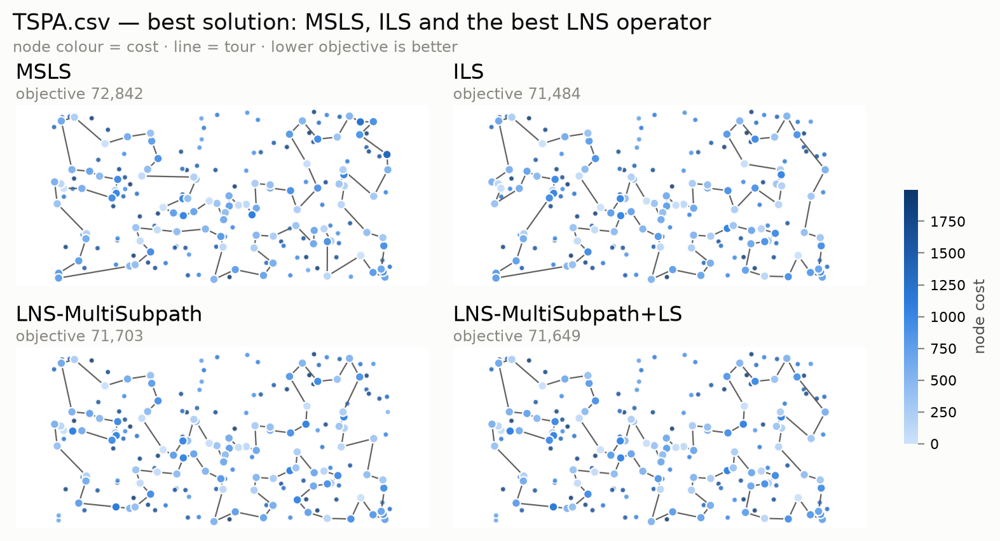
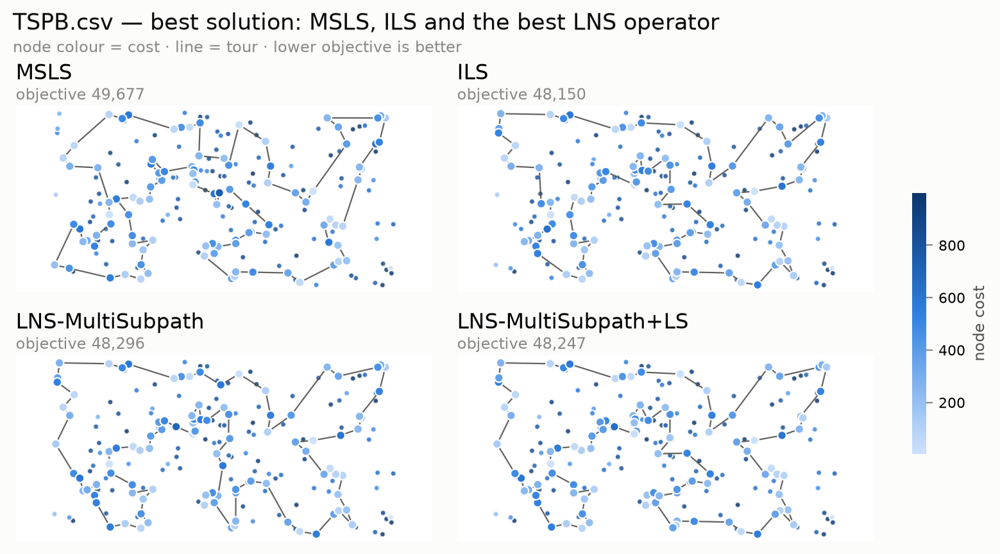
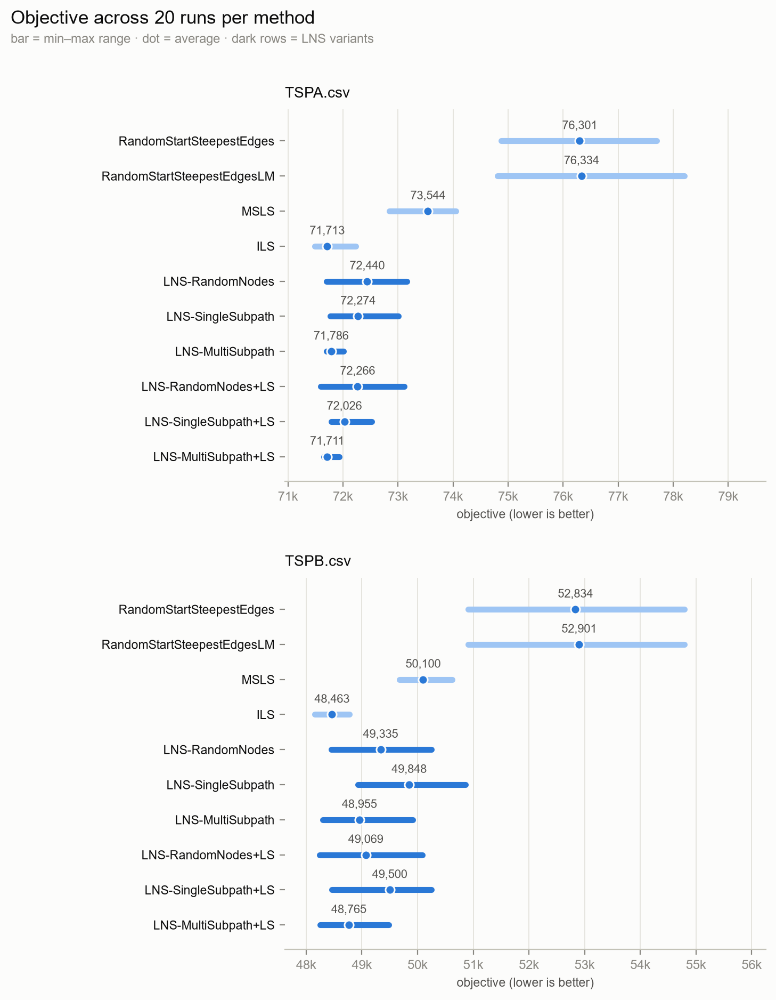
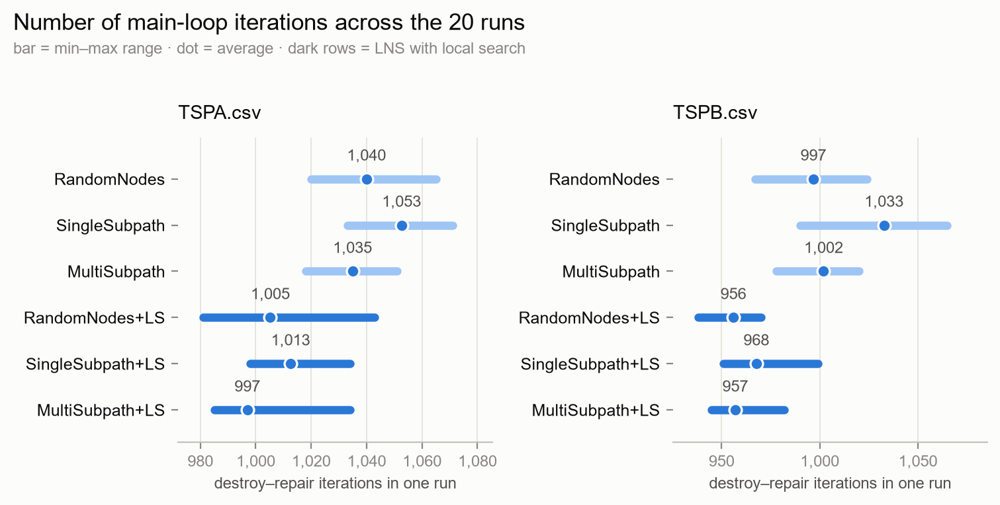
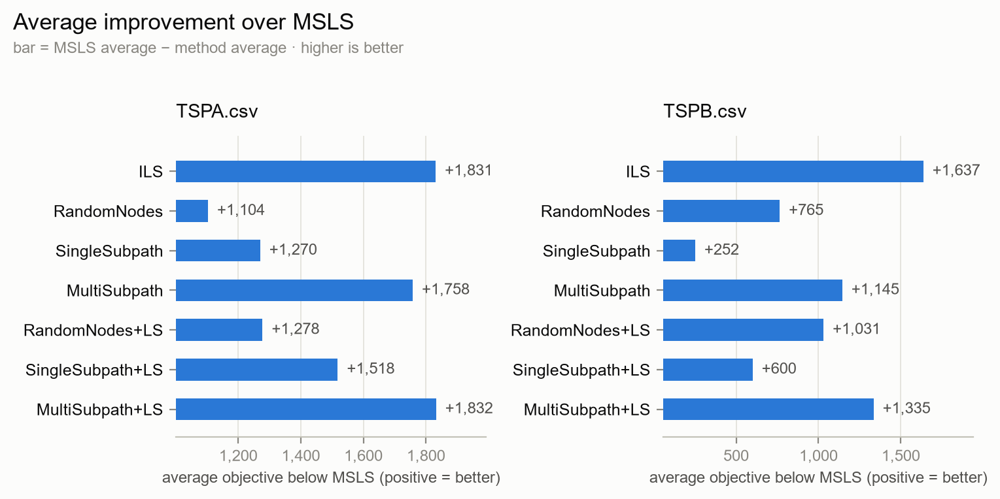

# Task 7 — Large neighborhood search

- 160296: Paweł Laszczyk
- 160314: Ashley Jurga

**Solver revision:** working tree on top of `4bb2e00` (Task 7 strategies; this revision adds the `-construction`
reference flag, the full-steepest baseline, the Task 7 report generator and the figures)<br>
**Source code link**: [GitHub](https://github.com/AER00/evolutionary_computation_pp)<br>
**Instances:** `TSPA.csv`, `TSPB.csv` — 200 nodes each<br>
**Methods:** six LNS variants: three destroy operators (random nodes, one random subpath, 3–5 random
subpaths), each with and without local search after destroy–repair. The repair operator is the
regret-weighted greedy cycle from Task 2, and the local search is the Task 5 list-of-improving-moves
steepest search.<br>
**Previous methods:** `MSLS` and `ILS` from Task 6, the full-neighbourhood and LM steepest searches
from Tasks 3 and 5, the seven construction heuristics from Tasks 1–2, and `RandomSolution` as the scale
baseline.

---

## 1. The problem

The problem is the same as in Tasks 1–6. Each instance has `N` points with coordinates and a **cost**.
We select exactly

```
M = ceil(N / 2) = 100
```

points and put them in a closed tour. The objective is

```
objective = tour length + cost of the selected nodes
```

and lower is better. Distances are Euclidean and rounded to the nearest integer, so all objective
values are integers. A solution is stored as the list of selected nodes in visit order; the last node
connects back to the first one.

Task 7 changes the **outer loop** again. Task 6 improved a solution by a small perturbation or by
restarting from scratch. LNS instead **destroys a large part of the current solution** (30% of the
nodes), **rebuilds it greedily**, and optionally runs local search on the rebuilt solution. The
destroyed part is large enough that the repair cannot simply undo one move, so the search can move to
a different region of the solution space while keeping the part of the solution that is not destroyed.

## 2. Methods

### 2.1 The LNS template

Every run starts from a random solution improved by the Task 5 steepest local search. The initial local
search is applied **always**, as the task requires. The main loop (`lns` in `task7/strategies.go`) then
repeats destroy → repair → optional local search until the time budget elapses:

```
LNS(p, budget, run, destroy, useLS):
    start ← now()
    rng   ← seeded generator
    x     ← SteepestLM(RandomSolution(seed(run)))
    xObj  ← objective(x)
    k     ← round(0.3 · |x|) = 30
    iters ← 0

    while now() − start < budget:
        y ← destroy(x, k, rng)              # remove 30 nodes
        y ← Repair(y)                       # regret-weighted greedy cycle
        if useLS:
            y ← SteepestLM(y)               # Task 5 local search
        iters ← iters + 1
        yObj ← objective(y)
        if yObj ≤ xObj:
            x, xObj ← y, yObj                # equal is accepted: plateau moves

    return x, iters
```

The two LNS versions differ only in `useLS`: without local search, the repaired solution is compared
with the current one directly; with local search, it is first improved to a local optimum. The six
variants are therefore 3 destroy operators × {no LS, LS}.

The acceptance rule is `≤`, so a solution that only moves along a plateau of the objective is accepted.
Worse solutions are never accepted; the returned solution is the best solution seen during the run, and
its objective is monotone non-increasing. `iters` is the number of completed destroy–repair iterations
of a run, which is the **main-loop iteration count** reported in section 4.4.

### 2.2 Destroy operators

Let `m = |x| = 100` be the length of the current tour. All three operators remove exactly

```
k = round(0.3 · 100) = 30
```

nodes and keep the other `m − k = 70` in their original **cyclic order**. The repair uses this order;
the destroy operators never reorder the kept nodes.

#### 2.2.1 Removal of randomly selected nodes

The implementation is `RemoveRandomNodes`.

```
DestroyRandom(x, k, rng):
    choose k distinct positions of x uniformly at random
    return the other m − k nodes, in their original order
```

The removed nodes are scattered over the whole tour. On average only about 49 of the 100 original
edges remain in the destroyed solution and the kept nodes form about 20 short fragments. The repair
has to fill 30 isolated gaps; because each gap is short, the greedy insertion has little surrounding
context, and the tour can change in many places at once. Section 4.5 shows that this was the weakest
operator on TSPA and the second on TSPB.

#### 2.2.2 Removal of a single random subpath

The implementation is `RemoveSubpath`.

```
DestroySubpath(x, k, rng):
    r ← uniform integer in [0, m − 1]
    remove x[r], x[r+1], …, x[r+k−1]     (indices modulo m)
    return the other m − k nodes, starting at x[(r+k) mod m]
```

The tour is cut at a uniformly random place, so the removed subpath may wrap around the end of the list.
This removes one long contiguous arc and leaves one long contiguous kept path. The random cut means the
operator is not biased towards any part of the tour; this also matches the task's requirement for
nearest-neighbour-based methods, although our repair is insertion-based.

#### 2.2.3 Removal of 3–5 random subpaths

The implementation is `RemoveSubpaths`.

```
DestroySubpaths(x, k, rng):
    c ← uniform integer in {3, 4, 5}
    removedLens ← uniform random composition of k into c positive parts
    keptLens    ← uniform random composition of m−k into c positive parts
    r ← uniform integer in [0, m − 1]

    walk the cycle from r:
        for j ← 1 to c:
            skip removedLens[j] nodes        # removed block j
            keep keptLens[j] nodes           # kept block j
    return the kept nodes in the order they were visited
```

A **composition** of `n` into `c` positive parts is generated by drawing `c−1` distinct cut points from
`1 … n−1`, sorting them and taking the differences. Every composition is equally likely. The cycle is
split into `c` alternating removed/kept blocks; the total removed length is exactly `k` and the total
kept length is exactly `m−k`, so the blocks never overlap and exactly 30 nodes are removed. For
`m = 100`, `k = 30`, `c ∈ {3,4,5}` is always feasible. The implementation also caps `c` at
`min(k, m−k)` and falls back to the single-subpath operator if the cap would make `c ≤ 0`; with the
parameters used here the cap never applies. The destroyed solution still keeps 65–67 original edges in
three to five long fragments, but the repair must reconnect all of them. Section 4.5 shows that this
operator gave the best results.

### 2.3 Repair: the best greedy heuristic with regret

The repair operator is the Task 2 **regret-weighted greedy cycle** (`RegretWeightedGreedyCycle`) with
weight `w = 0.5`, the value selected in the greedy-heuristics assignment. Nodes are inserted one at a
time until the tour has `M = 100` nodes:

```
Repair(partial):
    while |partial| < M:
        for every unselected node v:
            Δ1(v) ← smallest insertion delta over all positions of partial
            Δ2(v) ← second smallest insertion delta
            regret(v) ← Δ2(v) − Δ1(v)
            score(v) ← 0.5 · regret(v) − 0.5 · Δ1(v)
        insert the node with the largest score at its best position
    return partial
```

`partial` is treated as a **cycle**: the insertion delta of a node between the last and first nodes
includes the edge that closes the tour. This is the cycle variant `cyclic = true` in
`ExtendAtBestRegretWeightedPosition`. The implementation evaluates positions `0 … |partial|`;
positions `0` and `|partial|` both insert between the last and first nodes, so when the best insertion
is in that closing gap, `Δ1 = Δ2` and the regret term is zero.

We chose this heuristic for three reasons:

* On TSPA it is the best construction heuristic from Tasks 1–2 (73,572.1 average), and the
  regret-weighted variants are the best family on both instances. The pure-regret variants
  (`RegretOnly…`, `w = 1`) are far worse (122,757.1 and 123,011.3 on TSPA), so the weight really matters.
* On TSPB the non-cyclic `RegretWeightedExtendAny` is better as a **construction** (56,054.8 against
  58,357.9 for the cycle variant), but it builds an open path and its last insertion ignores the edge
  that will close the tour. A repair of an already closed tour needs the cyclic variant; among the
  cycle-based heuristics it is the best on TSPB as well (58,357.9 against 59,618.6 for `GreedyCycle`).
* The repair is insertion-based, not nearest-neighbour-based. The clause about breaking the cycle at a
  random place therefore does not apply literally, but the subpath destroy operators still cut the
  cycle at a uniformly random position, and the repair always sees the kept nodes in their cyclic order.

### 2.4 Local search

The local search is the Task 5 steepest search with the list of improving moves (`SteepestLM`,
`ImprovePathLM`). It uses the **full** neighbourhood from Task 3 — every inter-route exchange (one
selected node replaced by one unselected node) and every 2-opt exchange — and stops when no applicable
improving move is left. The list of improving moves keeps only moves with a negative delta, pops the
best one first, drops moves whose edges disappeared and keeps moves whose edges currently have the
wrong relative orientation. The returned solution is a full local optimum.

Two implementations of this neighbourhood exist from the earlier reports: the full scan
(`RandomStartSteepestEdges`) and the LM version (`SteepestLM`). The full scan is slightly better per
descent (76,301.1 against 76,334.5 on TSPA and 52,834.2 against 52,900.7 on TSPB, i.e. at most 0.13%),
but the LM descent is about 3.4× faster (2.48 ms against 8.40 ms on TSPA, 2.45 against 8.48 ms on
TSPB). This is the same trade-off as in Reports 5–6. LNS runs the local search about 1,000 times per
run, so we use the LM version: it is the cheaper way to run the same steepest search under the time
budget. Using the full scan here would make each optional local search 3.4× more expensive; because the
local search is only 3–6% of an LNS iteration, that would cost about a tenth of the iterations. The
full scan is still reported as the best single-start local-search reference.

### 2.5 Why the six variants are expected to behave differently

The destroy operator decides **which part of the solution is allowed to change**:

* Random-node removal scatters the removed nodes: only about half of the original edges remain in the
  destroyed solution and the kept nodes form about 20 short fragments. The repair fills 30 isolated
  gaps with little surrounding context, so the tour can change in many places at once.
* Single-subpath removal opens one long arc. The destroyed solution keeps 69 original edges in one long
  path; the repair rebuilds that arc, but the other 70 nodes still determine most of the tour. The
  change is substantial but confined to one region.
* Multi-subpath removal opens 3–5 separate arcs. The destroyed solution keeps 65–67 original edges in
  3–5 long paths; the repair has to reconnect several regions at once while those long subtours remain.
  Section 4.5 shows that this operator gave the best results.

Adding local search after repair turns each iteration into a small **ruin-and-recreate descent**: the
repaired solution is brought back to a local optimum before it is compared with the current solution.
Without local search, the accepted solution is the raw greedy repair, which need not be a local
optimum (section 4.7 measures this).

The repair is the expensive part of an iteration. Inserting 30 nodes means, for every insertion, scoring
about 100–130 unselected nodes at up to 100 positions, i.e. a few hundred thousand delta evaluations per
iteration. This is why an LNS iteration costs about 1 ms, while an ILS local search from a perturbed
solution costs about 0.1 ms (section 4.4).

### 2.6 Stopping condition

The stopping condition is a **time budget**, as the task requires. The budget of every ILS and LNS run
on an instance is the average running time of one MSLS run on the same instance, measured in the same
process immediately before:

```
budget(instance) = mean over the 20 MSLS runs of (time of one MSLS run)
```

MSLS uses `S = 400` local searches per run, so this is the cost of 400 descents from random solutions.
The time includes everything inside the strategy call: the initial local search, all destroy and repair
work, and all optional local searches.

## 3. Experiment setup

* `N = 200`, `M = 100`, two instances.
* **20 runs per method per instance**, as the task requires. Run numbers in the tables are the
  zero-based run index (`iteration`) used by the solver.
* Six LNS variants, as required: `LNS-RandomNodes`, `LNS-SingleSubpath`, `LNS-MultiSubpath`, and the
  same three with `+LS`.
* Destroy fraction: **30%**, i.e. `k = 30` nodes removed in every iteration. No other fractions were
  used in this experiment.
* Repair: regret-weighted greedy cycle, `w = 0.5`. Local search: Task 5 `SteepestLM`.
* Budget per run: the average MSLS time on the same instance, using the same definition as in Task 6
  (mean time of one MSLS run). It is re-measured in this process — **1,025.91 ms on TSPA** and
  **996.03 ms on TSPB** — because absolute times depend on the machine. This is larger than the
  753 ms / 741 ms of Report 6; every method in this report is measured in the same program run, so
  only comparisons inside this run are meaningful.
* Starting solutions and seeds:
  * MSLS run `r`, start `i` uses `RandomSolution` with seed `r·1,000,003 + i`;
  * ILS run `r` uses `RandomSolution` with seed `r·1,000,003` and a perturbation generator seeded with
    `r·7,919 + 1`;
  * LNS run `r` uses the same `RandomSolution` seed `r·1,000,003` for the initial local search and a
    destroy generator seeded with `r·104,729 + 3`.
  The first local search of MSLS, the initial local search of ILS and the initial local search of LNS
  therefore start from the **same random solution for the same run index** and return the same local
  optimum. The rest of the runs is independent. This makes the comparison of the outer loops clean:
  the methods start from the same point but spend the budget differently.
* Reference methods in the same run: `RandomSolution`, the full steepest search
  (`RandomStartSteepestEdges`), the LM steepest search (`RandomStartSteepestEdgesLM`), `MSLS`, `ILS`
  and the seven construction heuristics from Tasks 1–2.
* Total: 18 methods × 2 instances × 20 runs = **720 solutions**. The six LNS variants contribute 240;
  MSLS and ILS 80; the ten reference methods 400.
* Times are measured around the strategy call only. They come from one program run and vary between
  runs; the comparison is therefore between methods, not against the absolute values of Report 6.

To reproduce:

```sh
go run . -repeat 20 -construction -json results_task7.json
python3 tools/make_report_task7.py results_task7.json
python3 tools/check_with_excel.py results_task7.json --out report/excel_check_task7.json
```

`make_report_task7.py` writes the Task 7 figures to `report/figures_task7/`, prints the tables below,
re-checks every objective from the CSV files, and runs the independent full-neighbourhood local-optimum
check. The whole experiment takes about 5.5 minutes on the machine used for this report.

## 4. Results

### 4.1 Reference methods

The seven construction heuristics are the Task 1–2 reference set. They are deterministic for a fixed
run index: run `r` starts the construction from node `r`.

| Method | TSPA.csv av (min–max) | TSPB.csv av (min–max) |
|---|---:|---:|
| ExtendEnd | 87,625.6 (84,941 – 90,075) | 60,069.7 (56,954 – 63,166) |
| ExtendAny | 74,641.9 (72,328 – 76,985) | 59,481.4 (54,918 – 61,335) |
| GreedyCycle | 74,032.9 (72,912 – 75,281) | 59,618.6 (55,805 – 63,481) |
| RegretOnlyExtendAny | 122,757.1 (117,125 – 128,867) | 75,297.5 (71,821 – 79,871) |
| RegretOnlyGreedyCycle | 123,011.3 (114,576 – 131,469) | 74,876.1 (70,138 – 77,629) |
| RegretWeightedExtendAny | 75,362.2 (72,672 – 78,077) | 56,054.8 (51,196 – 61,406) |
| RegretWeightedGreedyCycle | 73,572.1 (72,024 – 75,260) | 58,357.9 (52,860 – 63,406) |

The best greedy heuristic depends on the instance, as in Report 2:

| Instance | Best greedy heuristic | Avg objective | Best run |
|---|---|---:|---:|
| TSPA.csv | RegretWeightedGreedyCycle | 73,572.1 | 72,024 (run 11) |
| TSPB.csv | RegretWeightedExtendAny | 56,054.8 | 51,196 (run 17) |

The best single-start local search is the full steepest search on both instances:

| Instance | Best local search | Avg objective | Avg time |
|---|---|---:|---:|
| TSPA.csv | RandomStartSteepestEdges | 76,301.1 | 8.40 ms |
| TSPB.csv | RandomStartSteepestEdges | 52,834.2 | 8.48 ms |

`RandomSolution` is the scale baseline: 261,033.1 (242,577 – 276,911) on TSPA and 207,616.1
(191,480 – 220,547) on TSPB. On TSPA the best construction heuristic is close to MSLS (73,572.1
against 73,543.9; its best run, 72,024, is even better than the best MSLS run, 72,842). On TSPB the
local searches are far ahead of every construction (50,100.2 for MSLS against 56,054.8 for the best
construction). This is the same picture as in Report 6 and is the baseline against which LNS has to be
judged.

### 4.2 Objective values

| Method | TSPA.csv av (min–max) | TSPB.csv av (min–max) |
|---|---:|---:|
| RandomSolution | 261,033.1 (242,577 – 276,911) | 207,616.1 (191,480 – 220,547) |
| RandomStartSteepestEdges | 76,301.1 (74,872 – 77,704) | 52,834.2 (50,909 – 54,792) |
| RandomStartSteepestEdgesLM | 76,334.5 (74,809 – 78,204) | 52,900.7 (50,909 – 54,792) |
| MSLS | 73,543.9 (72,842 – 74,048) | 50,100.2 (49,677 – 50,626) |
| ILS | 71,712.6 (71,484 – 72,232) | 48,463.2 (48,150 – 48,777) |
| LNS-RandomNodes | 72,440.4 (71,701 – 73,160) | 49,335.3 (48,451 – 50,251) |
| LNS-SingleSubpath | 72,273.6 (71,769 – 73,006) | 49,848.4 (48,928 – 50,862) |
| LNS-MultiSubpath | 71,786.0 (71,703 – 72,007) | 48,955.3 (48,296 – 49,913) |
| LNS-RandomNodes+LS | 72,265.9 (71,592 – 73,109) | 49,069.3 (48,242 – 50,087) |
| LNS-SingleSubpath+LS | 72,025.6 (71,788 – 72,520) | 49,500.0 (48,461 – 50,249) |
| LNS-MultiSubpath+LS | 71,711.4 (71,649 – 71,930) | 48,765.4 (48,247 – 49,481) |

**All six LNS variants beat MSLS on both instances.** The gains are:

| Method | TSPA gain vs MSLS | TSPB gain vs MSLS |
|---|---:|---:|
| LNS-RandomNodes | +1,103.5 (−1.50%) | +764.8 (−1.53%) |
| LNS-SingleSubpath | +1,270.3 (−1.73%) | +251.8 (−0.50%) |
| LNS-MultiSubpath | +1,757.9 (−2.39%) | +1,144.8 (−2.29%) |
| LNS-RandomNodes+LS | +1,278.0 (−1.74%) | +1,030.8 (−2.06%) |
| LNS-SingleSubpath+LS | +1,518.3 (−2.06%) | +600.2 (−1.20%) |
| LNS-MultiSubpath+LS | +1,832.5 (−2.49%) | +1,334.7 (−2.66%) |

For context, ILS improves on MSLS by 1,831.3 (−2.49%) on TSPA and 1,636.9 (−3.27%) on TSPB.

The best LNS variant on average is **`LNS-MultiSubpath+LS`**: 71,711.4 on TSPA and 48,765.4 on TSPB.
Its relation to ILS is different on the two instances:

* **TSPA:** essentially a tie. LNS-MultiSubpath+LS is 1.2 units below ILS (0.002%), far below the
  run-to-run variation. 16 of its 20 runs are below the ILS average; no run reaches the ILS best.
  The LNS distribution is narrower: 71,649 – 71,930 (spread 281) against 71,484 – 72,232 (spread 748)
  for ILS. ILS has the better single best (71,484 against 71,649) but also the worse worst run (72,232
  against 71,930); LNS is more consistent.
* **TSPB:** ILS is clearly better on average, by 302.2 units (0.62%). 8 of the 20 LNS-MultiSubpath+LS
  runs are below the ILS average, but none reaches the ILS best. The ILS distribution is also narrower
  there: 48,150 – 48,777 (spread 627) against 48,247 – 49,481 (spread 1,234).

The best single LNS runs are 71,592 on TSPA and 48,242 on TSPB, both from `LNS-RandomNodes+LS`. They
are worse than the ILS best (71,484 and 48,150) by 108 and 92 units, i.e. 0.15% and 0.19%. The best
average variant and the variant with the best single run are therefore not the same: `MultiSubpath+LS`
is the most reliable, `RandomNodes+LS` produced the two lucky runs.

On both instances the best **average** LNS variant beats the best MSLS run in all 20 runs: on TSPA the
worst LNS-MultiSubpath+LS run is 71,930 against the best MSLS run 72,842; on TSPB 49,481 against 49,677.

The full ranking among the metaheuristics is:

| Rank | TSPA.csv method | Avg | TSPB.csv method | Avg |
|---:|---|---:|---|---:|
| 1 | LNS-MultiSubpath+LS | 71,711.4 | ILS | 48,463.2 |
| 2 | ILS | 71,712.6 | LNS-MultiSubpath+LS | 48,765.4 |
| 3 | LNS-MultiSubpath | 71,786.0 | LNS-MultiSubpath | 48,955.3 |
| 4 | LNS-SingleSubpath+LS | 72,025.6 | LNS-RandomNodes+LS | 49,069.3 |
| 5 | LNS-RandomNodes+LS | 72,265.9 | LNS-RandomNodes | 49,335.3 |
| 6 | LNS-SingleSubpath | 72,273.6 | LNS-SingleSubpath+LS | 49,500.0 |
| 7 | LNS-RandomNodes | 72,440.4 | LNS-SingleSubpath | 49,848.4 |

### 4.3 Running times

| Method | TSPA.csv av (min–max) | TSPB.csv av (min–max) |
|---|---:|---:|
| RandomSolution | 0.01 ms (0.01 – 0.01) | 0.01 ms (0.01 – 0.04) |
| RandomStartSteepestEdges | 8.40 ms (7.08 – 10.21) | 8.48 ms (7.66 – 9.91) |
| RandomStartSteepestEdgesLM | 2.48 ms (2.03 – 3.18) | 2.45 ms (1.63 – 3.22) |
| MSLS | 1,025.91 ms (1,007.58 – 1,052.19) | 996.03 ms (980.01 – 1,014.31) |
| ILS | 1,025.99 ms (1,025.92 – 1,026.30) | 996.09 ms (996.04 – 996.17) |
| LNS-RandomNodes | 1,026.41 ms (1,026.01 – 1,026.95) | 996.50 ms (996.04 – 997.08) |
| LNS-SingleSubpath | 1,026.39 ms (1,026.03 – 1,026.81) | 996.39 ms (996.05 – 996.82) |
| LNS-MultiSubpath | 1,026.44 ms (1,025.95 – 1,026.93) | 996.57 ms (996.08 – 997.00) |
| LNS-RandomNodes+LS | 1,026.41 ms (1,026.04 – 1,026.81) | 996.48 ms (996.04 – 997.06) |
| LNS-SingleSubpath+LS | 1,026.51 ms (1,026.07 – 1,026.80) | 996.45 ms (996.09 – 996.96) |
| LNS-MultiSubpath+LS | 1,026.50 ms (1,026.08 – 1,027.16) | 996.59 ms (996.06 – 997.03) |

MSLS and all time-limited methods take the same time by construction, because every ILS/LNS budget is
the MSLS average. MSLS is not time-limited, so its spread (1,007.58 – 1,052.19 ms on TSPA) comes from
the 400 descents themselves. ILS and LNS check a clock before every iteration, so their time is almost
exactly the budget; the spread of every time-limited method is below 1.2 ms.

The two local searches are the only non-time-limited methods in this table besides `RandomSolution`:
one full steepest descent costs about 8.4 ms, one LM descent about 2.5 ms. This is the 3.4× speed
difference used in section 2.4.

MSLS and ILS reproduce the Report 6 averages exactly, including the min–max ranges (73,543.9 /
50,100.2 and 71,712.6 / 48,463.2), although the budget is about 1.03 s here against 0.75 s there. On
these instances the ILS runs had converged: the extra iterations of the larger budget did not change
the 20 outcomes. This makes the comparison with Report 6 meaningful despite the machine difference.

### 4.4 Number of main-loop iterations

`iters` counts completed destroy–repair iterations for LNS and completed local-search runs for ILS.
The two are different units: an LNS iteration contains one repair of 30 nodes, while an ILS iteration
is one local search from a perturbed local optimum.

| Instance | Method | Runs | Min | Max | Average | Total |
|---|---|---:|---:|---:|---:|---:|
| TSPA.csv | ILS | 20 | 9,876 | 10,450 | 10,147.0 | 202,939 |
| TSPA.csv | LNS-RandomNodes | 20 | 1,020 | 1,065 | 1,040.0 | 20,799 |
| TSPA.csv | LNS-SingleSubpath | 20 | 1,033 | 1,071 | 1,052.6 | 21,052 |
| TSPA.csv | LNS-MultiSubpath | 20 | 1,018 | 1,051 | 1,034.9 | 20,698 |
| TSPA.csv | LNS-RandomNodes+LS | 20 | 981 | 1,043 | 1,005.2 | 20,105 |
| TSPA.csv | LNS-SingleSubpath+LS | 20 | 998 | 1,034 | 1,012.5 | 20,251 |
| TSPA.csv | LNS-MultiSubpath+LS | 20 | 985 | 1,034 | 997.0 | 19,939 |
| TSPB.csv | ILS | 20 | 9,853 | 10,372 | 10,128.4 | 202,567 |
| TSPB.csv | LNS-RandomNodes | 20 | 967 | 1,024 | 996.8 | 19,935 |
| TSPB.csv | LNS-SingleSubpath | 20 | 990 | 1,065 | 1,032.7 | 20,654 |
| TSPB.csv | LNS-MultiSubpath | 20 | 978 | 1,020 | 1,002.0 | 20,039 |
| TSPB.csv | LNS-RandomNodes+LS | 20 | 938 | 970 | 956.0 | 19,120 |
| TSPB.csv | LNS-SingleSubpath+LS | 20 | 951 | 999 | 967.7 | 19,354 |
| TSPB.csv | LNS-MultiSubpath+LS | 20 | 945 | 982 | 957.0 | 19,139 |

ILS performs about **10,100 local searches per run**; LNS performs about **1,000 destroy–repair
iterations per run**. The counts differ by a factor of ten because an LNS iteration is ten times more
expensive: the repair of 30 nodes costs about 1.0 ms, while a local search from a perturbed solution
costs about 0.10 ms. This is expected: one LNS iteration rebuilds 30 nodes, while one ILS iteration
only perturbs a few.

The iteration counts also show the cost of the optional local search. Adding local search after repair
reduces the number of iterations by 3.3–6.3% (for example, `LNS-MultiSubpath` 1,034.9 → 997.0 on
TSPA (−3.7%), `LNS-SingleSubpath` 1,032.7 → 967.7 on TSPB (−6.3%)). Since the time budget is fixed,
the difference is the time spent in the local search: about 0.03–0.07 ms per iteration, or 3–6% of an
LNS iteration. The remaining 94–97% is the repair. The local search is therefore cheap per LNS
iteration, and section 4.5 shows that it still improves the objective.

### 4.5 The destroy operators

| Destroy operator | TSPA no LS | TSPA +LS | TSPA gain | TSPB no LS | TSPB +LS | TSPB gain |
|---|---:|---:|---:|---:|---:|---:|
| RandomNodes | 72,440.4 | 72,265.9 | +174.5 | 49,335.3 | 49,069.3 | +266.0 |
| SingleSubpath | 72,273.6 | 72,025.6 | +248.0 | 49,848.4 | 49,500.0 | +348.4 |
| MultiSubpath | 71,786.0 | 71,711.4 | +74.6 | 48,955.3 | 48,765.4 | +189.9 |

Three observations:

1. **Multi-subpath is the best operator on both instances, with and without local search.** It removes
   30 nodes in 3–5 separated regions, so the repair has to reconnect several parts of the tour and the
   iteration is not a small local perturbation. Its advantage over the second-best operator is large:
   487.6 units over SingleSubpath on TSPA without LS, and 380.0 units over RandomNodes on TSPB. This is
   the largest effect in the experiment: at a fixed local-search setting, the spread between the best
   and the worst operator is 555–893 units, larger than the 75–348 units gained by adding the local
   search.
2. **Single-subpath is the weakest operator on TSPB.** Its average is 49,848.4 without LS (only 251.8
   below MSLS, 0.50%) and 49,500.0 with LS. The reason is visible in the objective components
   (section 4.6): it produces short tours but expensive node sets. On TSPA it is better than random
   nodes (72,273.6 against 72,440.4), so the ranking of the two weaker operators depends on the
   instance.
3. **Local search helps every operator on every instance.** The absolute gain is 174.5–348.4 units
   (0.10–0.70%). The smallest gain is for MultiSubpath on TSPA (+74.6), which is already the best
   operator without it; the largest is for SingleSubpath on TSPB (+348.4). Local search never hurts,
   but it cannot compensate for a weak destroy operator: the best no-LS variant (MultiSubpath,
   71,786.0/48,955.3) is still better than the worst LS variant (RandomNodes+LS, 72,265.9 on TSPA;
   SingleSubpath+LS, 49,500.0 on TSPB) on both instances.

### 4.6 Objective components

Component averages are rounded, so they may not add exactly to the objective. The table shows the
non-LS and LS versions of the best operator, plus the ILS and MSLS references.

| Instance | Method | Avg tour length | Avg node cost | Avg objective |
|---|---|---:|---:|---:|
| TSPA.csv | MSLS | 21,999.8 | 51,544.1 | 73,543.9 |
| TSPA.csv | ILS | 21,398.5 | 50,314.1 | 71,712.6 |
| TSPA.csv | LNS-MultiSubpath | 20,342.5 | 51,443.5 | 71,786.0 |
| TSPA.csv | LNS-MultiSubpath+LS | 20,618.2 | 51,093.2 | 71,711.4 |
| TSPA.csv | LNS-SingleSubpath | 20,933.5 | 51,340.1 | 72,273.6 |
| TSPA.csv | LNS-SingleSubpath+LS | 20,762.7 | 51,262.8 | 72,025.6 |
| TSPB.csv | MSLS | 20,081.0 | 30,019.1 | 50,100.2 |
| TSPB.csv | ILS | 18,955.8 | 29,507.5 | 48,463.2 |
| TSPB.csv | LNS-MultiSubpath | 18,469.0 | 30,486.3 | 48,955.3 |
| TSPB.csv | LNS-MultiSubpath+LS | 18,261.5 | 30,504.0 | 48,765.4 |
| TSPB.csv | LNS-SingleSubpath | 17,730.3 | 32,118.0 | 49,848.4 |
| TSPB.csv | LNS-SingleSubpath+LS | 17,561.7 | 31,938.3 | 49,500.0 |

The LNS and ILS solutions are balanced differently. On TSPA, LNS-MultiSubpath+LS reaches almost the
same objective as ILS by a **shorter tour and a more expensive node set**: 20,618.2 and 51,093.2 against
21,398.5 and 50,314.1, i.e. the tour is 780.3 shorter and the node cost 779.1 higher, while the
objective is 1.2 lower. On TSPB the same trade-off is not enough: the tour is 694.3 shorter but the node
cost is 996.5 higher, so the objective is 302.2 worse. Against MSLS, LNS-MultiSubpath+LS improves both
components on TSPA (tour −1,381.6, cost −450.9); on TSPB it shortens the tour by 1,819.5 but pays
484.9 more for the nodes, and still wins on the objective.

The single-subpath operator shows the extreme of this profile: on TSPB its +LS version has the shortest
average tour among the local-search and LNS methods (17,561.7) and a very expensive node set (31,938.3);
the no-LS version is even more expensive for the nodes (32,118.0) but has a longer tour. This is why
its total is worse than MultiSubpath's. The greedy repair is willing to buy a short tour with expensive
nodes; the local search moves the balance back towards cheaper nodes when it is applied (for
MultiSubpath on TSPA, the tour becomes 275.7 longer and the node cost 350.3 cheaper).

### 4.7 Local-optimum check

Every returned solution of the seven full-neighbourhood methods was checked independently: a separate
Python checker computed the most negative delta over the full neighbourhood (all inter-route exchanges
and all 2-opt exchanges) and checked that it is non-negative.

| Instance | Method | Runs checked | Full local optima |
|---|---|---:|---:|
| TSPA.csv | RandomStartSteepestEdges | 20 | 20/20 |
| TSPA.csv | RandomStartSteepestEdgesLM | 20 | 20/20 |
| TSPA.csv | MSLS | 20 | 20/20 |
| TSPA.csv | ILS | 20 | 20/20 |
| TSPA.csv | LNS-RandomNodes+LS | 20 | 20/20 |
| TSPA.csv | LNS-SingleSubpath+LS | 20 | 20/20 |
| TSPA.csv | LNS-MultiSubpath+LS | 20 | 20/20 |
| TSPB.csv | RandomStartSteepestEdges | 20 | 20/20 |
| TSPB.csv | RandomStartSteepestEdgesLM | 20 | 20/20 |
| TSPB.csv | MSLS | 20 | 20/20 |
| TSPB.csv | ILS | 20 | 20/20 |
| TSPB.csv | LNS-RandomNodes+LS | 20 | 20/20 |
| TSPB.csv | LNS-SingleSubpath+LS | 20 | 20/20 |
| TSPB.csv | LNS-MultiSubpath+LS | 20 | 20/20 |

All **280** checked solutions are full local optima. For the LNS+LS variants this says that the
returned solution is always the result of a completed local search, not a raw repaired solution.

The versions without local search are not expected to pass, and they do not:

| Instance | Method | Full local optima |
|---|---|---:|
| TSPA.csv | LNS-RandomNodes | 10/20 |
| TSPA.csv | LNS-SingleSubpath | 8/20 |
| TSPA.csv | LNS-MultiSubpath | 10/20 |
| TSPB.csv | LNS-RandomNodes | 5/20 |
| TSPB.csv | LNS-SingleSubpath | 6/20 |
| TSPB.csv | LNS-MultiSubpath | 6/20 |

Between 25% and 50% of the raw repaired solutions are already local optima; the rest still have an
improving move. The local search after repair guarantees the property, and it also improves the
average objective by 75–348 units for 3–6% of the iteration time.

### 4.8 Best runs

| Instance | Method | Best objective | Run | Tour length | Node cost |
|---|---|---:|---:|---:|---:|
| TSPA.csv | RandomSolution | 242,577 | 10 | 143,221 | 99,356 |
| TSPA.csv | RandomStartSteepestEdges | 74,872 | 14 | 22,544 | 52,328 |
| TSPA.csv | RandomStartSteepestEdgesLM | 74,809 | 14 | 22,481 | 52,328 |
| TSPA.csv | MSLS | 72,842 | 15 | 21,614 | 51,228 |
| TSPA.csv | ILS | 71,484 | 15 | 21,301 | 50,183 |
| TSPA.csv | LNS-RandomNodes | 71,701 | 17 | 20,811 | 50,890 |
| TSPA.csv | LNS-SingleSubpath | 71,769 | 17 | 20,338 | 51,431 |
| TSPA.csv | LNS-MultiSubpath | 71,703 | 13 | 20,184 | 51,519 |
| TSPA.csv | LNS-RandomNodes+LS | 71,592 | 6 | 20,564 | 51,028 |
| TSPA.csv | LNS-SingleSubpath+LS | 71,788 | 9 | 20,593 | 51,195 |
| TSPA.csv | LNS-MultiSubpath+LS | 71,649 | 4 | 20,579 | 51,070 |
| TSPB.csv | RandomSolution | 191,480 | 17 | 138,840 | 52,640 |
| TSPB.csv | RandomStartSteepestEdges | 50,909 | 11 | 20,315 | 30,594 |
| TSPB.csv | RandomStartSteepestEdgesLM | 50,909 | 11 | 20,315 | 30,594 |
| TSPB.csv | MSLS | 49,677 | 11 | 19,404 | 30,273 |
| TSPB.csv | ILS | 48,150 | 10 | 18,783 | 29,367 |
| TSPB.csv | LNS-RandomNodes | 48,451 | 19 | 18,608 | 29,843 |
| TSPB.csv | LNS-SingleSubpath | 48,928 | 12 | 18,165 | 30,763 |
| TSPB.csv | LNS-MultiSubpath | 48,296 | 2 | 18,502 | 29,794 |
| TSPB.csv | LNS-RandomNodes+LS | 48,242 | 9 | 18,602 | 29,640 |
| TSPB.csv | LNS-SingleSubpath+LS | 48,461 | 9 | 18,898 | 29,563 |
| TSPB.csv | LNS-MultiSubpath+LS | 48,247 | 12 | 18,660 | 29,587 |

The best LNS run overall is `LNS-RandomNodes+LS` on both instances (71,592 and 48,242); the best LNS
operator on average is `LNS-MultiSubpath+LS` (71,711.4 and 48,765.4). The best single run and the best
average are different statistics, and both are reported.

### 4.9 Best solutions as lists of nodes

The tour is given in visit order; the last node connects back to the first one. Each list is a closed
tour of `M = 100` distinct nodes. The figure in section 4.10 uses the best **average** operator
(`LNS-MultiSubpath+LS`); the lists below use the best **single run** of each method.

**TSPA.csv — MSLS — objective 72,842, run 15**

```
85, 174, 8, 54, 9, 33, 131, 99, 36, 177, 52, 179, 53, 140, 144, 67, 185, 102, 28, 180, 156, 35, 16, 51, 132, 76, 4, 71, 157, 91, 80, 48, 31, 60, 108, 152, 100, 123, 83, 160, 49, 63, 149, 116, 168, 97, 127, 69, 129, 104, 171, 2, 189, 187, 30, 141, 87, 45, 73, 135, 114, 181, 192, 158, 58, 84, 134, 176, 151, 150, 106, 89, 42, 57, 107, 88, 78, 193, 153, 170, 146, 159, 130, 93, 50, 3, 169, 1, 47, 147, 21, 101, 55, 17, 29, 178, 184, 136, 186, 164
```

**TSPA.csv — ILS — objective 71,484, run 15**

```
185, 45, 73, 135, 114, 181, 192, 158, 58, 84, 134, 72, 176, 150, 106, 113, 89, 42, 151, 182, 57, 64, 107, 88, 78, 193, 153, 170, 146, 159, 130, 47, 147, 101, 29, 178, 184, 136, 186, 164, 1, 169, 3, 50, 93, 85, 174, 8, 54, 9, 33, 131, 36, 177, 52, 179, 53, 140, 144, 67, 16, 51, 35, 156, 28, 180, 132, 76, 4, 71, 157, 91, 80, 48, 31, 60, 116, 149, 63, 168, 49, 108, 152, 100, 123, 83, 160, 97, 127, 69, 129, 104, 171, 2, 189, 187, 30, 141, 87, 102
```

**TSPA.csv — LNS-RandomNodes+LS — objective 71,592, run 6**

```
164, 142, 8, 54, 9, 33, 131, 36, 177, 52, 179, 53, 140, 144, 67, 16, 51, 35, 185, 102, 28, 180, 132, 76, 4, 71, 157, 91, 80, 48, 31, 60, 108, 152, 100, 123, 83, 160, 49, 11, 63, 149, 116, 168, 97, 127, 69, 129, 104, 92, 171, 2, 189, 187, 30, 141, 87, 45, 73, 135, 114, 181, 192, 158, 58, 84, 134, 72, 176, 174, 150, 106, 113, 89, 42, 151, 182, 57, 64, 107, 88, 78, 193, 153, 170, 146, 159, 130, 47, 93, 50, 3, 169, 1, 101, 29, 178, 184, 136, 186
```

**TSPB.csv — MSLS — objective 49,677, run 11**

```
97, 26, 154, 140, 47, 38, 21, 30, 191, 130, 183, 133, 136, 172, 160, 69, 122, 151, 173, 184, 3, 27, 66, 67, 24, 34, 152, 181, 167, 51, 73, 59, 85, 82, 87, 179, 88, 99, 171, 74, 20, 14, 153, 182, 80, 127, 129, 90, 10, 114, 196, 139, 61, 105, 94, 81, 190, 70, 187, 54, 192, 162, 76, 185, 57, 89, 46, 72, 120, 48, 96, 198, 121, 42, 147, 116, 149, 28, 145, 158, 125, 170, 115, 6, 197, 29, 132, 103, 178, 1, 174, 62, 175, 134, 45, 157, 60, 40, 71, 155
```

**TSPB.csv — ILS — objective 48,150, run 10**

```
82, 87, 179, 88, 99, 171, 17, 74, 20, 2, 14, 153, 90, 129, 127, 80, 192, 162, 54, 78, 10, 114, 196, 61, 105, 94, 81, 187, 70, 190, 104, 76, 185, 57, 89, 48, 96, 198, 121, 42, 147, 116, 37, 146, 13, 149, 28, 145, 158, 177, 125, 170, 115, 180, 6, 29, 132, 197, 36, 175, 134, 45, 157, 60, 40, 71, 155, 97, 154, 140, 47, 38, 21, 30, 183, 69, 160, 172, 136, 133, 120, 8, 117, 72, 46, 184, 3, 151, 27, 66, 67, 24, 34, 152, 181, 167, 73, 59, 85, 51
```

**TSPB.csv — LNS-RandomNodes+LS — objective 48,242, run 9**

```
24, 34, 98, 151, 3, 184, 46, 72, 117, 8, 120, 133, 136, 172, 160, 69, 189, 183, 30, 21, 38, 47, 140, 154, 97, 155, 71, 40, 60, 157, 45, 134, 175, 62, 36, 197, 132, 29, 6, 180, 115, 170, 125, 177, 158, 145, 28, 149, 13, 146, 37, 116, 147, 42, 121, 198, 96, 48, 156, 89, 57, 185, 76, 162, 192, 54, 187, 70, 190, 81, 94, 105, 61, 196, 114, 10, 127, 80, 129, 90, 153, 14, 2, 20, 74, 17, 171, 99, 88, 179, 87, 82, 51, 85, 59, 73, 167, 181, 152, 67
```

The best ILS and best LNS solutions are close to each other: on TSPA they share 97 of the 100 selected
nodes and 83 of the 100 undirected edges; on TSPB 96 nodes and 85 edges. LNS does not find a completely
different solution; it explores the same region as ILS and does not reach the best ILS run within the
same time budget.

Every run with its tour, objective, tour length, node cost and main-loop iteration count is written to
`results_task7.json`.

### 4.10 Figures

Node colour is the node cost (light blue cheap, dark blue expensive) and the dark line is the closed
tour. The four panels show MSLS, ILS, and the best-average LNS operator with and without local search.





Objective ranges over the 20 runs for both instances. The two single-start local searches are included
as context; the six LNS variants are drawn in the darker accent.



Main-loop iterations of the six LNS variants. The dark rows are the versions with local search; the
optional local search costs 3–6% of the iterations.



Average improvement over MSLS for ILS and the six LNS variants. All bars are positive: every
metaheuristic in the figure is better than MSLS on both instances.



## 5. Solution checker

All 720 runs were checked with the course-provided **`Solution checker.xlsx`** through
`tools/check_with_excel.py`. The workbook has one sheet per instance. The script writes the tour into
`F3:F102` (with `F103 = F3`, so the cycle closes), calls `calculateAll()` and reads the node cost from
`I2`, the tour length from `J2` and the objective from `K2`. It checks feasibility in Python (exactly
`M = 100` distinct ids in the range `0..N-1`), because a repeated or out-of-range id would make the
`LOOKUP` formulas meaningless. The provided workbook is copied to a temporary file and is not modified.

```sh
python3 tools/check_with_excel.py results_task7.json --out report/excel_check_task7.json
```

| Instance | Method | Runs checked | Feasible | Objective matches | Components match |
|---|---|---:|---:|---:|---:|
| TSPA.csv | MSLS | 20 | 20/20 | 20/20 | 20/20 |
| TSPA.csv | ILS | 20 | 20/20 | 20/20 | 20/20 |
| TSPA.csv | LNS-RandomNodes | 20 | 20/20 | 20/20 | 20/20 |
| TSPA.csv | LNS-SingleSubpath | 20 | 20/20 | 20/20 | 20/20 |
| TSPA.csv | LNS-MultiSubpath | 20 | 20/20 | 20/20 | 20/20 |
| TSPA.csv | LNS-RandomNodes+LS | 20 | 20/20 | 20/20 | 20/20 |
| TSPA.csv | LNS-SingleSubpath+LS | 20 | 20/20 | 20/20 | 20/20 |
| TSPA.csv | LNS-MultiSubpath+LS | 20 | 20/20 | 20/20 | 20/20 |
| TSPB.csv | MSLS | 20 | 20/20 | 20/20 | 20/20 |
| TSPB.csv | ILS | 20 | 20/20 | 20/20 | 20/20 |
| TSPB.csv | LNS-RandomNodes | 20 | 20/20 | 20/20 | 20/20 |
| TSPB.csv | LNS-SingleSubpath | 20 | 20/20 | 20/20 | 20/20 |
| TSPB.csv | LNS-MultiSubpath | 20 | 20/20 | 20/20 | 20/20 |
| TSPB.csv | LNS-RandomNodes+LS | 20 | 20/20 | 20/20 | 20/20 |
| TSPB.csv | LNS-SingleSubpath+LS | 20 | 20/20 | 20/20 | 20/20 |
| TSPB.csv | LNS-MultiSubpath+LS | 20 | 20/20 | 20/20 | 20/20 |

The same check covered the ten reference methods: 400 more runs, also with 0 failures. In total the
workbook validated **720 runs, all feasible, with every objective and both components matching**. All
arithmetic comes from the workbook, not from the Go solver. The full per-run record is written to
`report/excel_check_task7.json`. The independent local-optimum check in section 4.7 is separate and
also passes 280/280 for the full-neighbourhood methods.

## 6. Source code

| File | Contents |
|---|---|
| `solver/problem.go` | loading the instance, the distance matrix, `TourLength` / `NodesCost` / `Objective` |
| `solver/solver.go` | the `Strategy` interface and the benchmark loop; `Result.LSRuns` stores the per-run iteration count |
| `task1/strategies.go` | `RandomSolution` and the construction heuristics from Task 1 |
| `task2/task2.go` | `ExtendAtBestRegretWeightedPosition`, the regret-weighted insertion used as the LNS repair |
| `task2/strategies.go` | the regret construction heuristics from Task 2 |
| `task3/task3.go`, `task3/strategies.go` | the full-neighbourhood steepest search (`RandomStartSteepestEdges`), used as the best local-search reference |
| `task5/task5.go` | the list of improving moves and `ImprovePathLM`, the local search inside LNS |
| `task6/task6.go`, `task6/strategies.go` | `MSLS`, `ILS`, the perturbation and the local-search counter |
| `task7/task7.go` | `DestroyFraction`, `destroyCount`, the three destroy operators and the random composition |
| `task7/strategies.go` | the `LNS` strategy, the main loop and the iteration counter |
| `main.go` | command line (`-repeat`, `-msls-starts`, `-regret-weight`, `-construction`, `-json`), the MSLS budget, the six LNS variants, the results and iteration tables and the JSON export |
| `tools/check_with_excel.py` | drives `Solution checker.xlsx` through LibreOffice/UNO |
| `tools/make_report_task7.py` | Task 7 figures and tables, the objective re-check, the local-optimum check and the iteration summaries |
| `tools/oeviz.py` | plotting helpers shared by the report generators |

The LNS itself is one function, `lns` in `task7/strategies.go`, plus the three destroy operators in
`task7/task7.go`. The six variants are the same loop with a different `DestroyOp` and a boolean
`UseLS`; the initial local search, the repair and the acceptance rule are shared, so any difference
between the variants comes only from the destroy operator and the optional local search.

## 7. Conclusions

1. **Every LNS variant is better than MSLS on both instances.** The gains are 251.8–1,832.5 units
   (0.50–2.66%). Even the weakest variant, `LNS-SingleSubpath` on TSPB, is ahead of MSLS; the best,
   `LNS-MultiSubpath+LS`, is 2.49% and 2.66% ahead.
2. **The best LNS variant is competitive with ILS on TSPA and slightly behind on TSPB.**
   `LNS-MultiSubpath+LS` averages 71,711.4 against 71,712.6 for ILS on TSPA — a difference of 1.2,
   i.e. a tie within the run-to-run variation — and 48,765.4 against 48,463.2 on TSPB (302.2, 0.62%).
   The LNS distribution is narrower on TSPA (spread 281 against 748) but wider on TSPB (1,234 against
   627), so ILS still has the best single solutions; on TSPA LNS is more consistent, and on TSPB ILS
   is more consistent.
3. **The destroy operator matters more than the optional local search.** At a fixed local-search
   setting, the spread between the best and the worst operator is 555–893 units; adding local search
   moves the average by 75–348 units. Multi-subpath is the best operator on both instances, with and
   without local search. Removing several separated segments keeps several long subtours and forces the
   repair to reconnect all of them; this was more effective than one long arc (only one region changes)
   or scattered nodes (many short fragments with little context).
4. **Local search after repair is cheap and always helps.** It costs 3–6% of an LNS iteration (the
   iteration count falls by 3.3–6.3% at a fixed budget) and improves the objective for every operator on
   every instance. All 120 LNS+LS runs are full local optima; the no-LS variants are local optima only
   5–10 times out of 20.
5. **LNS and ILS explore different objective trade-offs.** On TSPA, LNS-MultiSubpath+LS matches ILS with
   a tour 780 shorter and a node cost 779 higher. On TSPB the same profile is not enough: the tour is
   694 shorter but the nodes cost 996 more, so the objective is 302 worse. On TSPB the single-subpath
   +LS version is the extreme case among the local-search and LNS methods: it has the shortest average
   tour and a very expensive node set.
6. **The main loop is short but expensive.** LNS completes about 1,000 destroy–repair iterations per
   run against about 10,100 local searches for ILS in the same time. One LNS iteration costs about
   1 ms, dominated by the 30-node greedy repair, while one ILS local search costs about 0.1 ms. The
   iteration counts should therefore be compared together with the time, not instead of it.
7. **Best solutions.** ILS still has the best single solution on both instances (71,484 and 48,150).
   The best LNS run is 71,592 and 48,242 (`LNS-RandomNodes+LS`); the best LNS operator on average is
   `LNS-MultiSubpath+LS`. The best ILS and LNS tours share 96–97 of the 100 nodes and 83–85 of the 100
   edges, so LNS explores the same region of the solution space rather than a different one.
8. **Practical recommendation.** Under a time budget equal to MSLS, `LNS-MultiSubpath+LS` is a robust
   alternative to ILS: it is a tie on TSPA, slightly behind on TSPB, and it returns full local optima.
   ILS remains the best average method on these instances, and it is simpler: one perturbation and one
   local search per iteration, with no repair to implement. LNS is attractive when a large destroy can
   be repaired cheaply; on TSPA it also gives a more stable result than ILS.
9. **Limitations.** The experiment uses the required 30% removal fraction and one regret weight (0.5);
   other fractions and a randomised "bad node/edge" destroy heuristic were not tested. The time budget
   is machine-dependent, so the iteration counts and the small differences between the time-limited
   methods would change on another machine or toolchain.
